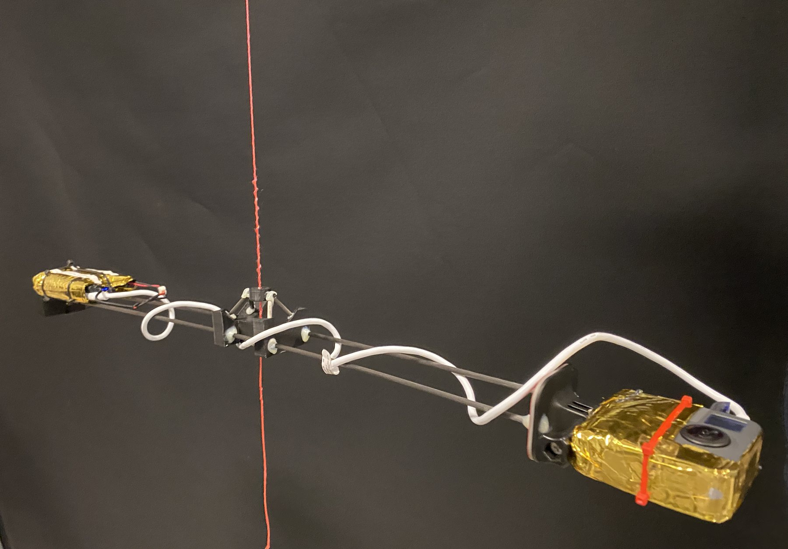
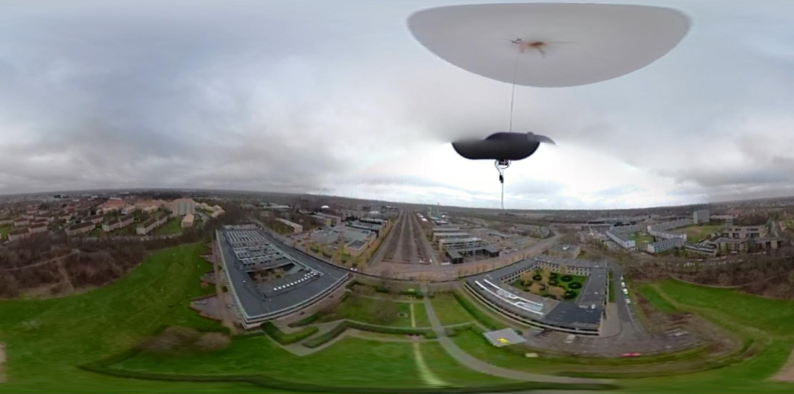
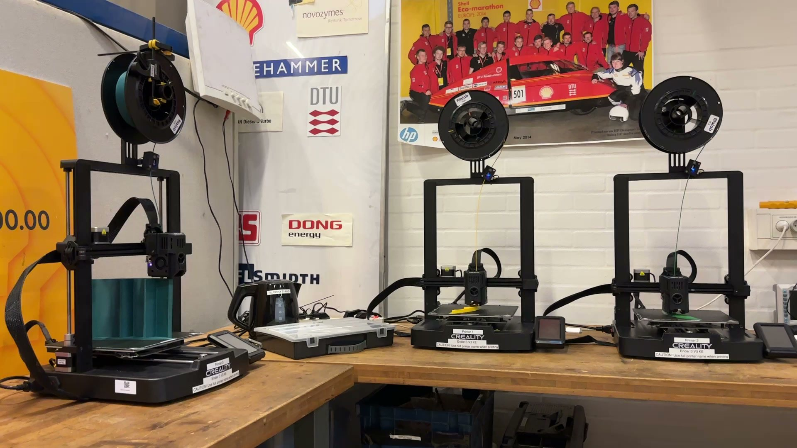
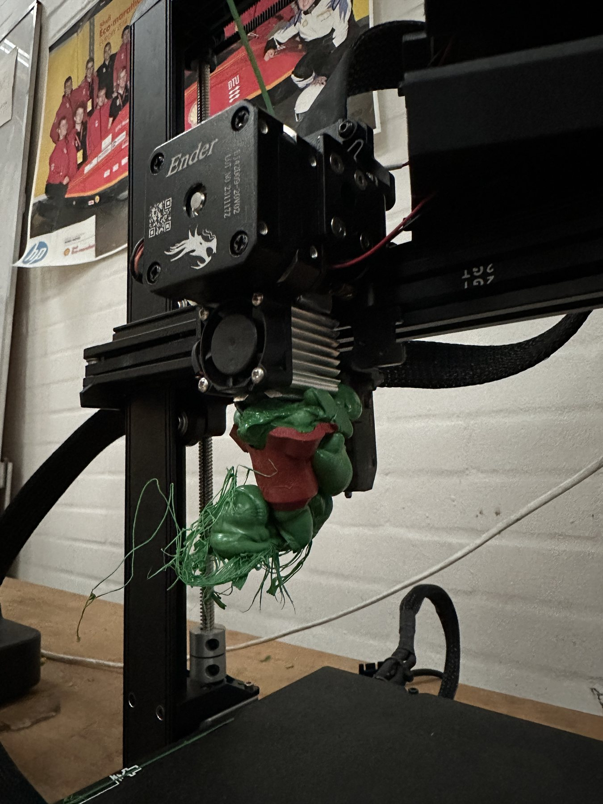
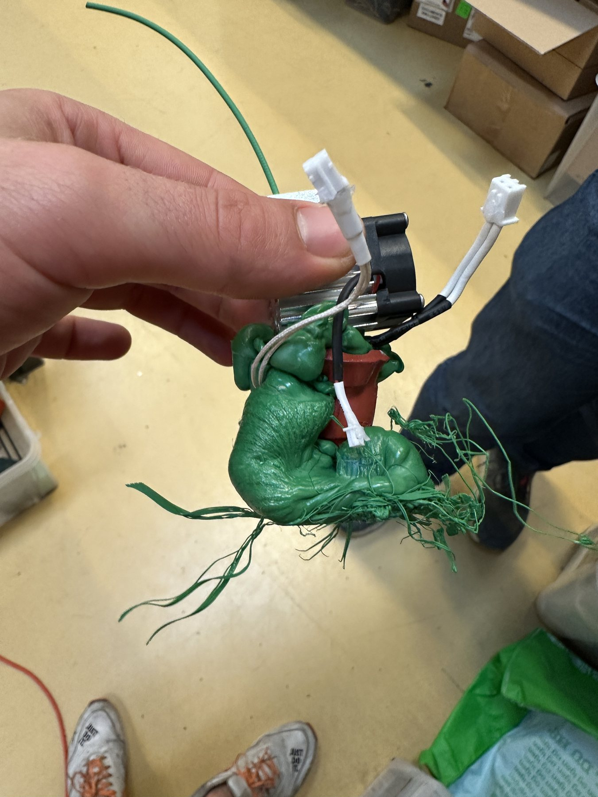
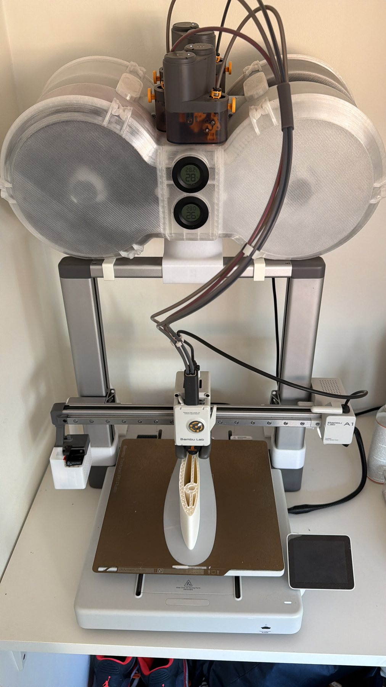
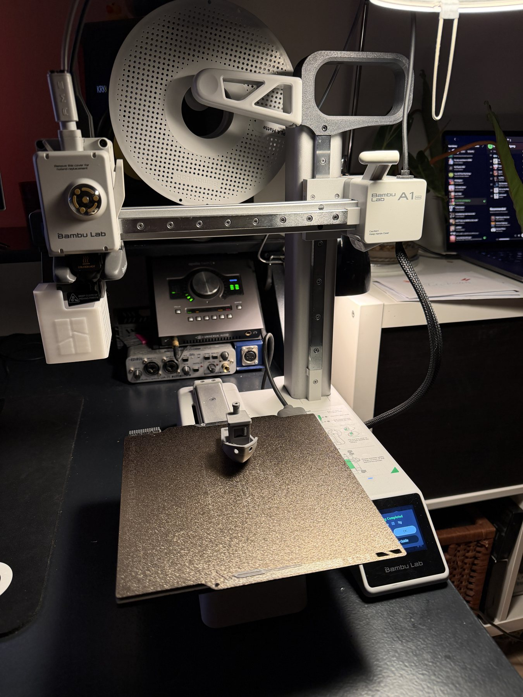
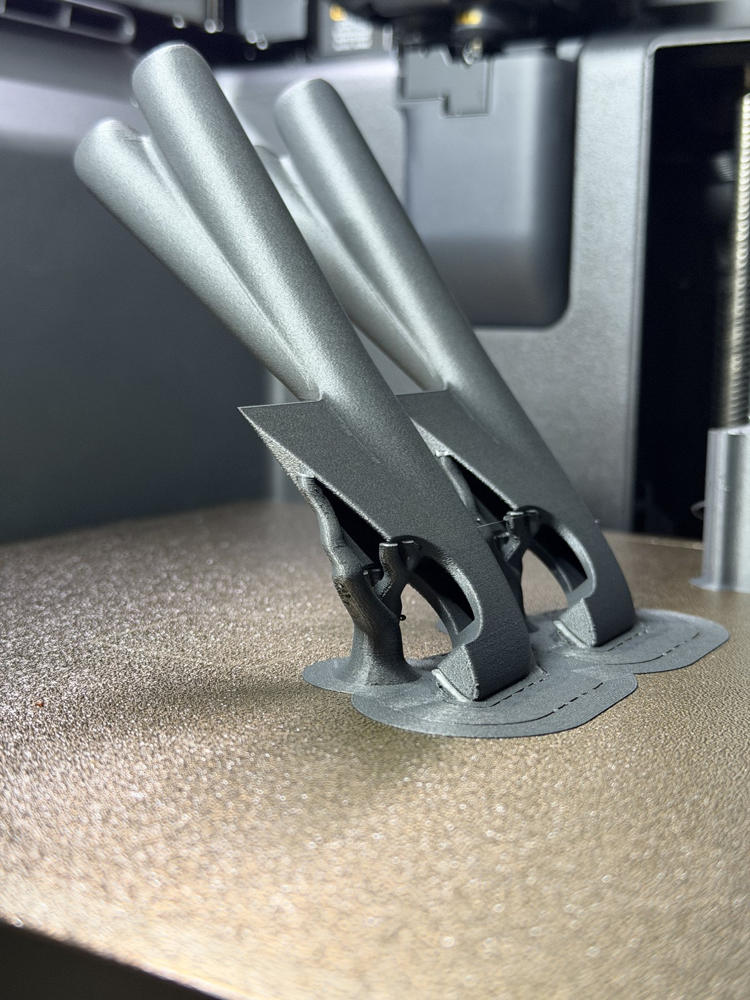
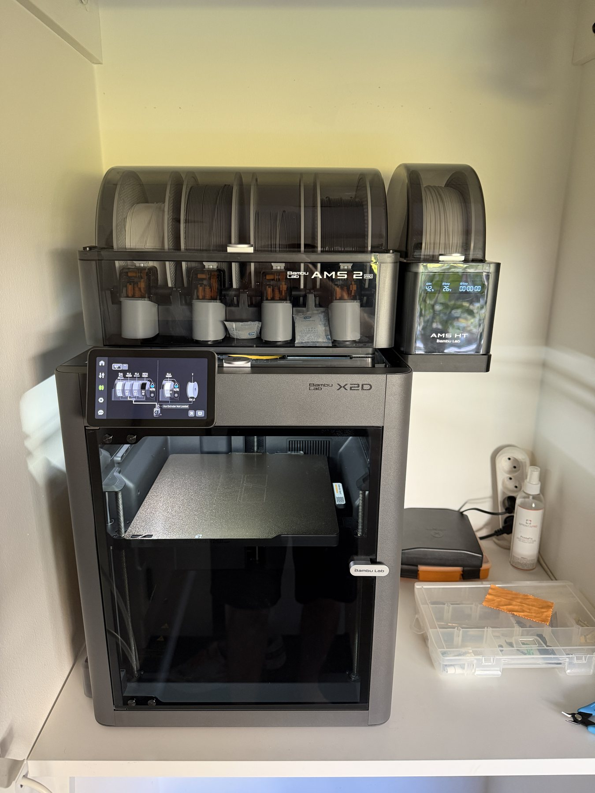

## The goal

3D printing has been one of my main tools since 2021: for my own projects, for DTU RoadRunners and for the airfoil models in my MSc thesis. Getting good parts out of a printer takes more than pressing print. It takes a design suited to the process, the right material and print orientation, settings tuned to the part, and printers that are set up and maintained properly. My aim has been to build that skill all the way from my first prints to engineering parts.

## My involvement

I have been 3D printing since 2021. I set up the entire 3D printing capacity of DTU RoadRunners on my own and kept the printers running, and I run three printers of my own, from everyday prints to engineering materials and hand-written G-code.

## 2021: The starting point

I started 3D printing in 2021 on one of the first Ultimaker printers, printing the payload frame for a hobby weather-balloon camera project. The camera and its power bank needed special mounts, the layout had to be readjusted along the way, and every gram counted. 3D printing solved all three: lightweight custom mounts on two carbon rods, which I could simply reprint whenever the layout changed.

My first printed parts: lightweight mounts on two carbon rods.

The printed payload in flight, seen from its own camera.

## DTU RoadRunners: setting up the print capacity

At DTU RoadRunners, I was responsible for the team's entire 3D printing capacity, and I set it all up myself: I installed three Creality Ender-3 V3 KE printers in the workshop and got them ready for the whole team to use. Keeping them running was my job too. Shared printers take a lot of wear, and errors and damage happened often, so I did all the maintenance and repairs myself whenever something went wrong.

The three Creality printers I set up for DTU RoadRunners in the team's workshop.

A print head buried in filament after incorrect use, one of the many repairs I did on the team printers.

The same hot end, removed for repair.

## My own printers: A1, A1 mini and X2D

In 2024 I got my own printer, a Bambu Lab A1: to develop my skills further, for the fun of it, and most of all to have a printer that is looked after properly, which in my experience a shared printer never is. It has since been joined by an A1 mini and an X2D:

| Printer | Used for |
|---|---|
| Bambu Lab A1 | Everyday printing, including the airfoil models for the MSc thesis |
| Bambu Lab A1 mini | Practice, testing new printing techniques and custom G-code |
| Bambu Lab X2D | Complex prints and engineering parts in high-temperature materials |

My three printers and what I use each one for.

My A1 with its multi-material unit, printing one of the many airfoil models for my MSc thesis.

My A1 mini just after finishing a Benchy from my hand-written G-code.

I use the A1 mini for practice and experiments. I printed the Benchy above from G-code I wrote by hand, without the slicer's generated G-code. It is not necessary in practice, but it gave me a real understanding of what CAM software produces and how G-code drives a printer, and it was a fun little project.

Parts in carbon-fibre reinforced nylon on the X2D, printed at 45° for strength, on custom supports with a separate support-interface material on their top surfaces.

My X2D with its multi-material unit, which I use for complex prints and engineering materials.

