## The goal

Wind turbines and aircraft operate across a wide range of conditions, and their performance depends on keeping the boundary layer attached. When it separates, lift drops abruptly and drag rises. Flow control tries to prevent this, either actively, which needs power and hardware, or passively, which needs neither but cannot adapt.

Dimples roughly halve the drag of a golf ball by delaying separation. Whether the same mechanism helps a wing is far less settled: an airfoil in attached flow has little separation to delay, so a dimple that helps a sphere can just as easily add drag. This thesis set out to map when dimples help an airfoil, and to build a surface whose dimples can adapt to the flow.

## My involvement

Carried out the thesis individually, from start to finish:

- Literature study, dimple design and test planning
- CAD and 3D printing of all wind tunnel models, including the pressure tap models
- Wind tunnel campaigns at DTU and TU Delft: wake rake, pressures, force balance, PIV and tufts
- PIV setup design, with a calculator published online
- RANS and LES simulations in OpenFOAM
- Data processing and analysis
- Design, build, calibration and testing of the adaptive prototype

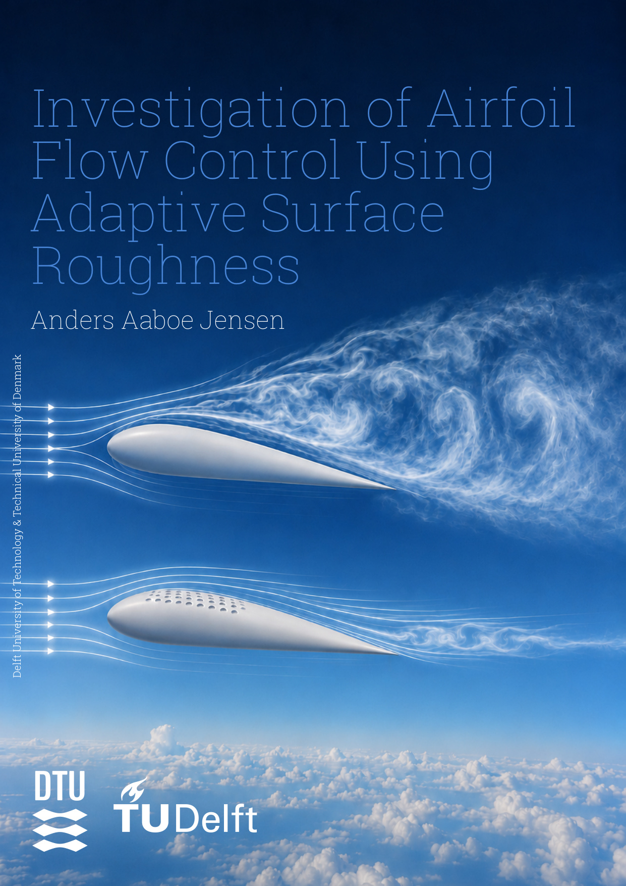

## Research question

> How can the controlled variation of dimple depth and chordwise placement be exploited to alter the aerodynamic characteristics and flow-separation behaviour of a lifting surface across varying operating conditions?

## How a dimple controls the flow

A dimple works as surface roughness turned inside out. Instead of a protrusion that trips the boundary layer, like a vortex generator, the dimple is a small cavity. The incoming boundary layer separates at its upstream rim, forms a shear layer over the cavity and recirculates beneath it. The shear layer becomes unstable and mixes, so the flow reattaches downstream with more momentum near the wall. A boundary layer with more momentum near the wall resists the adverse pressure gradient further back on the airfoil, which delays separation.

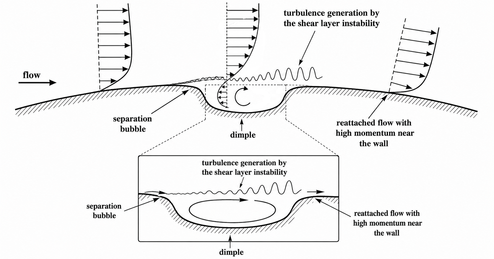

Flow over a single dimple. The boundary layer separates at the upstream rim, recirculates inside the cavity under an unstable shear layer, and reattaches downstream with more momentum near the wall.

## Design study

The literature review set the design parameters: one airfoil, one dimple size, and a placement region on the suction side where dimples could either help or hurt.

| Parameter | Selected value |
|---|---|
| Airfoil | NACA 63-415, chord 200 mm, t/c = 0.15 |
| Dimple diameter | D/c = 0.05 (10 mm) |
| Dimple depth | 1.25, 2.50 and 5.00 mm |
| Dimple spacing | Twice the diameter (Ds/D = 2.0) |
| Dimple geometry | Inward spherical |
| Placement region | x/c = 0.33 to 0.85, suction side, 4 to 7 rows |
| Reynolds numbers | 1, 2 and 5 × 10⁵ |
| Wind tunnels | DTU Red Wind Tunnel, TU Delft Small Low-Turbulence Tunnel |

Selected design parameters.

This gave ten airfoils: a smooth baseline, and three dimple layouts (mid-chord, aft and full coverage), each at three depths.

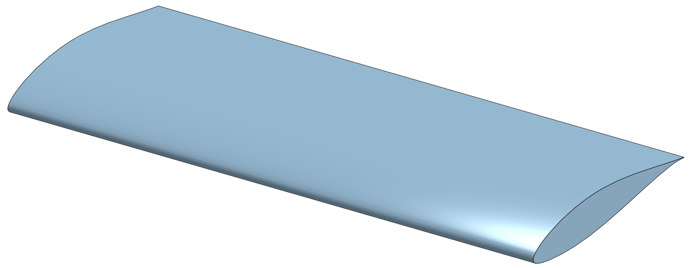

Smooth: the undimpled NACA 63-415 baseline that every configuration is compared against.

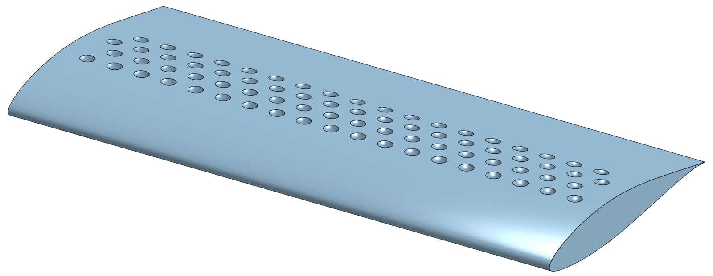

Mid: four dimple rows over the mid-chord, from 0.33c to 0.59c.

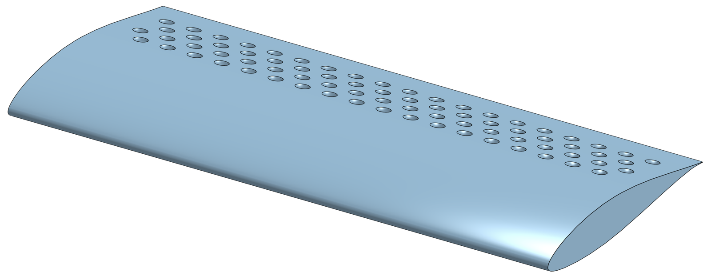

Aft: four dimple rows over the aft chord, from 0.59c to 0.85c.

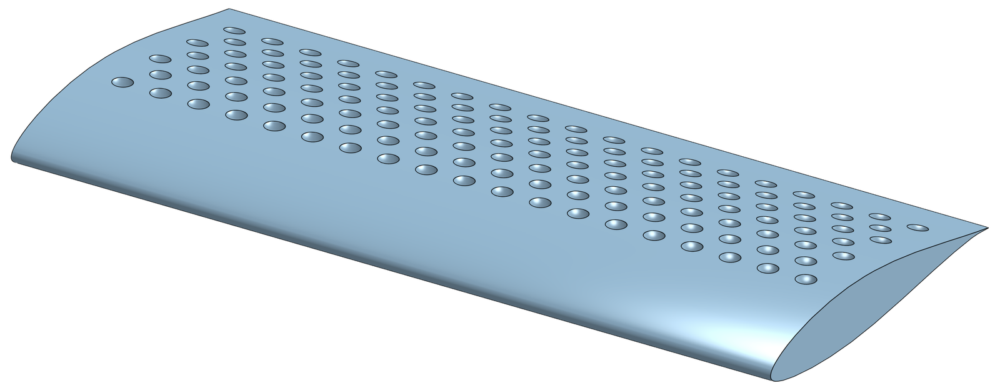

Full: all seven dimple rows, from 0.33c to 0.85c.

## Wind tunnel testing: DTU Red Wind Tunnel

The parametric screening ran in DTU's Red Wind Tunnel, a low-turbulence tunnel with a 0.50 × 0.75 m test section and a turbulence intensity below 0.1%. All ten 3D-printed airfoils were mounted vertically across the full 500 mm span.

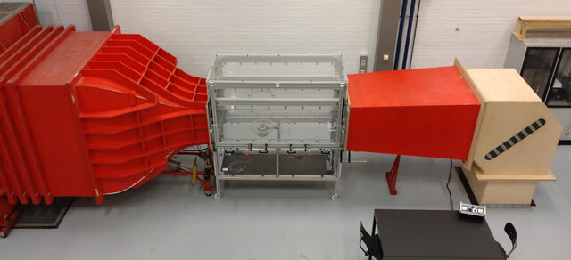

The DTU Red Wind Tunnel: the red contraction accelerates the flow into the transparent 0.50 × 0.75 m test section.

Lift and drag were measured together on every run. Drag came from the momentum deficit in the wake, measured by a 16-tube wake rake 195 mm behind the trailing edge. Lift came from static pressure taps in the tunnel side walls. Over three Reynolds numbers and sixteen angles of attack, this gave **480 runs**, the main screening dataset of the thesis.

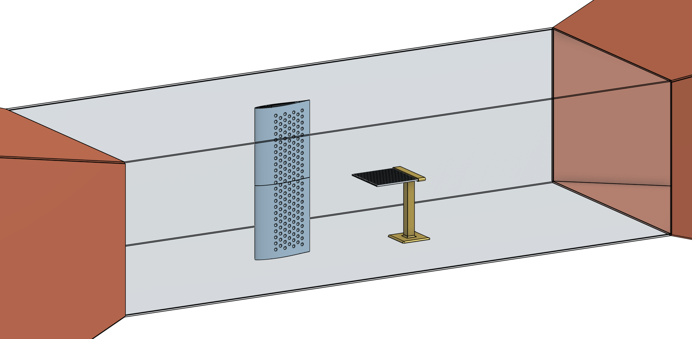

CAD of the Red Wind Tunnel setup: the airfoil mounted vertically across the test section, with the horizontal wake rake at mid-span.

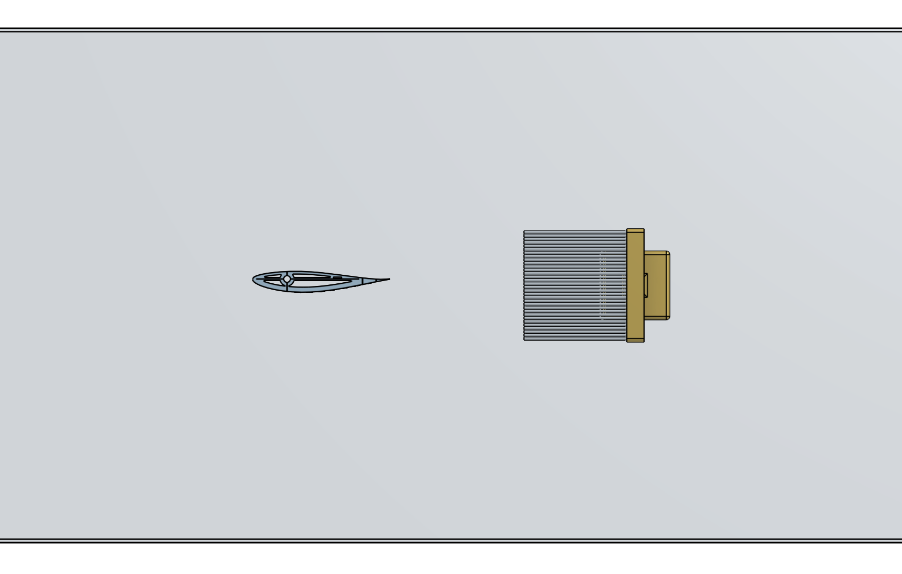

Top view of the setup: the 16-tube wake rake sits 195 mm (0.975c) behind the trailing edge.

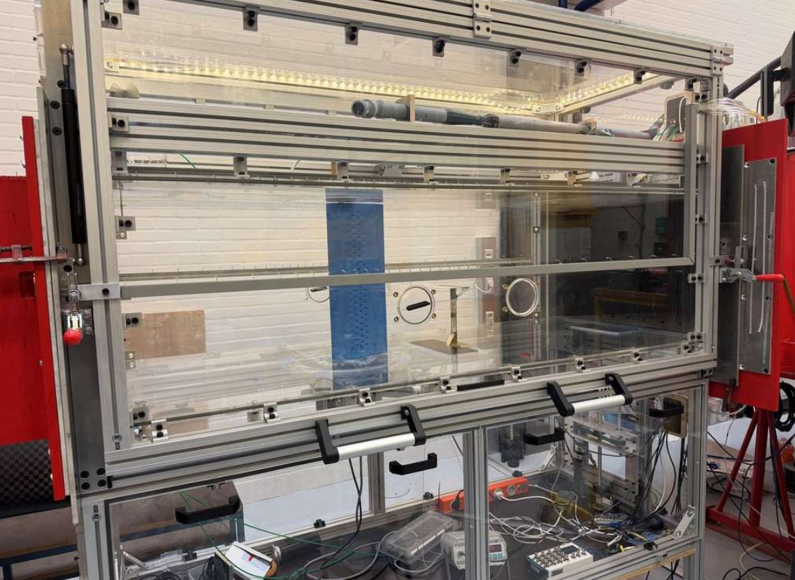

The 3D-printed dimpled airfoil mounted in the Red Wind Tunnel test section.

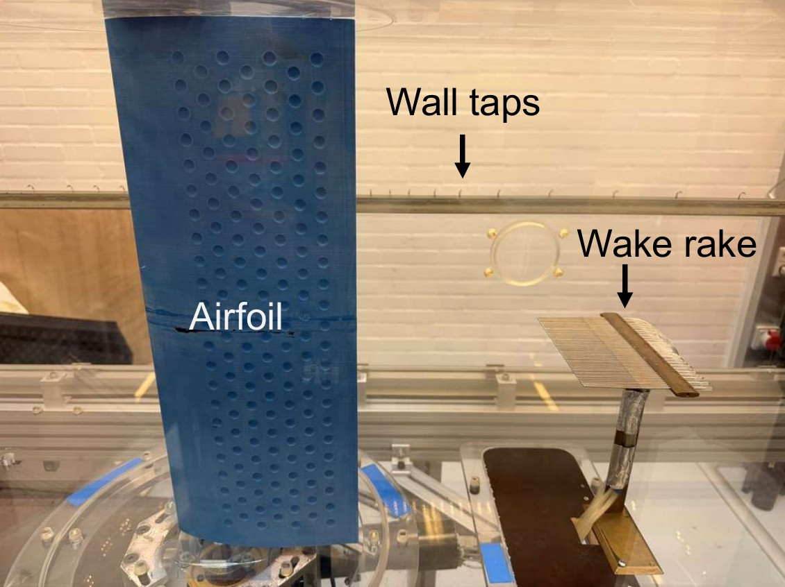

The measurement chain in the tunnel: the airfoil, the wall pressure taps that give lift, and the wake rake that gives drag.

### Surface pressure tap models

To measure the pressure distribution on the airfoil itself, two dedicated models were designed: the smooth airfoil and Mid-2.50, each with 32 flush pressure taps, 20 on the suction side and 12 on the pressure side. Each tap is a 0.7 mm hole, connected to an internal channel printed directly into a solid centre section, so the passages are airtight without any drilling or tubing inside the model. The channels exit through hollow end caps alongside the mounting rod. These models added 96 runs.

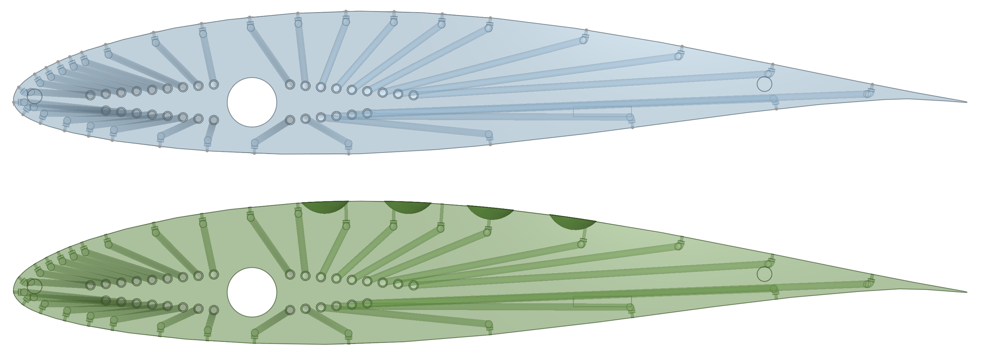

Transparent CAD of the two pressure tap models, Smooth (blue) and Mid-2.50 (green). The internal channels run from 32 surface taps to the centre, densest near the leading edge where the pressure changes fastest.

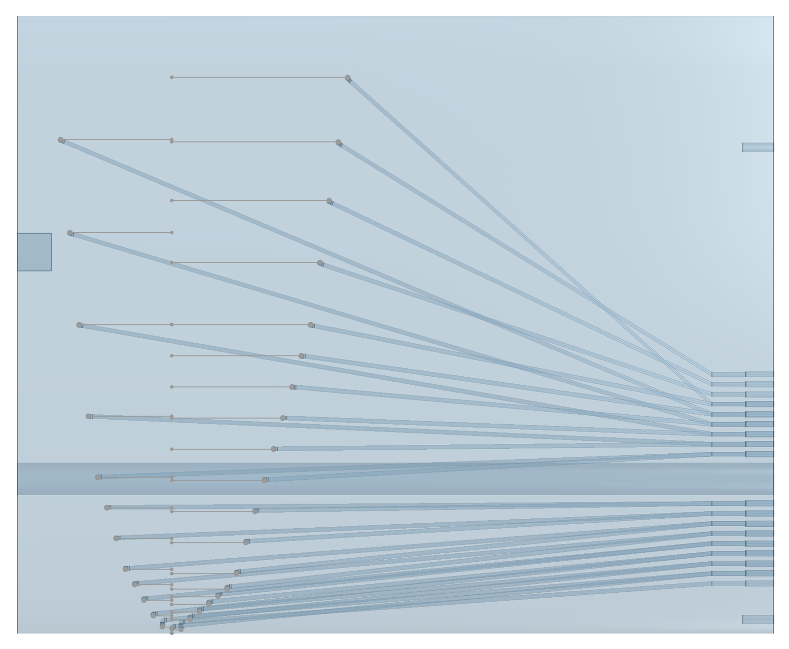

Top view of the solid centre section, with all 32 printed channels routed out to one end of the model.

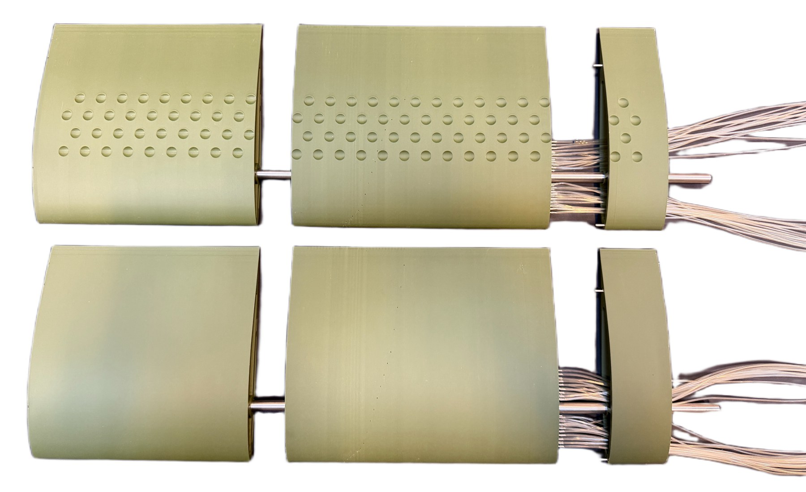

The printed pressure tap models before final assembly, Mid-2.50 (top) and Smooth (bottom): two hollow end caps and a solid centre section with the tubing routed out alongside the mounting rod.

## Wind tunnel testing: TU Delft Small Low-Turbulence Tunnel

The flow field was measured in TU Delft's Small Low-Turbulence Tunnel, with a turbulence intensity of 0.03 to 0.07% and full optical access through its polycarbonate walls. The same airfoils were extended with smooth end pieces to its 600 mm span.

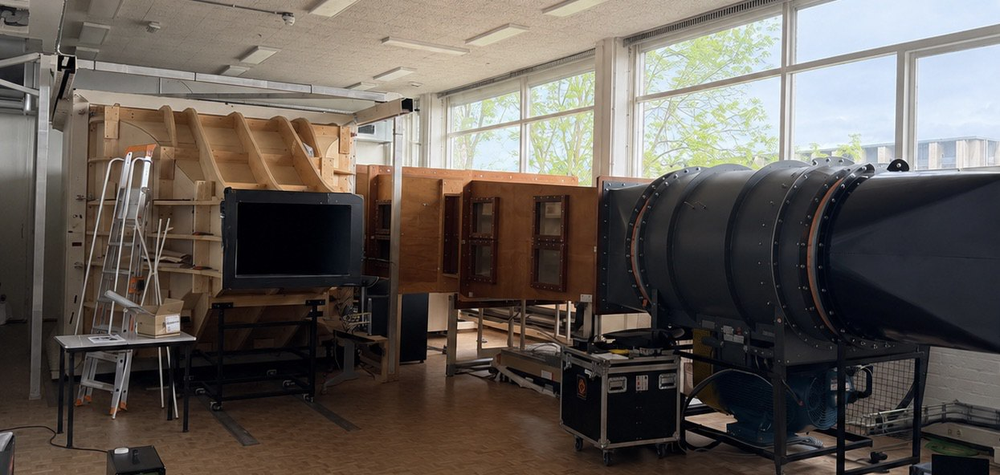

The Small Low-Turbulence Tunnel at TU Delft, before the test section was installed: axial fan (right), settling chamber and wooden contraction (centre).

### Particle image velocimetry

A planar PIV system measured the velocity field over the suction side at mid-span: a 532 nm Nd:YAG laser with 200 mJ pulses formed into a horizontal light sheet, a 2560 × 2160 pixel sCMOS camera looking down through the top wall, and 1 µm seeding droplets. The 300 mm field of view, magnification, aperture and pulse separation (124 µs and 62 µs for the two speeds) were derived with a [PIV setup calculator](/projects/piv-setup-calculator/) developed during the thesis and free for others to use. The campaign covered 40 measurement sets.

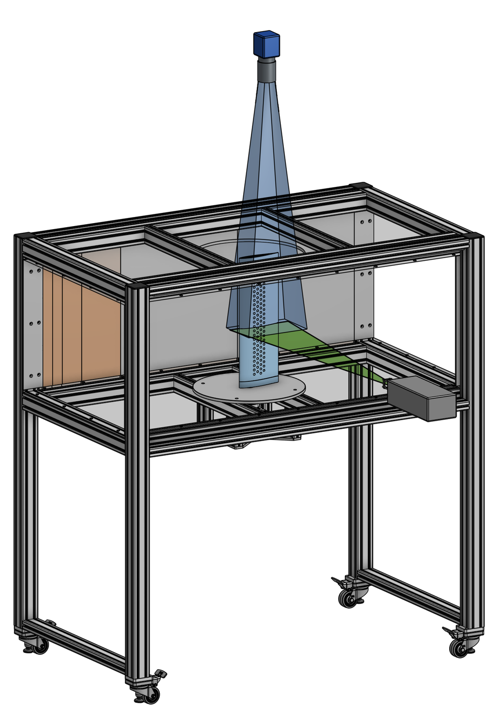

CAD of the PIV setup: the airfoil with span extensions in the test section, the green laser sheet across the suction side at mid-span, and the camera (blue) above.

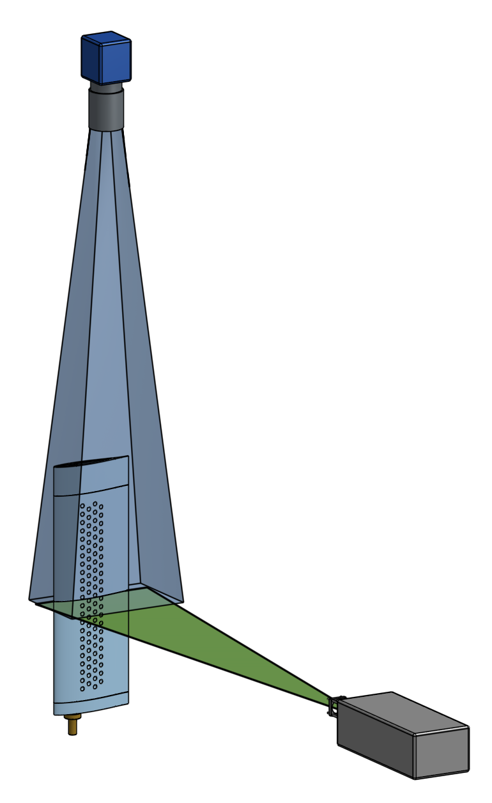

The same setup with the test section removed: the airfoil on the force balance adapter, the camera field of view from above and the laser sheet entering from the side.

The PIV setup at TU Delft: the sCMOS camera mounted above the test section and the Nd:YAG laser beside it.

The airfoil in the test section, with the laser sheet at mid-span and the camera looking down from above.

### Force balance and tufts

A three-component force balance measured lift and drag directly, while its rotary stage set each angle of attack, for 72 runs. A custom aluminium adapter, designed and drawn for the campaign, connects the airfoil's support rod to the balance. Tufts of yarn on the suction side then showed where the flow stayed attached and where it separated.

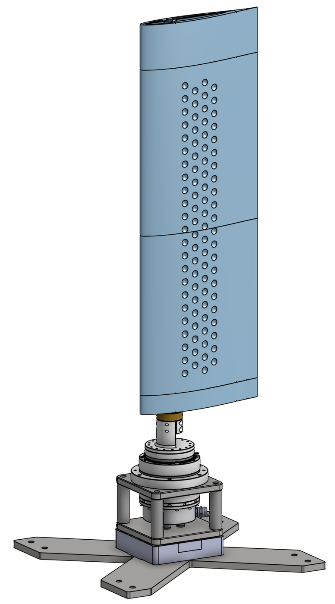

CAD of the dimpled airfoil on the three-component force balance, whose rotary stage sets the angle of attack.

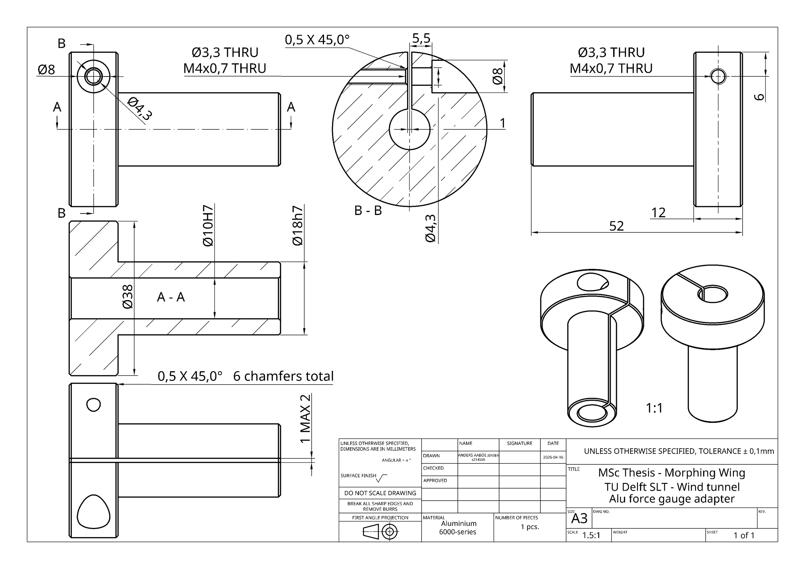

Technical drawing of the aluminium adapter that connects the airfoil support rod to the force balance.

## CFD: RANS and LES in OpenFOAM

The experiments were complemented by simulations in OpenFOAM, run on an HPC cluster.

- **RANS** with the k–ω SST turbulence model and the pimpleFoam solver screened the dimple configurations. The mesh resolved the near-wall region down to y+ ≈ 1, including inside the dimple cavities. A study of five meshes from 1.6 to 4.7 million cells selected a 2.5-million-cell mesh, which cost about 36 core hours per case across the 48 production runs.
- **LES** resolved the large turbulent structures directly for the smooth airfoil and Mid-2.50 at Re = 1 × 10⁵, with a Smagorinsky sub-grid model and van Driest wall damping. Each simulation used a 9.9-million-cell mesh and about 3,400 core hours.

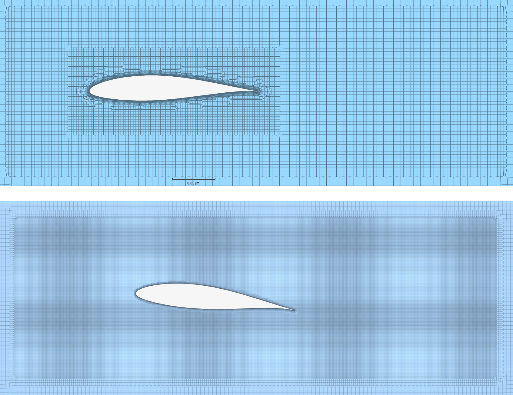

Near-field meshes around the airfoil: the 2.5-million-cell RANS mesh with its refinement regions (top) and the finer 9.9-million-cell LES mesh (bottom).

## Validation

Before comparing dimpled airfoils, each method was checked on the smooth baseline, against each other and against XFoil and published data for the NACA 63-415. The wall-pressure lift and wake-rake drag agree closely with XFoil through the attached regime, including a clear drag bucket, and repeat well between measurement days. RANS over-predicts lift and under-predicts drag, as expected without a transition model. The single LES point lands on the experimental data.

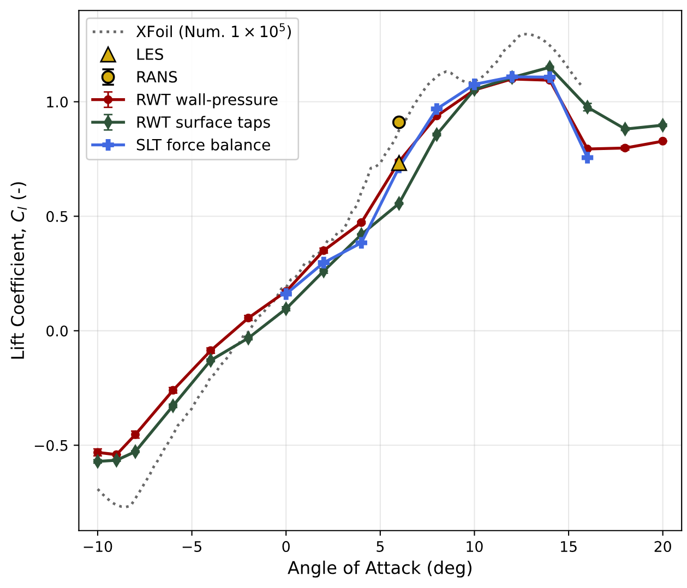

Lift of the smooth airfoil at Re = 1 × 10⁵ from every method (wall pressure, surface taps, force balance, RANS and LES) against XFoil.

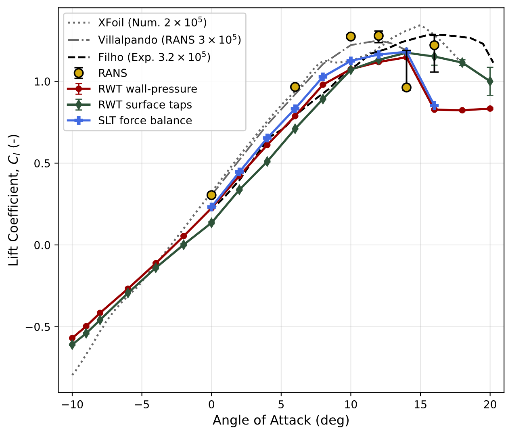

Lift at Re = 2 × 10⁵, also against published RANS (Villalpando) and wind tunnel data (Filho) for the NACA 63-415.

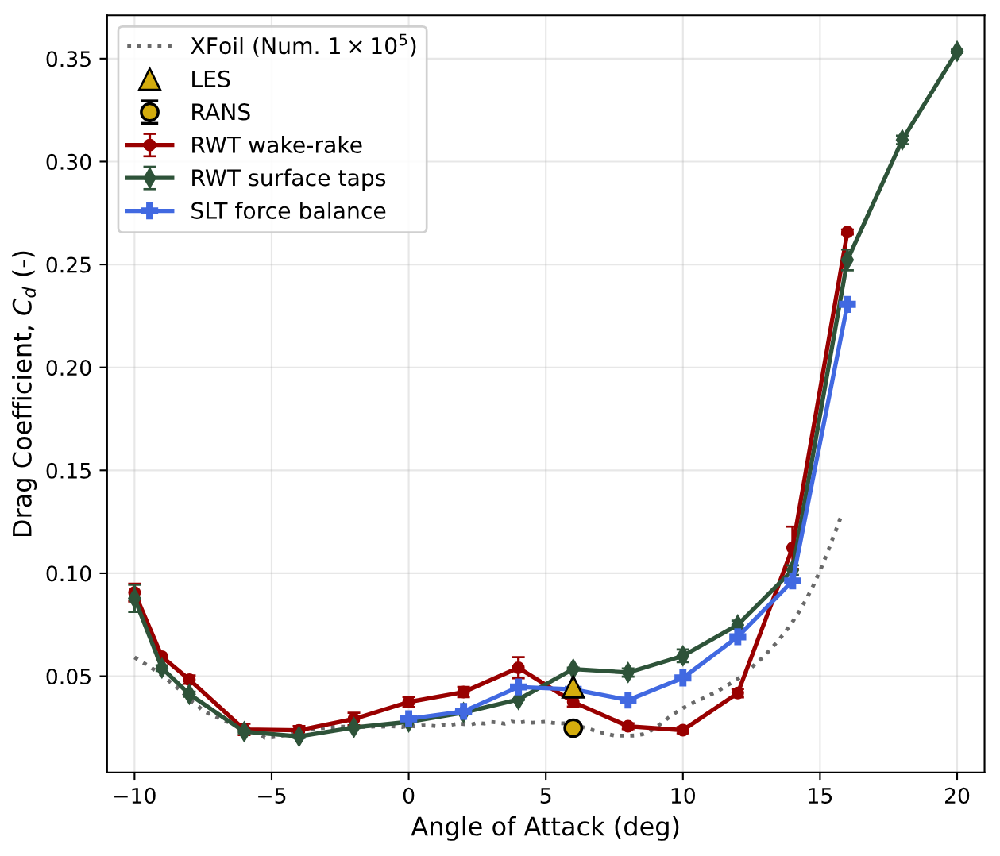

Drag at Re = 1 × 10⁵. The wake rake reproduces the drag bucket and sits just above XFoil, as expected at low Reynolds number.

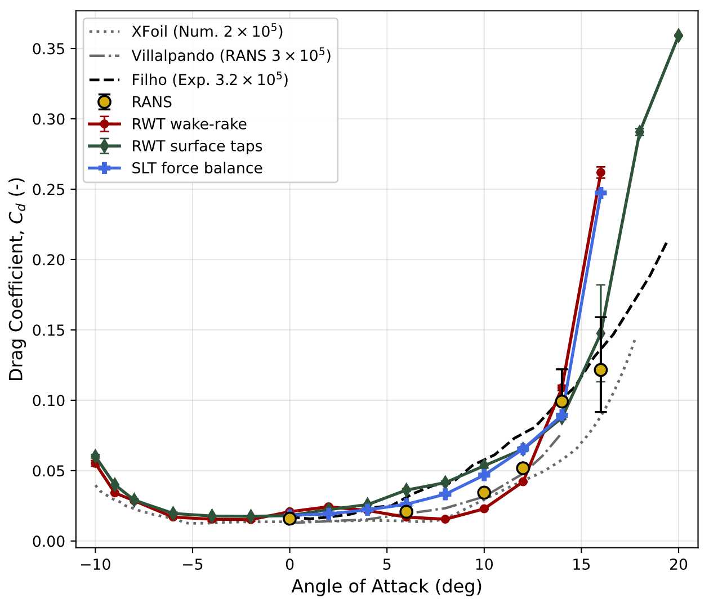

Drag at Re = 2 × 10⁵. Wake rake, surface taps and force balance agree through the attached regime and diverge only once the airfoil stalls.

## Results: screening the dimple configurations

The Red Wind Tunnel screening is summarised as the change in glide ratio (lift over drag) of each dimpled airfoil relative to the smooth one, at every angle of attack. Green means better than smooth, red means worse. The changes are driven mainly by drag rather than lift.

At Re = 1 × 10⁵, mid and full coverage were broadly beneficial from 0° to 8°, in places more than doubling the glide ratio, with a best case of **+132%** for Mid-5.00 at 4°. At Re = 2 × 10⁵ the benefit collapsed to a narrow band around 2° to 4°, with a best case of +22%, and most of the map turned red.

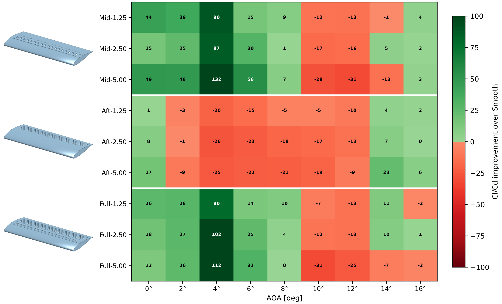

Change in glide ratio (CL/CD) over Smooth at Re = 1 × 10⁵, for all nine dimpled airfoils (rows) and every angle of attack (columns). Green is better than Smooth and red worse; mid and full coverage are strongly green from 0° to 8°.

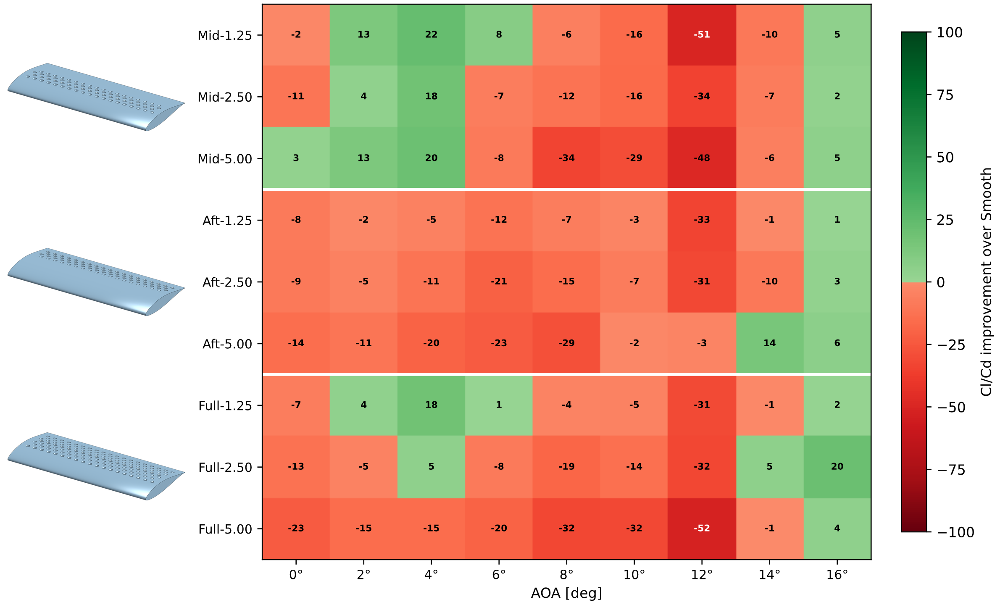

The same map at Re = 2 × 10⁵. The gains shrink to a narrow band around 2° to 4°, and most of the map turns red.

Summing each row across 0° to 16° shows the performance over the whole envelope: solid bars sum only the gains, hatched bars give the true net. At Re = 1 × 10⁵, mid and full coverage gave genuine gains over the entire envelope while aft coverage was a net loss, so the forward dimples drive the benefit. At Re = 2 × 10⁵ every configuration became a net loss.

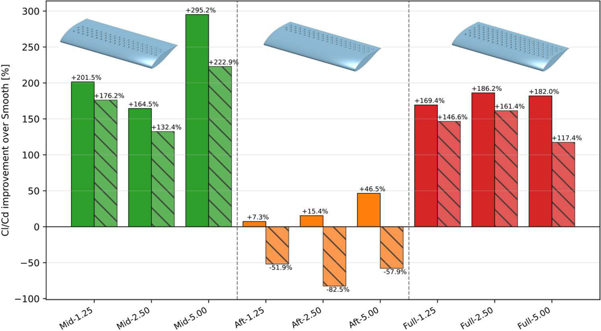

Each heatmap row summed over 0° to 16° at Re = 1 × 10⁵. Solid bars count only the gains; hatched bars give the true net. Mid and Full gain across the whole envelope, while Aft is a net loss.

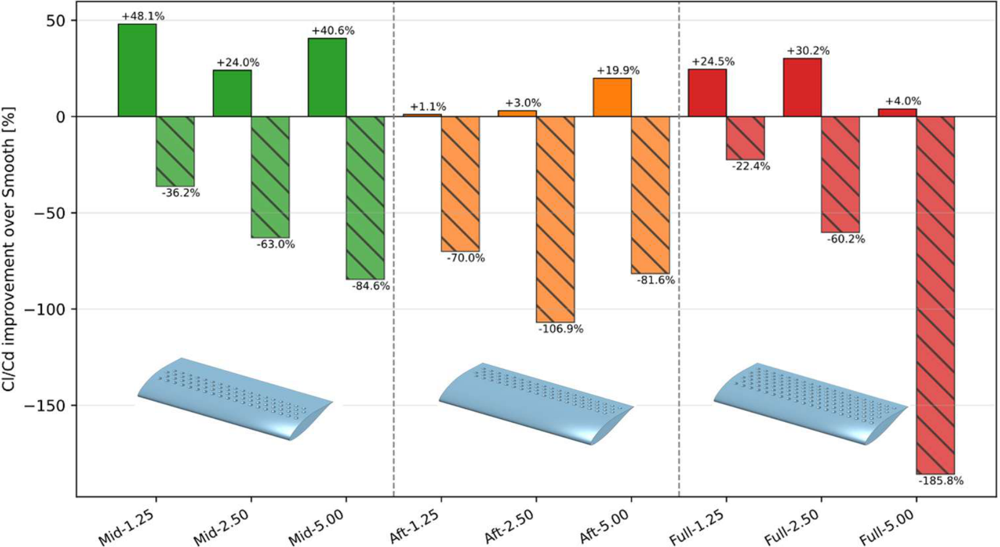

The same sums at Re = 2 × 10⁵: some gains remain (solid bars), but every configuration is a net loss over the envelope (hatched bars).

At Re = 5 × 10⁵ the trend reversed completely: the mid layout, best at the lowest Reynolds number, became the worst at every angle, and only the aft layout gave any benefit, close to stall. Dimple depth behaved the same way. The depth that reduced drag the most at Re = 1 × 10⁵ was the most harmful at 5 × 10⁵, and near stall only the middle depth helped at all. **No single fixed geometry works across the envelope**, which is the central argument for an adjustable dimple depth.

## A closer look at the dimple flow effects

To understand where the gains come from, the standout configuration Mid-2.50 at Re = 1 × 10⁵ and 4°, a +87% gain in glide ratio, was examined with PIV, the wake rake and the surface pressure taps.

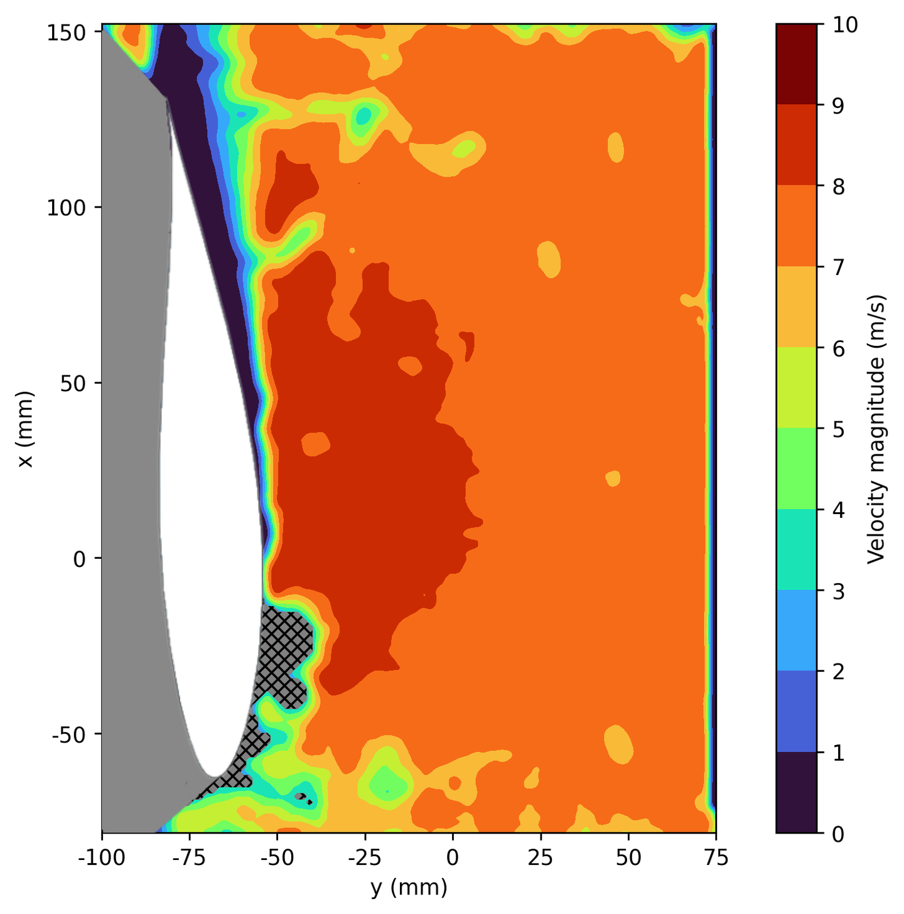

PIV velocity field over Smooth at 4° and Re = 1 × 10⁵. The flow separates over the aft suction side (dark low-velocity region near the surface). The airfoil is masked white and its laser shadow grey.

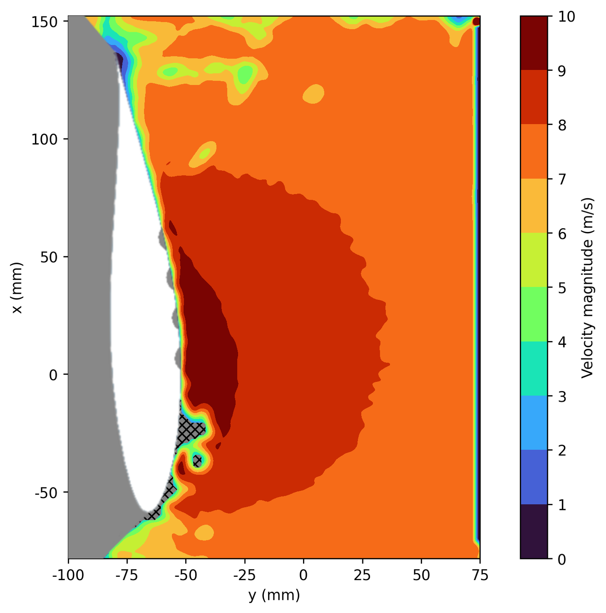

Mid-2.50 at the same condition, +87% in glide ratio. The separation is suppressed right where the dimples sit, and the high-velocity core gains an extra step, meaning stronger suction.

The PIV shows two clear differences. The separation present on the smooth airfoil is suppressed, and the dimples sit exactly where that separation starts. The high-velocity core over the suction side also gains an extra step, showing stronger suction.

The wake rake confirms it: the smooth wake is close to twice as wide as the Mid-2.50 wake, and the narrowing happens only on the suction side, where the dimples are. It is the same signature as a golf ball, but on one side only.

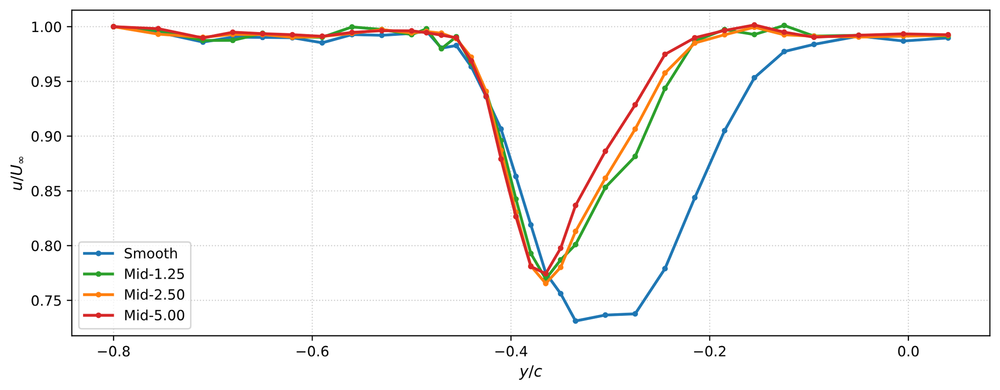

Wake velocity profiles 0.975c behind the airfoil at 4° and Re = 1 × 10⁵. The Smooth wake (blue) is close to twice as wide as the dimpled ones, and the narrowing happens only on the suction side, where the dimples are.

The surface pressures tell the same story. Mid-2.50 has stronger suction over the forward half of the chord, matching the faster flow seen in the PIV, and a better pressure recovery towards the trailing edge, matching the narrower wake.

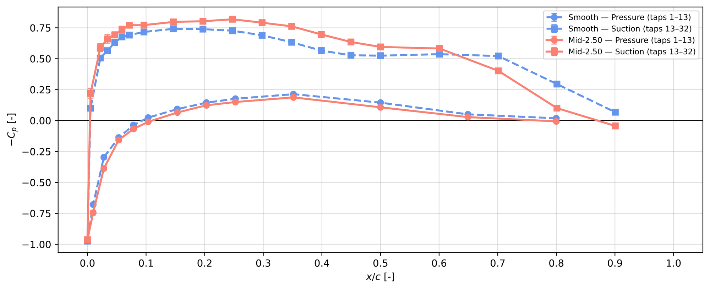

Surface pressure (−Cp) along the chord at 4° and Re = 1 × 10⁵, Smooth (blue, dashed) against Mid-2.50 (red). Mid-2.50 has stronger suction over the forward half and recovers closer to ambient at the trailing edge.

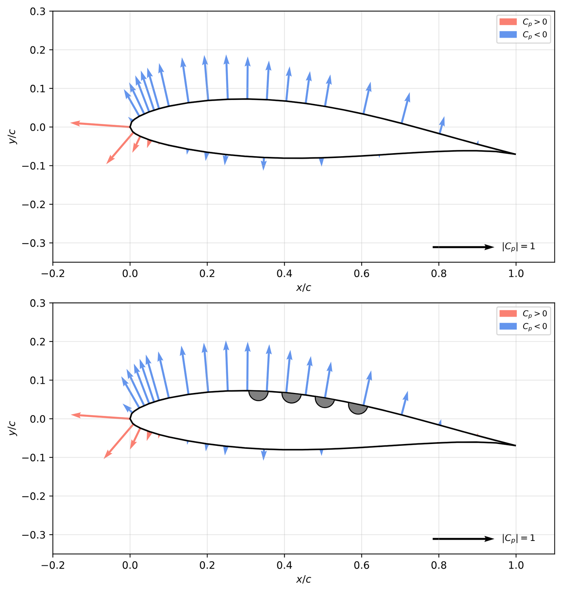

The same pressures as vectors normal to the surface, Smooth (top) and Mid-2.50 with its four dimple rows (bottom). Longer blue arrows mean more suction.

## Stall delay from the dimples

At Re = 2 × 10⁵, Mid-2.50 also delayed stall. The smooth airfoil stalls around 16°, while Mid-2.50 is still flying at the same angle, confirmed independently by three methods:

- **Surface pressure:** Mid-2.50 keeps a slightly stronger suction peak, while the leading-edge taps on the smooth airfoil scatter strongly, the unsteadiness of a flow that is starting to separate.
- **Force balance:** at 16°, the smooth airfoil's lift drops abruptly and its drag rises steeply. Mid-2.50 shows neither: its lift is about 30% higher and its drag close to half.
- **Tufts:** on the smooth airfoil, the tufts point in every direction, a sign of full stall. On Mid-2.50, they lie straight from leading to trailing edge at mid-span.

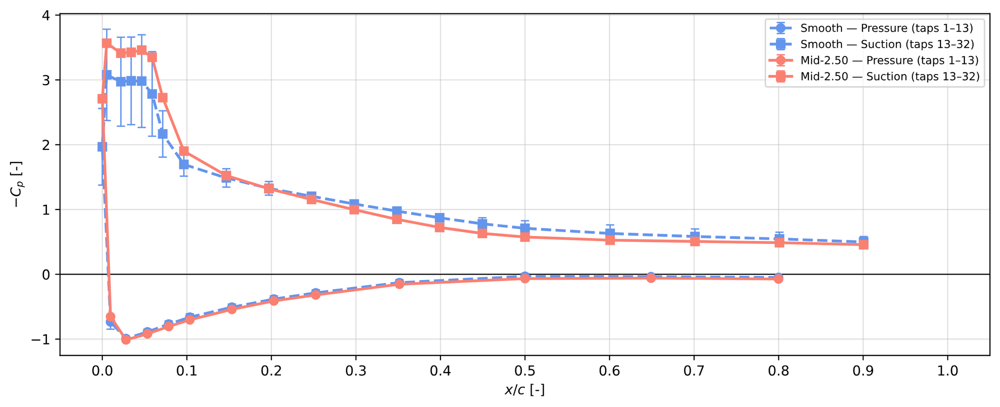

Surface pressure at 16° and Re = 2 × 10⁵. The large error bars on the Smooth leading-edge taps show an unsteady, separating flow; Mid-2.50 stays steady with a slightly stronger suction peak.

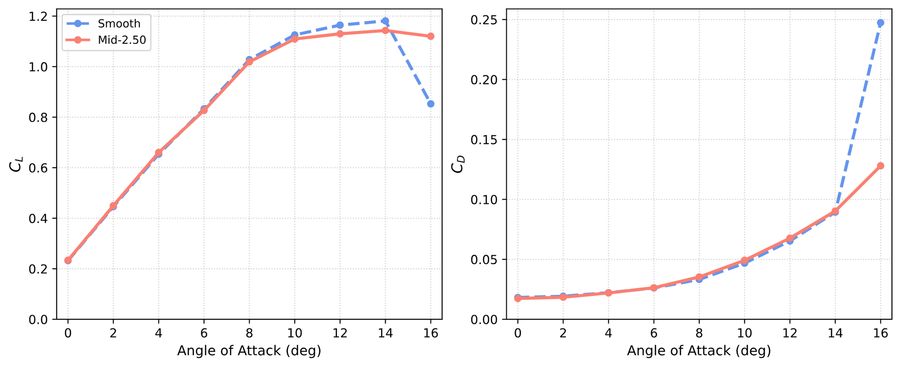

Force balance lift (left) and drag (right) at Re = 2 × 10⁵. Smooth (blue, dashed) stalls at 16°, with lift dropping and drag rising sharply; Mid-2.50 (red) carries on smoothly.

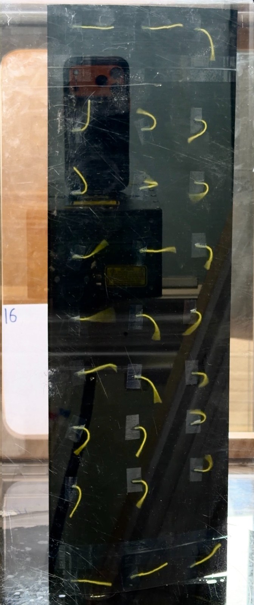

Tufts on Smooth at 16° and Re = 2 × 10⁵ point in every direction across the suction side: the airfoil has stalled.

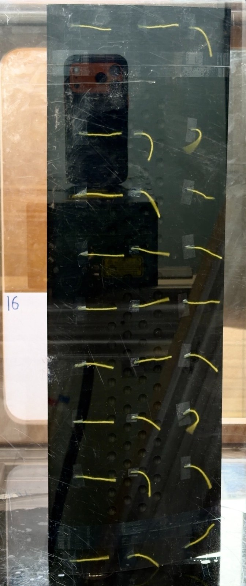

Tufts on Mid-2.50 at the same condition lie straight from leading to trailing edge at mid-span: the flow is still attached.

## The adaptive prototype

Because the best depth changes with the flow, the final part of the thesis built an airfoil whose dimple depth can be set on demand. Each dimple is a 0.30 mm latex membrane over a shared cavity inside the airfoil. A vacuum pump draws the membranes inward to form the dimples, one solenoid valve seals the vacuum to hold the depth without running the pump, and a second vents the cavity to return the surface flush. A pressure transducer, read through a voltage divider, feeds the cavity pressure to an Arduino Uno, which controls the pump and valves.

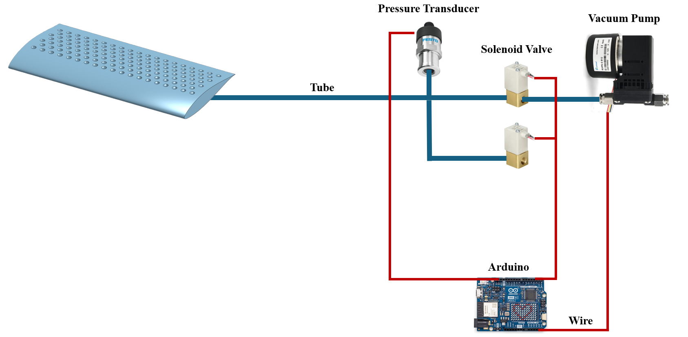

The actuation system: the airfoil cavity connects through a tube to a pressure transducer, two solenoid valves and a vacuum pump, all controlled by an Arduino.

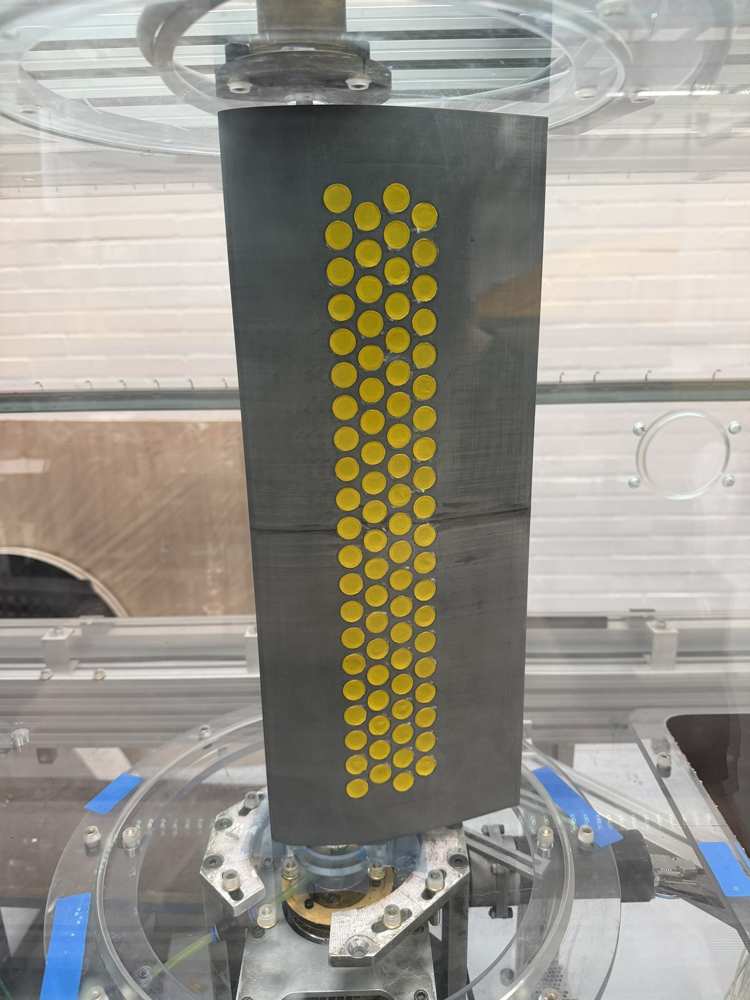

The adaptive prototype in the DTU Red Wind Tunnel, with the yellow latex membranes on the suction side and the supply tube leaving from the base.

The electronics and the Arduino code were developed as part of the thesis. Everything is built into a stacked acrylic control box: the Arduino Uno, the relay module that switches the pump and valves, the vacuum pump, the two solenoid valves and the pressure transducer, with two displays, a knob and push buttons on top for operating the system. The code runs a closed-loop pressure control. The transducer reads the chamber pressure continuously, and the Arduino runs the pump and switches the valves to reach a set target pressure and hold it there. The chambers are slightly leaky, so the loop keeps adjusting the vacuum to the target, which keeps the dimple depth constant through a run. Before going into the airfoil, the pump, valves and control code were tested on a separate test box with a latex membrane.

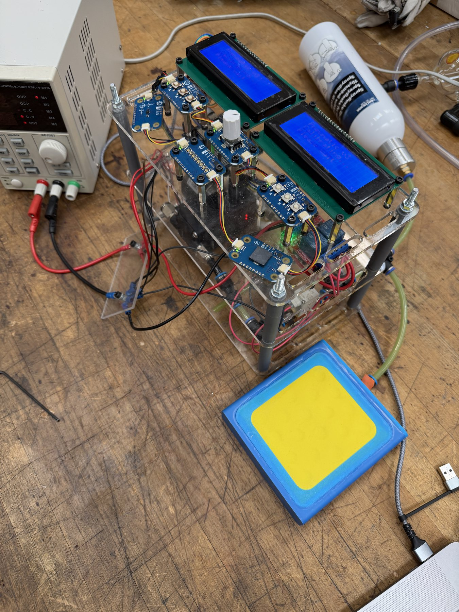

The control box from above: two displays, the knob and the push buttons on the top deck, with the membrane test box (front) used to test the pump, valves and control code.

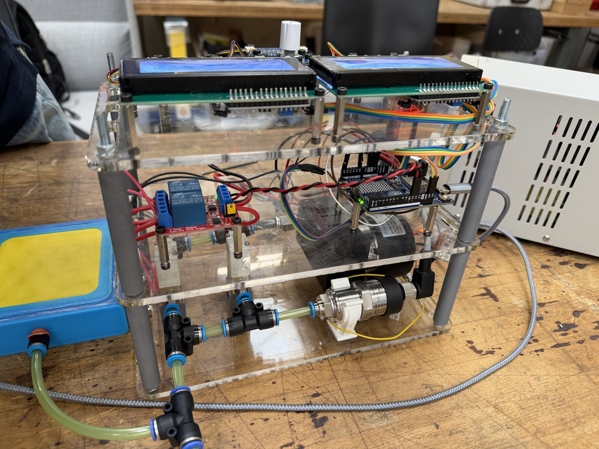

The control box from the side: the Arduino Uno and the relay module on the middle deck, with the vacuum pump, solenoid valves and pressure transducer below, connected to the test box (left).

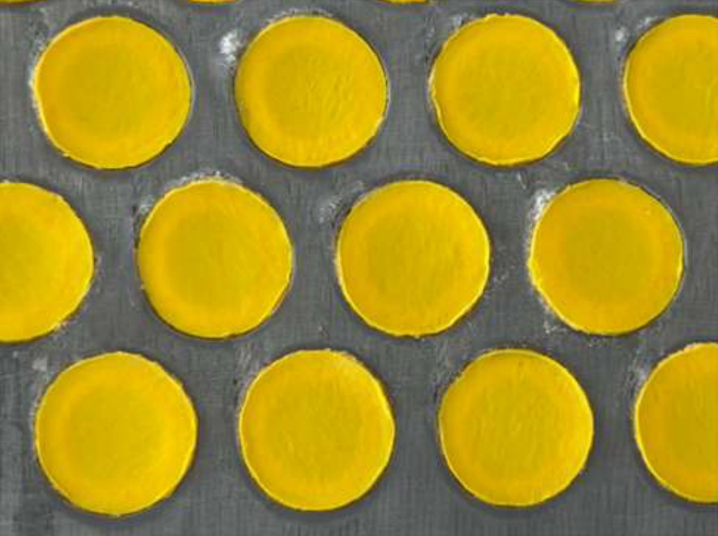

Close-up of the dimples unactuated: the latex membranes lie flush with the surface (0 mm).

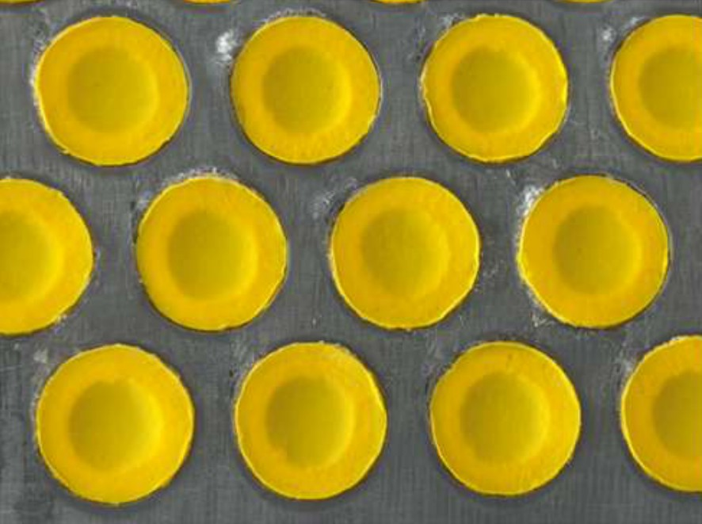

The same dimples actuated: the vacuum pulls the membranes in to a depth of about 1.5 mm.

To link cavity pressure to physical depth, the actuated membranes were measured with an ATOS III structured-light 3D scanner at each pressure setpoint.

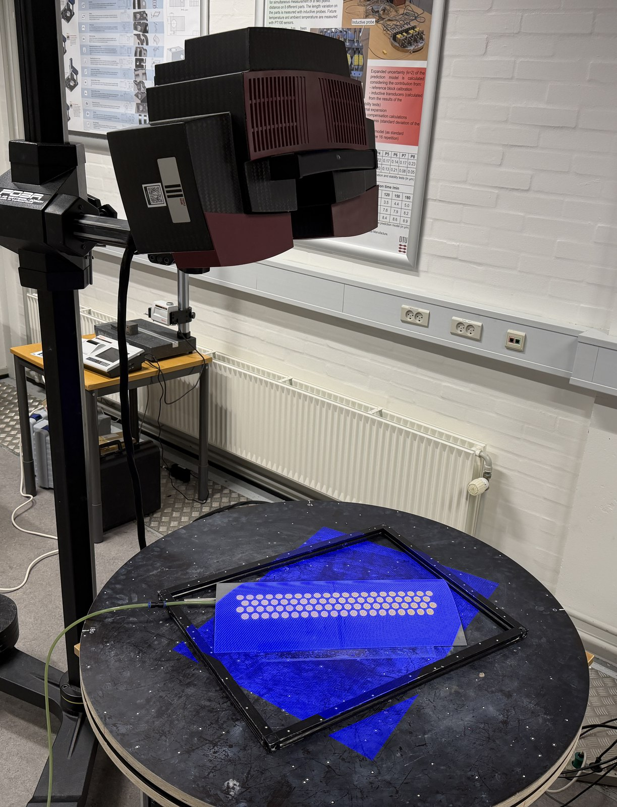

The ATOS III structured-light scanner projecting a blue fringe pattern onto the actuated dimples to measure their depth.

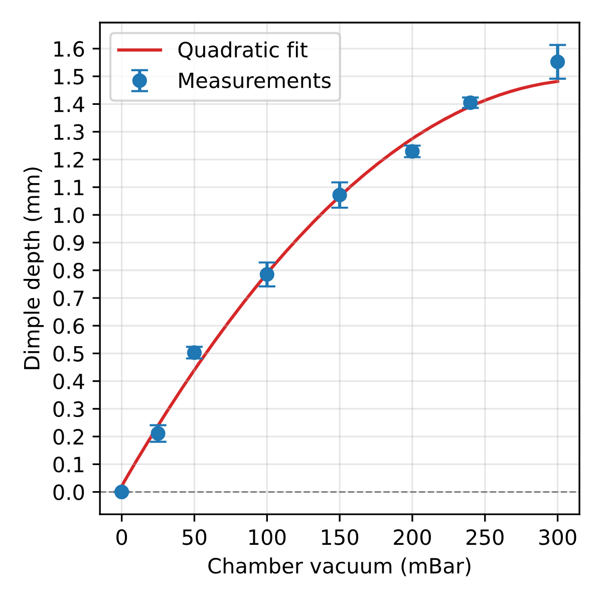

Measured dimple depth against cavity vacuum, with a quadratic fit. Error bars grow with the membrane's unsteadiness during the scan.

In the wind tunnel at Re = 1 × 10⁵, 56 runs covered three actuated depths and the unactuated state. Between 0° and 8° every actuated depth reduced drag relative to the same airfoil at rest, peaking at about **22%** at 6°, and the wake narrowed on the suction side just as for the static dimpled models. As in the static campaign, the effect reversed into a drag penalty near stall, and no lift benefit was measured. Side by side with the static Mid airfoils, the adaptive prototype follows the same overall pattern, a reduction at low angles and a penalty towards stall, from a single airfoil that switches between states without any change of hardware.

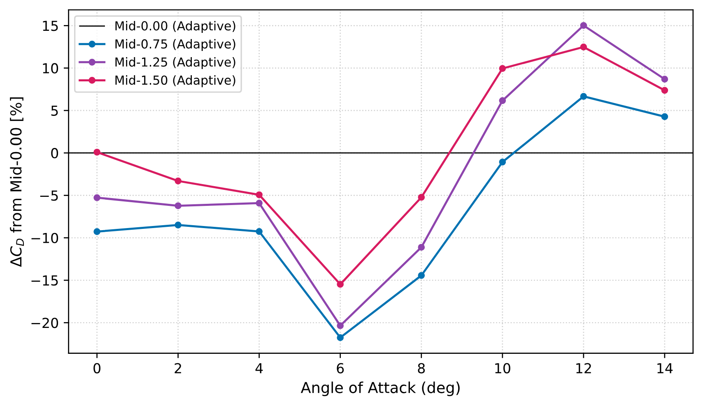

Change in drag of the prototype relative to its own unactuated state at Re = 1 × 10⁵, for three actuated depths. Every depth reduces drag from 0° to 8°, by up to about 22% at 6°, and adds drag towards stall.

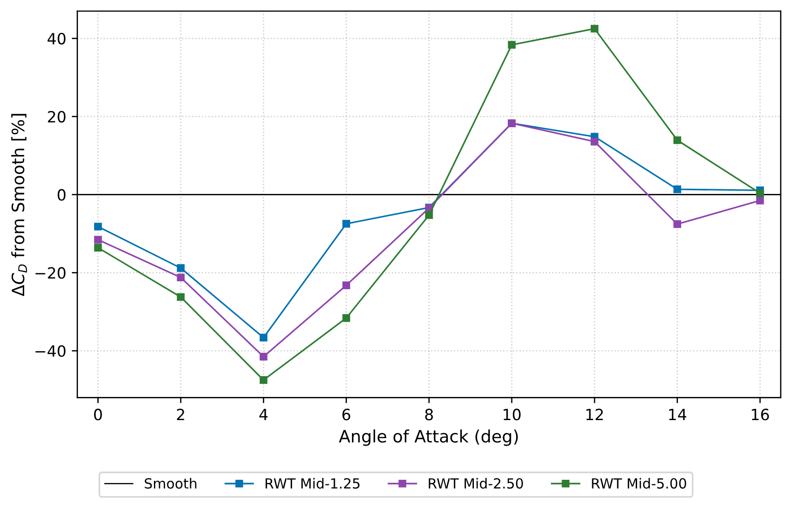

The static Mid airfoils relative to Smooth at the same Reynolds number, for comparison (note the larger y-axis range). The same pattern appears: lower drag up to 8° and a penalty towards stall.

## Conclusion

Dimples can transform the performance of an airfoil, but only in the right conditions:

- **Up to 49% lower drag and up to +132% glide ratio** at Re = 1 × 10⁵, with dimples over the mid-chord or the full suction side.
- **Separation suppressed:** PIV shows the dimples removing the separation on the smooth airfoil, and the wake shrinks to about half its width.
- **Stall delayed:** at Re = 2 × 10⁵ and 16°, Mid-2.50 kept about 30% more lift at roughly half the drag, while the smooth airfoil had already stalled.
- **An adaptive surface that works:** the pneumatic prototype cut its drag by up to about 22% by changing its dimple depth on demand.

Because the effect depends on how close the boundary layer is to separating, no single, fixed dimple geometry is optimal across a realistic operating envelope. The prototype showed that one airfoil can switch pneumatically between states that resemble different static geometries, establishing the feasibility of an adaptive dimpled surface. Closed-loop control based on flow measurements is the next step.

The thesis received the **DANSIS Graduate Award 2026 for Best Fluid Mechanics Thesis**, and was graded 12 / 12 at DTU and 9.0 / 10 at TU Delft. The experimental work and the prototype were partly funded by Siemens Fonden.

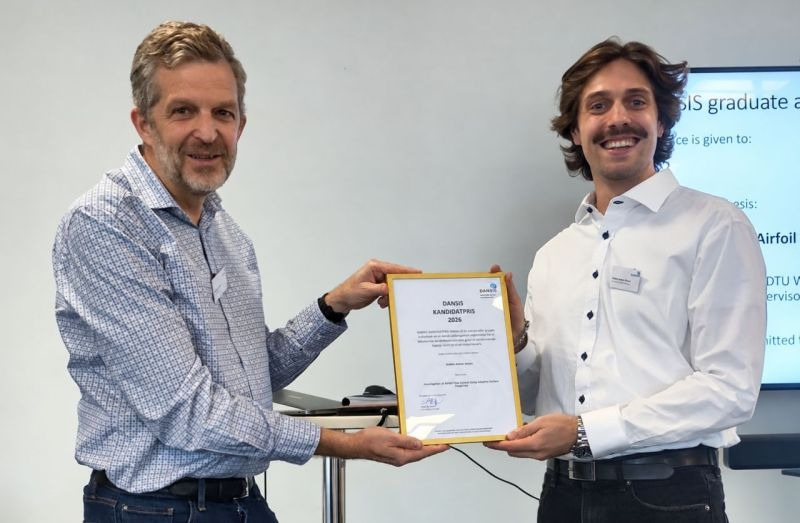

Receiving the DANSIS Graduate Award 2026 for Best Fluid Mechanics Thesis.
