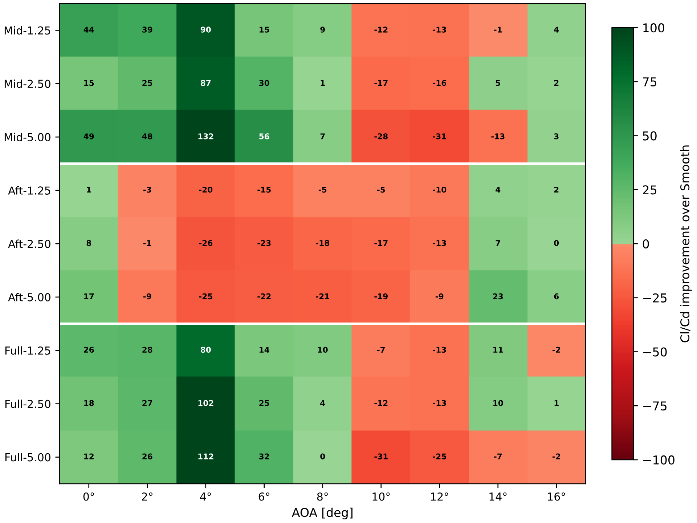
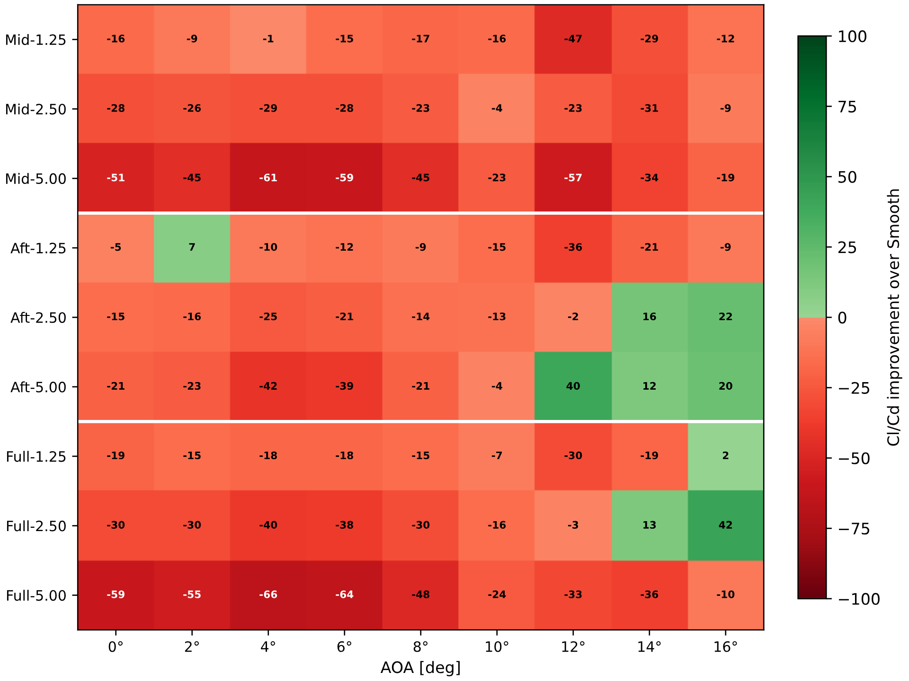
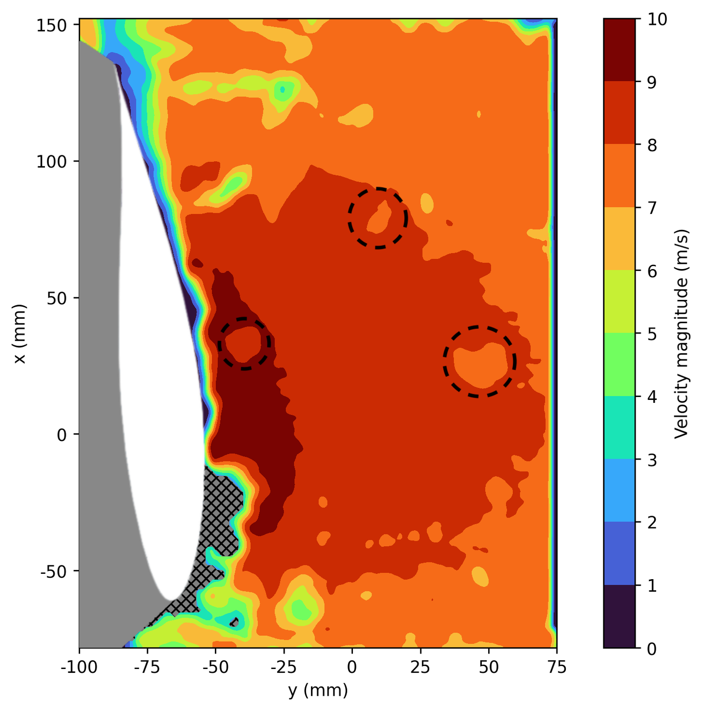
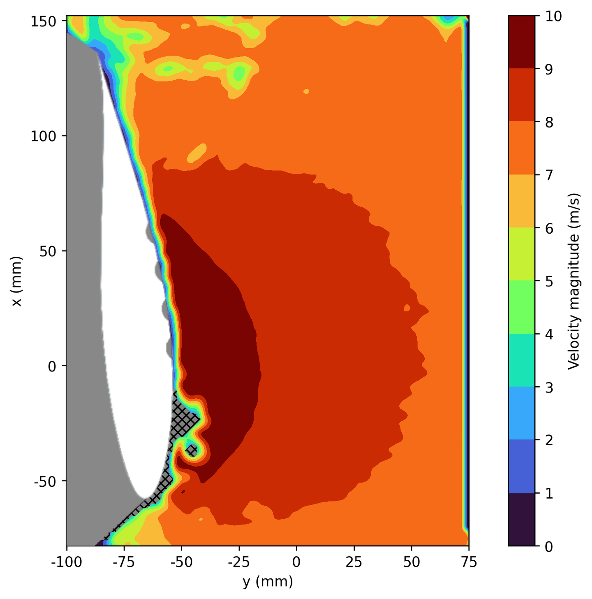
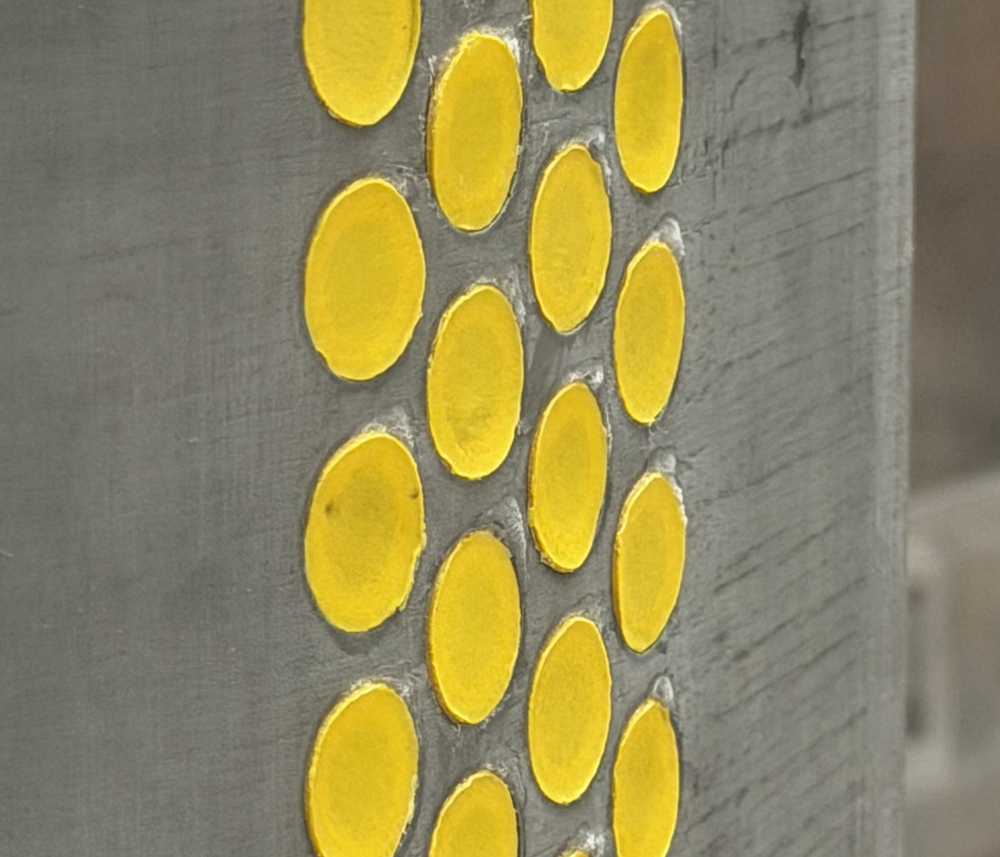
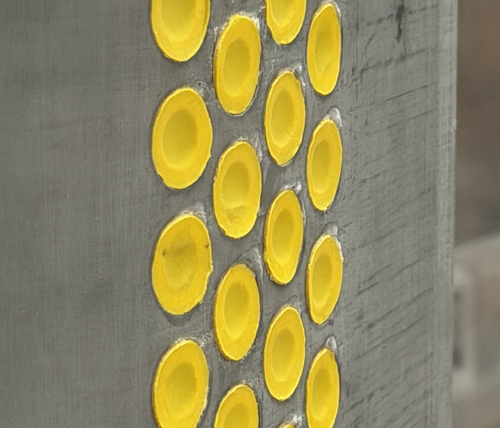

## The goal

Dimples roughly halve the drag of a golf ball by tripping the boundary layer into turbulence, which delays separation and narrows the wake. Whether the same mechanism helps a wing is far less settled: an airfoil in attached flow has little separation to delay, so a dimple that helps a sphere can just as easily add drag. Earlier studies on dimpled airfoils disagree on where along the chord dimples should sit and how deep they should be.

This thesis asked how dimple depth and chordwise placement change the lift, drag and separation of an airfoil across operating conditions, and whether a surface that changes its own dimple depth could get the best of each.

## My involvement

Carried out the thesis individually: the literature study and dimple design, CAD and 3D-printed wind tunnel models, two wind tunnel campaigns at DTU and TU Delft, the RANS and LES simulations in OpenFOAM, and the design, build, calibration and wind tunnel testing of the adaptive prototype.

## The test campaign

A NACA 63-415 airfoil with a 200 mm chord was tested smooth and with three dimple layouts on the suction side: mid-chord (0.33c to 0.59c), aft (0.59c to 0.85c) and full coverage (0.33c to 0.85c), each at three dimple depths of 1.25, 2.50 and 5.00 mm. All models were 3D-printed, so layouts could be swapped quickly between runs.

Smooth: the undimpled baseline.

Mid: dimple rows 1 to 4.

Aft: dimple rows 4 to 7.

Full: dimple rows 1 to 7.

Every configuration was measured at Reynolds numbers of 1, 2 and 5 × 10⁵, mostly between 0° and 16° angle of attack, with complementary methods across two wind tunnels:

| Method | Facility | Result |
|---|---|---|
| Wake rake and wall pressures | Red Wind Tunnel, DTU | Lift and drag of every configuration |
| Surface pressure taps | Red Wind Tunnel, DTU | Pressure distribution, smooth and Mid-2.50 |
| Force balance | Low-Turbulence Tunnel, TU Delft | Independent lift and drag, stall |
| Particle image velocimetry (PIV) | Low-Turbulence Tunnel, TU Delft | Velocity field over the suction side |
| Tuft visualisation | Low-Turbulence Tunnel, TU Delft | Attached or separated surface flow |
| RANS (k–ω SST) and LES | OpenFOAM | Numerical comparison of key cases |

Measurement methods and what each contributed.

Red Wind Tunnel setup, with the airfoil and the wake rake downstream.

PIV setup in the Low-Turbulence Tunnel, with the laser sheet at mid-span.

## Results: no single geometry works everywhere

Dimple depth, chordwise location and Reynolds number interact strongly. At Re = 1 × 10⁵, mid and full coverage more than doubled the glide ratio of the smooth airfoil at low angles, up to **+132%**, with drag reductions of nearly 50%. At Re = 5 × 10⁵ this reversed completely: mid coverage became harmful at every angle, and only the aft layout gave any benefit, close to stall.

Change in glide ratio over the smooth airfoil at Re = 1 × 10⁵, by layout, depth and angle of attack.

The same map at Re = 5 × 10⁵: mostly penalties, with gains only for the aft layouts near stall.

Depth behaved the same way. The depth that reduced drag the most at the lowest Reynolds number was the most harmful at the highest, and near stall the trend was not even monotonic: at 14° only the 2.50 mm depth reduced drag, while both 1.25 and 5.00 mm did not. Since no fixed depth is best across the envelope, this is the central argument for making dimple depth adjustable.

## The mechanism

PIV on the standout configuration, Mid-2.50 at Re = 1 × 10⁵, shows the dimples energising the flow near the wall and suppressing the separation present on the smooth airfoil. Surface pressures and the wake rake confirm it: stronger suction over the forward chord, a fuller pressure recovery, and a wake roughly half as wide as the smooth baseline. At Re = 2 × 10⁵, force balance, surface pressures and tufts showed the same configuration delaying stall.

PIV, smooth airfoil at 6° and Re = 1 × 10⁵. Separation near the trailing edge.

PIV, Mid-2.50 at the same condition. Faster near-wall flow and less separation.

RANS and LES reproduced the direction of the drag trends but not the mechanism itself: neither resolved the change in the near-wall boundary layer, consistent with the RANS model's lack of a transition formulation. The simulations were therefore used as a check on trends rather than as independent confirmation.

## The adaptive prototype

Because the best depth changes with the flow, the final part of the thesis built an airfoil whose dimple depth can be set on demand. Each dimple is a 0.30 mm latex membrane over a shared cavity inside the airfoil. A vacuum pump draws the membranes inward to form the dimples, one solenoid valve seals the vacuum to hold the depth without running the pump, and a second vents the cavity to return the surface flush. A pressure transducer, read through a voltage divider, feeds the cavity pressure to an Arduino Uno, which controls the pump and valves.

The actuation system: vacuum pump, solenoid valves, pressure transducer and Arduino.

The prototype in the DTU Red Wind Tunnel.

Unactuated: the membranes lie flush (0 mm).

Actuated: the membranes form dimples about 1.5 mm deep.

To link cavity pressure to physical depth, the actuated membranes were measured with an ATOS III structured-light 3D scanner at each pressure setpoint.

Structured-light scanning of the actuated dimples.

Measured dimple depth against cavity vacuum.

In the wind tunnel at Re = 1 × 10⁵, 56 runs covered three actuated depths and the unactuated state. Between 0° and 8° every actuated depth reduced drag relative to the same airfoil at rest, peaking at about **22%** at 6°, and the wake narrowed on the suction side just as for the static dimpled models. As in the static campaign, the effect reversed into a drag penalty near stall, and no lift benefit was measured.

Change in drag relative to the unactuated prototype, for the three actuated depths.

## Result

The thesis showed that no single, fixed dimple geometry is optimal across a realistic operating envelope. Dimples help where the boundary layer is close to separating and hurt where the flow is comfortably attached, so their best depth and position depend on the operating condition. The prototype showed that one airfoil can switch pneumatically between aerodynamic states that resemble different static geometries, establishing the feasibility of an adaptive dimpled surface. Closed-loop control based on flow measurements is the next step.

The thesis received the **DANSIS Graduate Award 2026 for Best Fluid Mechanics Thesis**, and was graded 12 / 12 at DTU and 9.0 / 10 at TU Delft. The experimental work and the prototype were supported by Siemens Fonden.
