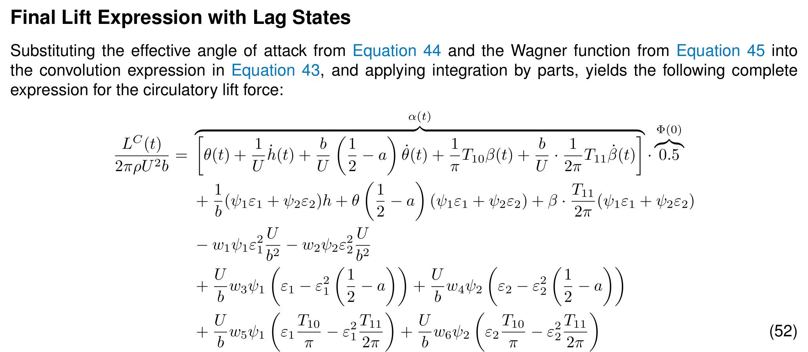
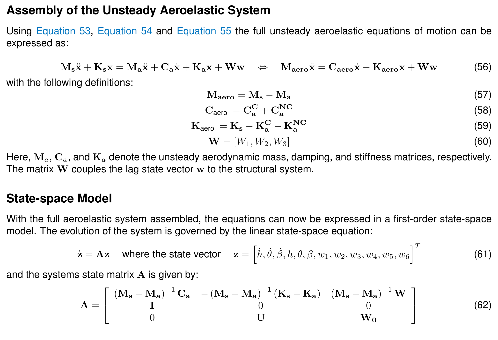
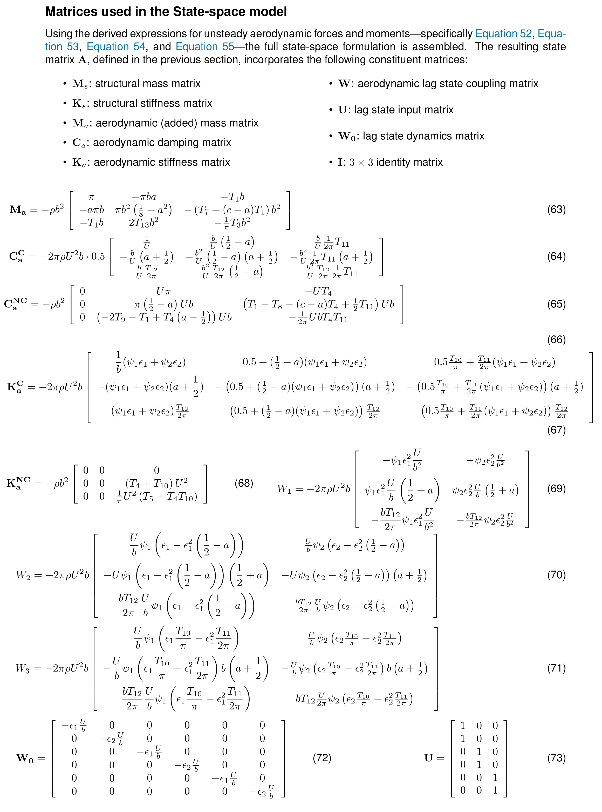

## The problem

When a wing deforms under aerodynamic load, the deformation changes the load in turn. At high enough speed this feedback becomes unstable: the wing can twist until it fails (**divergence**), a control surface can start acting in the wrong direction (**control reversal**), or the structure can enter a self-excited oscillation that grows with every cycle (**flutter**).

This individual take-home assignment for TU Delft's Fundamentals of Aeroelasticity course (AE4ASM506) asked for all three to be predicted for a classic test case: a two-dimensional airfoil section that can heave, pitch and deflect a trailing-edge flap, with structural parameters from a NASA reference study. I derived the model and implemented it in Python.

## Structural model

Each degree of freedom is restrained by a spring, and the derivation gives a coupled mass matrix and a diagonal stiffness matrix. Solving the resulting eigenvalue problem shows how inertial coupling changes the natural frequencies:

| Mode | Uncoupled | Coupled |
|---|---|---|
| 1 · Heave | 7.96 Hz (50 rad/s) | 7.75 Hz (48.7 rad/s) |
| 2 · Pitch | 15.92 Hz (100 rad/s) | 17.64 Hz (110.8 rad/s) |
| 3 · Flap | 47.75 Hz (300 rad/s) | 55.51 Hz (348.8 rad/s) |

Natural frequencies of the typical section with and without inertial coupling.

Coupling softens the heave mode slightly and stiffens the pitch and flap modes, and the mode shapes no longer belong to a single degree of freedom.

## From steady to unsteady aerodynamics

For the static problems, Theodorsen's theory reduced to steady flow gives an aerodynamic stiffness matrix and an external force vector, and from them closed-form divergence and control-reversal speeds.

Flutter needs the unsteady aerodynamics. Using the indicial-function method, the lag in lift build-up after a change in motion is described by a two-term exponential approximation of the Wagner function. This adds six aerodynamic lag states, giving a linear **12-state model**: three velocities, three displacements and six lag states. The same structure can take gust loads by adding lag states based on the Küssner function, which the assignment discussed but did not implement.

### The derivation

Every matrix in the model was derived by hand before being implemented. First, substituting the effective angle of attack and the Wagner approximation into the convolution integral gives the circulatory lift in terms of the lag states:

Unsteady lift with lag states (report, Eq. 52). Click any equation block to enlarge it.

The lift and moments are then assembled into the aeroelastic equations of motion and rewritten as a first-order state-space system:

Assembly into the state-space model ż = Az (report, Eqs. 56–62).

Finally, the aerodynamic mass, damping and stiffness matrices, the lag-state coupling matrices and the lag dynamics that make up the state matrix **A**:

The matrices of the state-space model (report, Eqs. 63–73).

## Finding flutter

The eigenvalues of the state matrix were computed across a range of speeds. Flutter begins where a complex pair crosses into the right half-plane, so that an oscillation grows instead of decaying. Here, the pitch-dominated mode crosses at **299 m/s**, against **302 m/s** in the NASA reference, a deviation of less than 1%. The flutter mode is a coupled heave–pitch (bending–torsion) motion, with only a small flap contribution.

| Instability | Critical speed |
|---|---|
| Flutter | **299.0 m/s** |
| Control reversal | 367.3 m/s |
| Divergence | 707.1 m/s |

Critical aeroelastic speeds of the typical section.

Flutter occurs first and is therefore the design driver for this section. The assignment closed by identifying which single parameter would make each of the other instabilities critical instead: the position of the elastic axis relative to the aerodynamic centre for divergence, and the aerodynamic effectiveness of the flap for control reversal.
