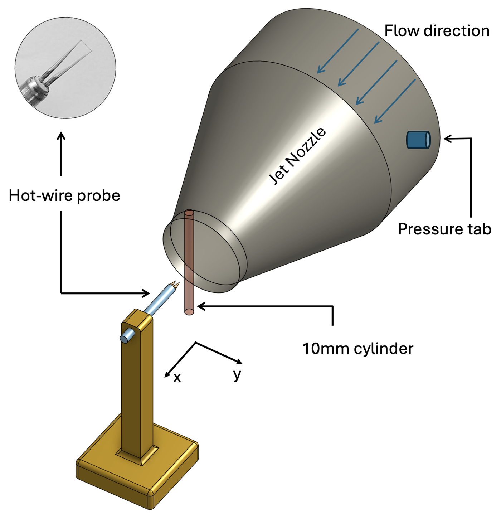
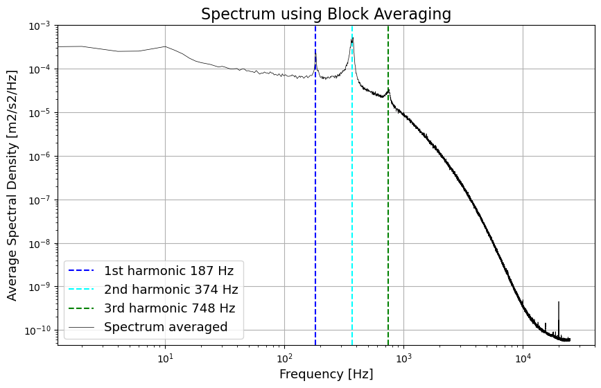
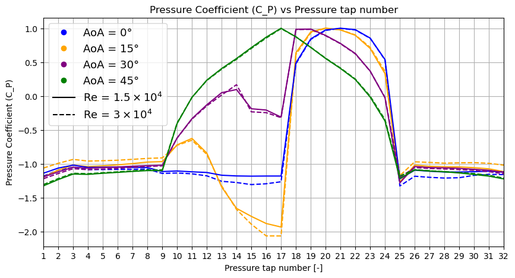
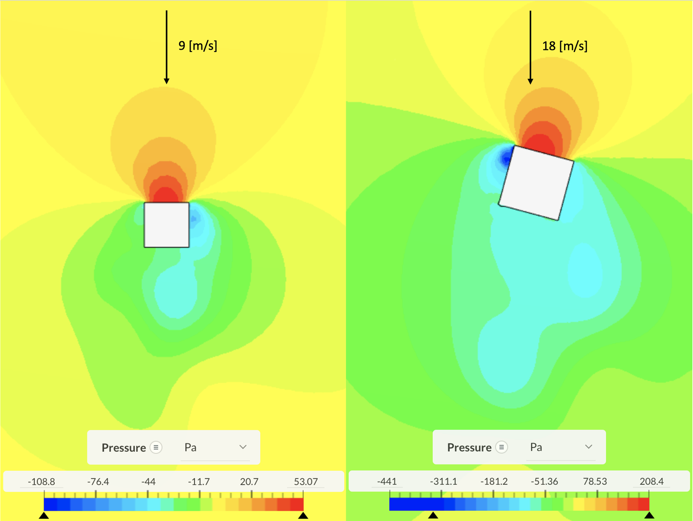
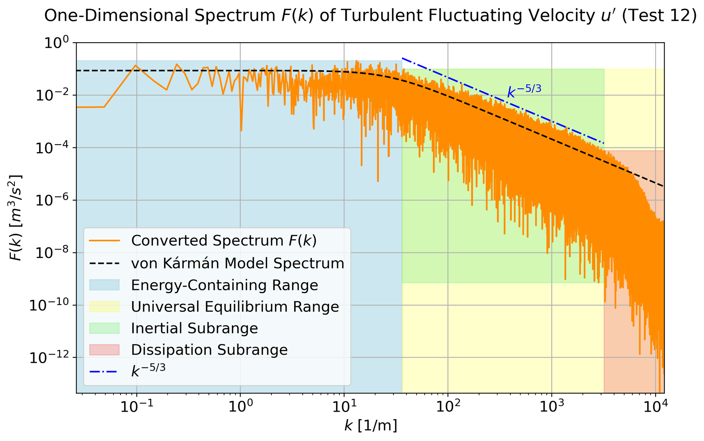
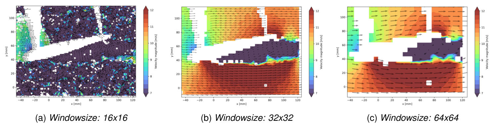
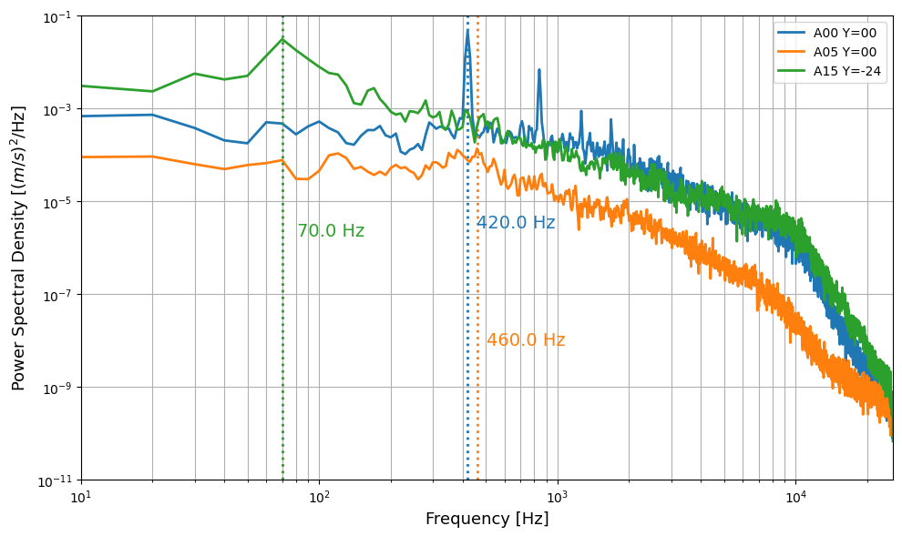
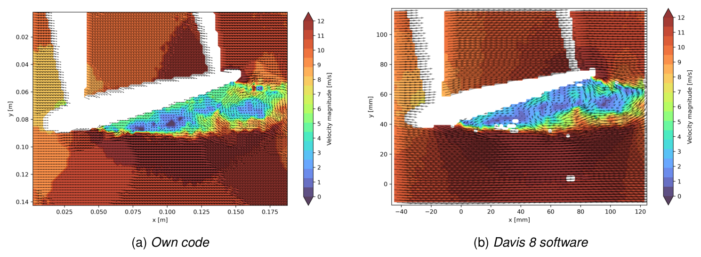
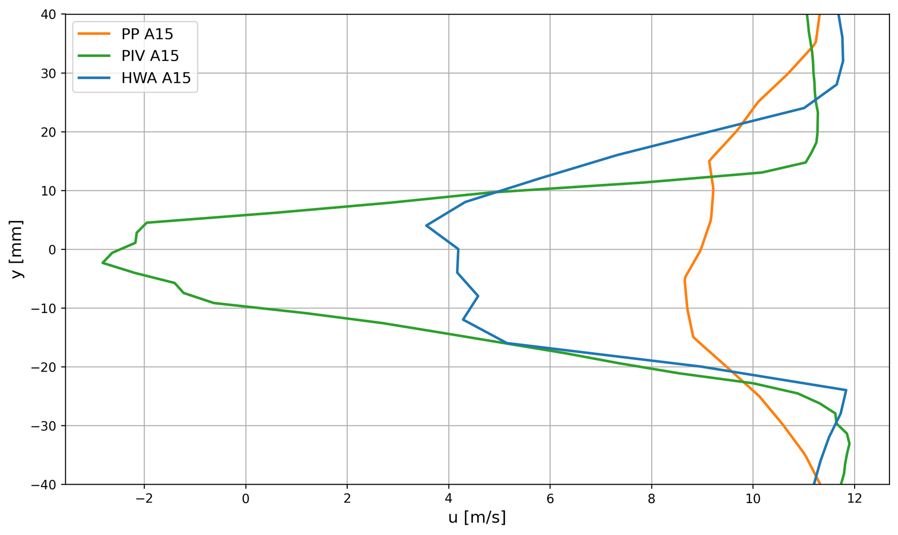

## The goal

Every flow measurement technique trades something: spatial resolution against temporal resolution, intrusiveness against simplicity, a single point against a full field. Across three closely related courses, two at DTU and one at TU Delft, the same toolbox was used on jets, bluff bodies and an airfoil. The aim was to learn what each technique can and cannot see, and to turn raw signals into physical quantities.

## My involvement

Planned and carried out the experiments, set up and calibrated the instruments, and processed and analysed the data in Python, including a self-written PIV cross-correlation code compared against the commercial DaVis software.

## The toolbox

| Technique | What it measures | Used for |
|---|---|---|
| Hot-wire anemometry (CTA) | Velocity at a point, sampled at 20–51 kHz | Jet profiles, vortex shedding, turbulence spectra |
| Particle image velocimetry | 2D velocity field, 15 Hz | Airfoil flow and wake at 0°, 5° and 15° |
| Multi-hole pressure probe | Mean 3D velocity, optically tracked | Wake surveys |
| Surface pressure taps and wake rake | Pressure coefficient, lift and drag | Square cylinder at four angles |

Techniques used across the three courses.

## Hot-wire in a free jet

A hot-wire probe was traversed through a free jet from a 100 mm nozzle. The probe was calibrated against the nozzle pressure at the start and end of the day, to check for drift. The velocity profile changed from a flat top-hat at the outlet to a bell shape 350 mm downstream, as the jet mixed with the surrounding air. With a 10 mm cylinder placed in the jet, the spectrum of the hot-wire signal at 50 kHz showed sharp peaks at **187, 374 and 748 Hz**: the vortex-shedding frequency and its harmonics. This gives a Strouhal number of **0.187**, close to the theoretical value of about 0.2.

Free-jet setup with the hot-wire probe and the 10 mm cylinder used for the vortex-shedding measurement.

Hot-wire spectrum behind the cylinder, with the shedding frequency at 187 Hz and its harmonics.

## Square cylinder in the Red Wind Tunnel

A 25 mm square cylinder with 32 pressure taps was tested in DTU's Red Wind Tunnel at angles of 0°, 15°, 30° and 45°, at Reynolds numbers of 1.5 × 10⁴ and 3 × 10⁴. A wake rake of 54 tubes measured the total pressure behind it. The pressure distribution was symmetric at 0° and 45° and asymmetric at 15° and 30°. Lift and the shedding Strouhal number both peaked at 15°, and the measured lift and drag at 0° and 15° agreed closely with CFD simulations. Results at the two Reynolds numbers were similar, as both lie in the subcritical range.

Measured pressure coefficient at the 32 taps around the square cylinder, for 0°, 15°, 30° and 45°.

CFD pressure field around the square cylinder at 0° (left) and 15° (right), used to compare with the wind tunnel measurements.

## Turbulence in a jet

A 50 kHz hot-wire record from a turbulent round jet was analysed statistically, through its correlation function and spectrally. The highest-speed case, with an exit velocity of 38.4 m/s, gave:

| Quantity | Value |
|---|---|
| Turbulence intensity | 0.24 |
| Eulerian macro / micro time scale | 2.15 ms / 0.24 ms |
| Macro / micro length scale | 27.6 mm / 3.1 mm |
| Dissipation rate | 447 m²/s³ |
| Kolmogorov length / time scale | 53 µm / 0.18 ms |

Turbulence scales of the jet at 38.4 m/s, with length scales from Taylor's frozen turbulence hypothesis.

The fluctuations followed a Gaussian distribution. The integrated spectrum matched the variance exactly, and the wavenumber spectrum showed a clear **−5/3 inertial subrange** in agreement with the von Kármán model. Across all twelve exit velocities, the ratio of the macro to the Kolmogorov scale followed the expected Re³ᐟ⁴ scaling. The Kolmogorov scale itself lies beyond what 50 kHz sampling can resolve, which shows the limit of the measurement.

Wavenumber spectrum of the turbulent jet, with the spectral ranges, the von Kármán model and the −5/3 slope.

## Three techniques on one airfoil

In the TU Delft W-tunnel, a transparent NACA 0012 airfoil (100 mm chord) was measured at 10 m/s and angles of 0°, 5° and 15° with PIV, a hot-wire and a pressure probe, so the techniques could be compared directly in the same wake.

- **PIV:** the setup was designed from first principles: a 150 mm field of view, magnification 0.048, an aperture of f/5.6 for particle images of about 2 pixels, and a pulse separation of 75 µs. Processing settings were tested systematically, and 32 × 32 px windows and 100 image pairs were chosen. The instantaneous fields showed vortex shedding at 0° and full separation at 15°.
- **Hot-wire:** a constant-temperature anemometer at an overheat ratio of 0.7, calibrated from 0 to 20 m/s with a fourth-order polynomial. The acquisition time was set from the integral time scale for 1% uncertainty in the mean. The wake spectra showed a shedding peak at **420 Hz** at 0° with harmonics up to 1680 Hz, and a −5/3 inertial subrange.
- **Pressure probe:** a seven-hole probe, tracked optically in 3D by three cameras and moved by hand through the wake.

Effect of the PIV interrogation window at 15°. 16 × 16 px is too noisy, 64 × 64 px too coarse, and 32 × 32 px was chosen.

Hot-wire spectra in the airfoil wake. At 0° the shedding peak at 420 Hz and its harmonics stand out.

A self-written PIV cross-correlation code in Python was also compared with the commercial DaVis 8 software on the same images:

Instantaneous velocity field at 15° from the self-written Python code (left) and DaVis 8 (right).

With masking of the airfoil, the own code reproduced the separated region and wake. Its remaining differences come from integer-pixel peak finding and single-pass, fixed windows, where DaVis uses sub-pixel fitting, window deformation and outlier rejection.

## Result

Comparing the techniques in the same wake showed where each is reliable. The **hot-wire** gave the most accurate mean and fluctuation profiles and the full frequency content, but only at one point at a time. **PIV** captured the whole field, but its 15 Hz frame rate limits spectra to below 7.5 Hz and its interrogation windows smooth out the sharpest peaks. The **pressure probe** was quick and simple, but its 10 mm averaging and hand-held positioning underestimated the wake deficit and missed the reverse flow at 15°. All three techniques also picked up wind tunnel blockage at 15°, with about 12 m/s outside the wake at a set speed of 10 m/s.

Wake profiles at x/c = 1.2 and 15° from the pressure probe (PP), PIV and hot-wire (HWA). Only PIV and the hot-wire resolve the deep deficit.
