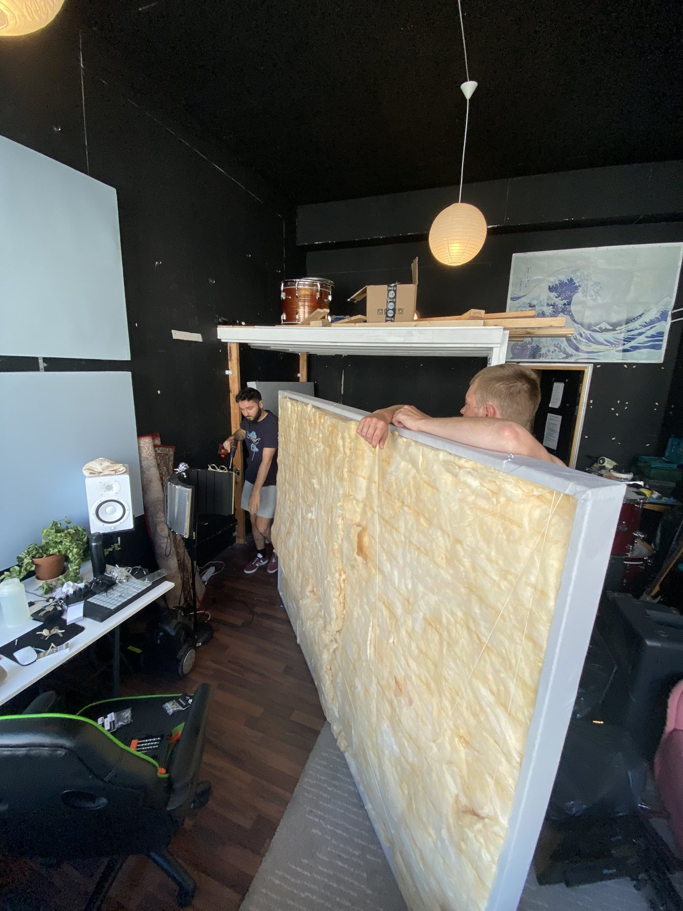
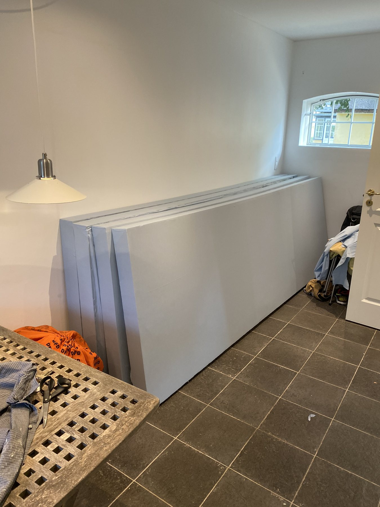
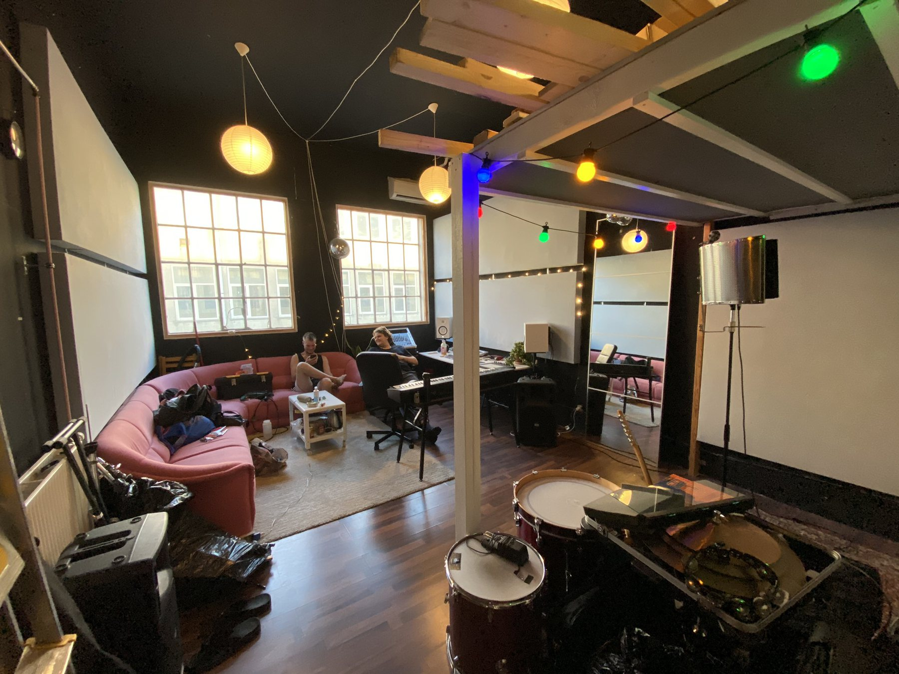
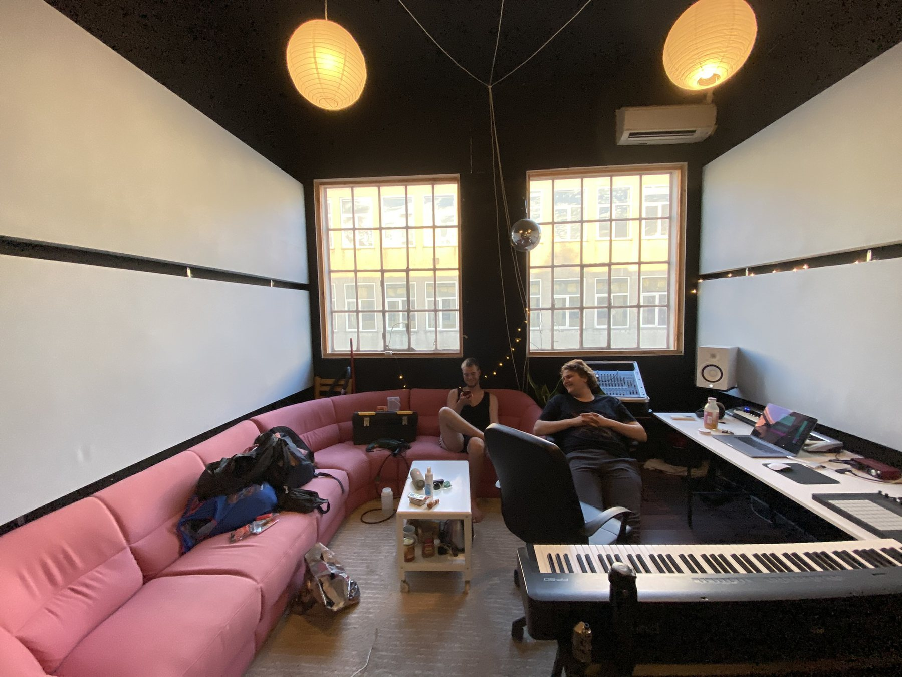
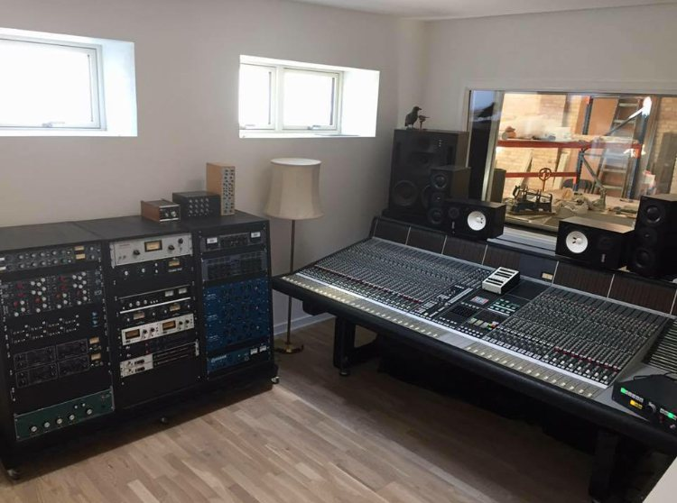
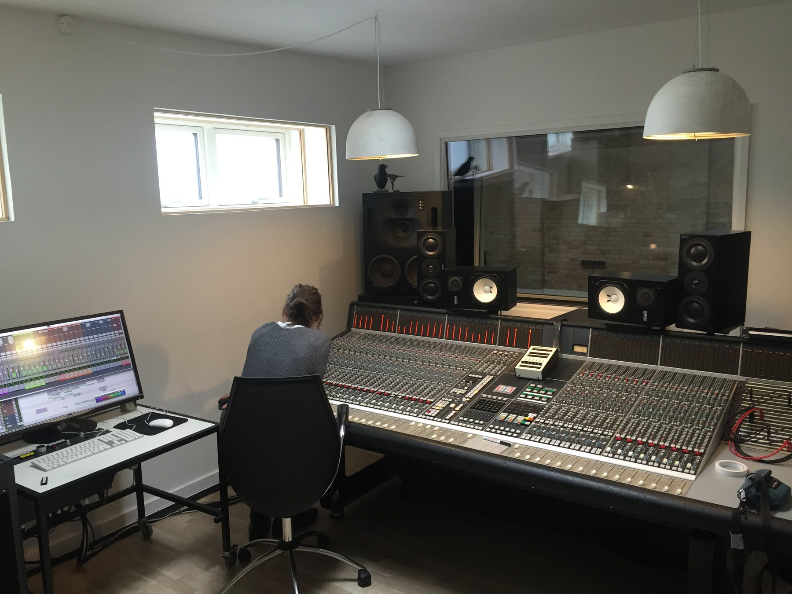
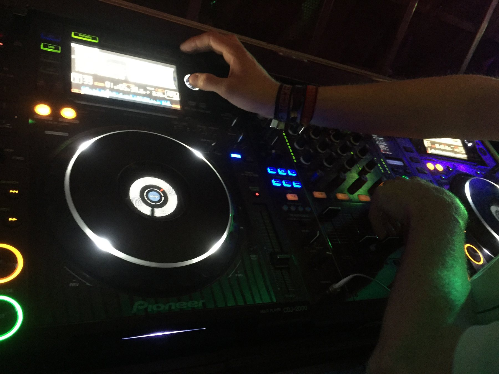
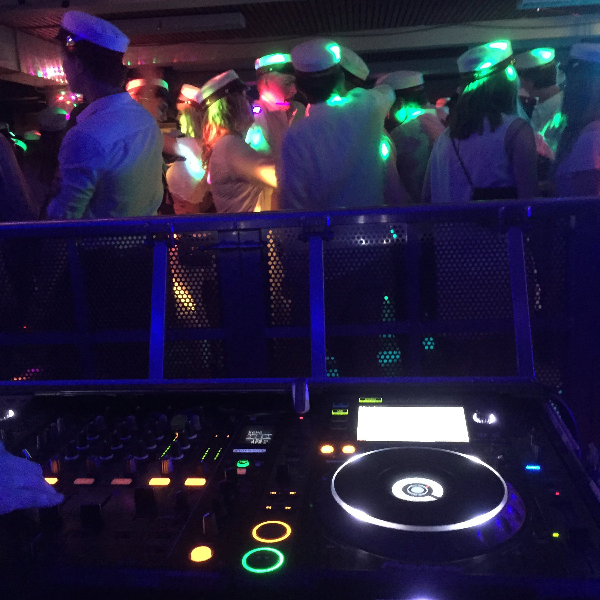

## The goal

Music is the creative side of my engineering. Producing a track, building a room that sounds right, and running sound for a crowd all come down to the same things: signal flow, acoustics, equipment that works, and an ear for the result. Over the years this has grown into four cornerstones: my own music production, building AA-studios, helping build HEYMAN Studios, and DJ'ing.

## My involvement

Producer, mixing and mastering engineer under the name HEY!AABOE, co-builder of AA-studios in Copenhagen, part of the build crew at HEYMAN Studios, and DJ since 2015.

## Music production

From 2017 to 2022 I worked as a producer under the name HEY!AABOE, producing, mixing and mastering music for multiple artists. As a producer, my name is in the credits rather than the artist list. The releases are on Spotify, several have music videos on YouTube, and together they have passed **more than three million streams**. Some of the music has been played on the Danish radio station DR P3 and used on Danish television on DR1.

## AA-studios, Copenhagen

In 2020 I co-built AA-studios in Copenhagen, turning a raw room into a working studio. That meant the acoustic treatment, with framed insulation panels and fabric-covered absorbers, and setting up the room and its equipment for recording and production. I later left the studio, which is still running.

Carrying in one of the framed insulation panels for the acoustic treatment.

The finished acoustic panels, ready to go up.

The studio taking shape, with panels on the walls and the equipment moving in.

The finished room in use.

## HEYMAN Studios

In 2017 I helped build HEYMAN Studios, a professional recording studio, working hands-on in the build crew.

The control room at HEYMAN Studios, with the outboard racks, the console and the window into the recording room.

The console in use in the control room.

## DJ'ing

I have been DJ'ing since 2015. It started with private parties and gigs, and when the [mobile PA](/projects/mobile-pa-system/) took off, I played at the events the PA was used for, such as unofficial festival parties at Roskilde. Since then I have also played at various bars, small nightclubs and private birthday parties.

On the decks.

Playing for a crowd of new graduates in their student caps.

