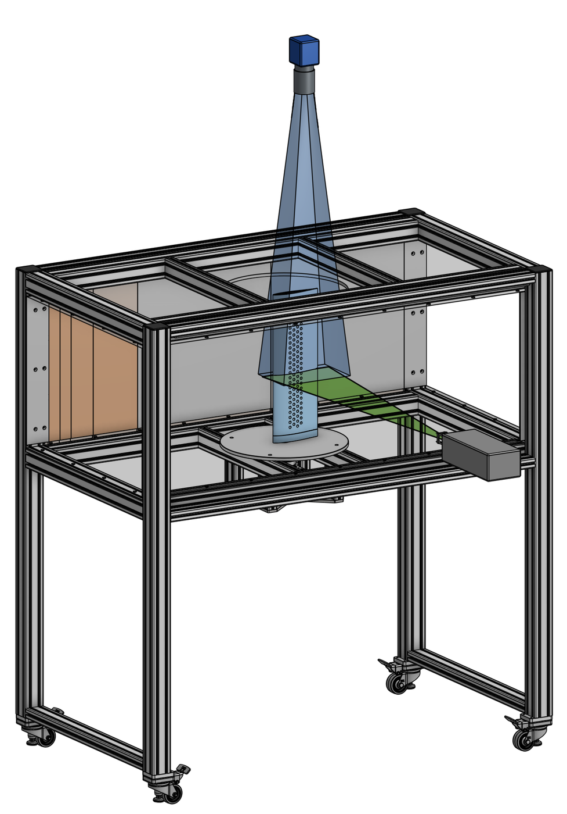
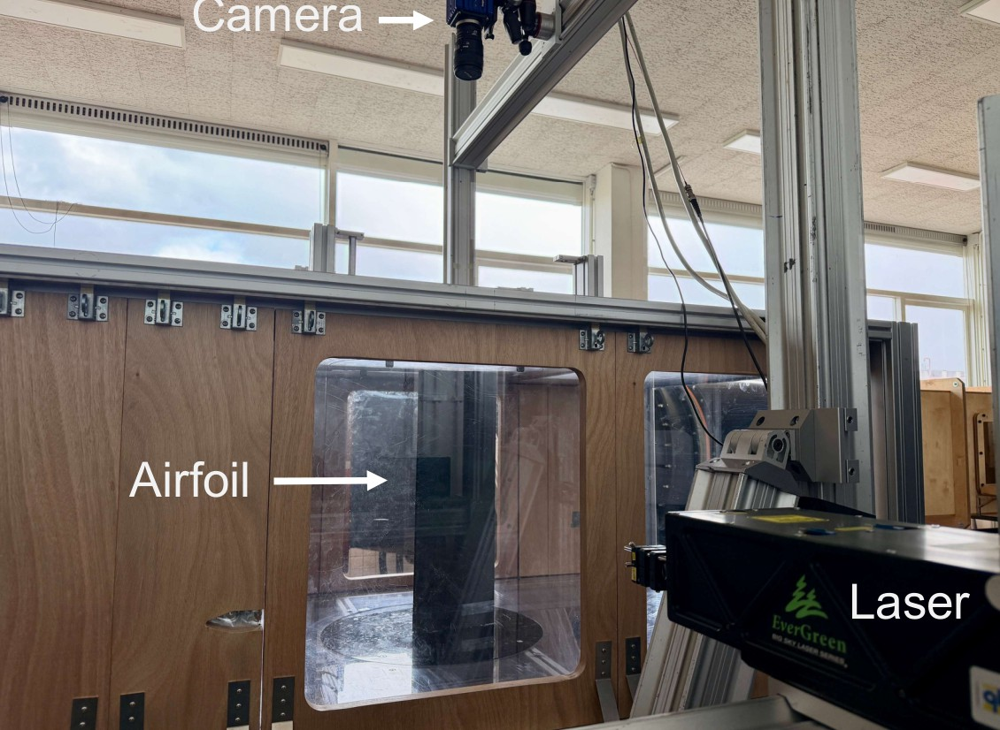
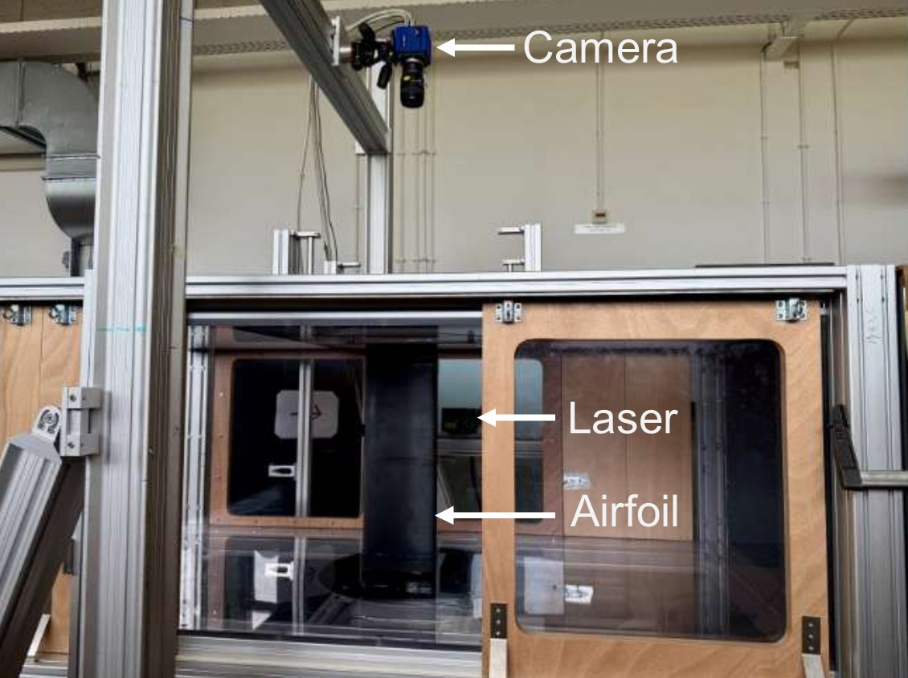
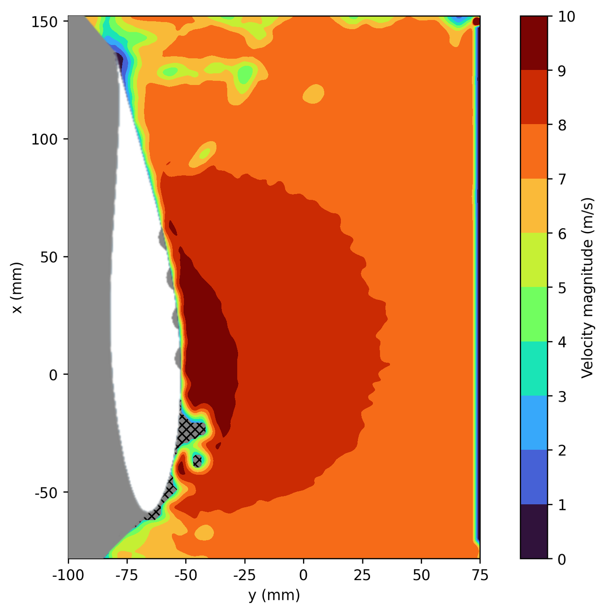

## The goal

Planning a PIV experiment is a chain of optical decisions. The field of view sets the magnification, the magnification and the lens set where the camera stands, the aperture sets how large the particles appear on the sensor, and the magnification and flow speed set the time between the two laser pulses. Change one input and everything after it moves. The goal was a tool that walks through the whole derivation, shows every equation with the actual numbers, and updates the full chain the moment any input changes, so setup options can be compared in minutes instead of by hand.

## My involvement

Built the calculator from scratch: the derivation of the optical relations, the step-by-step structure, the implementation in HTML and JavaScript, and its use to plan the PIV campaign of the MSc thesis. It was first published online alongside the thesis for others planning similar campaigns, and now lives on this page.

## The calculator

Every input can be changed, and the summary at the top always shows the current setup.

## How it was used in the MSc thesis

In the thesis, planar PIV measured the flow over the suction side of a 200 mm chord airfoil in the Small Low-Turbulence Tunnel at TU Delft, at 7.5 and 15 m/s. The calculator set up the optics for that campaign:

| Step | Value in the thesis | How it was found |
|---|---|---|
| Field of view | 300 mm | 1.5 × the 200 mm chord, to keep the near wake in the image |
| Magnification | 0.0555 | 2560 px × 6.5 µm sensor over the 300 mm field of view |
| Lens distances | ≈ 1141 mm and ≈ 63.3 mm | 60 mm Micro-Nikkor lens, thin lens equation |
| Aperture | f/8 | f/9.5 needed for 2 px particle images; f/8 chosen for more light |
| Particle image | ≈ 1.69 px | Above the 1.5 px peak-locking limit |
| Pulse separation | 124 µs and 62 µs | One-quarter rule with 32 px windows, at 7.5 and 15 m/s |

PIV setup of the MSc thesis. The 124 µs and 62 µs used in practice sit just below the calculated 125 µs and 62.5 µs.

The aperture shows why the tool shows every step rather than only a final answer. A 2 px target asks for f/9.5, so the next stop up, f/11, is the recommended choice. In the experiment, however, the laser energy and the faint scattering of the 1 µm seeding droplets at more than a metre from the lens set the real limit, so f/8 was chosen: about twice the light, for particle images of about 1.69 px, still above the 1.5 px limit where peak-locking bias sets in. The calculator shows the same trade-off when f/8 is selected.

CAD of the thesis PIV setup: the green laser sheet across the suction side at mid-span, and the camera (blue) above the test section, about 1.1 m from the measurement plane.

The setup in the tunnel: the sCMOS camera with the 60 mm lens above the test section, and the Nd:YAG laser beside it.

The airfoil in the test section, with the laser sheet at mid-span and the camera looking down from above.

One of the resulting velocity fields: a dimpled airfoil at 4° and 7.5 m/s. See the [MSc thesis](/projects/adaptive-airfoil-flow-control/) for the results.

