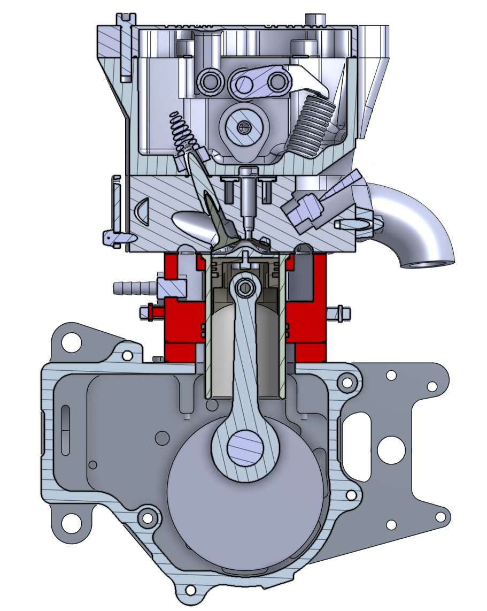
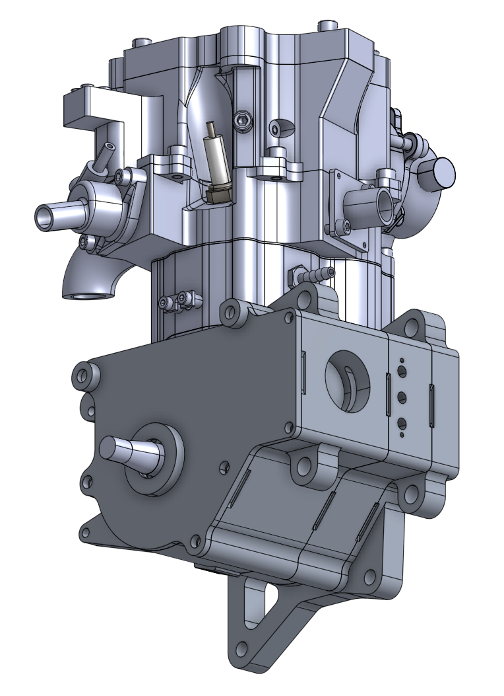
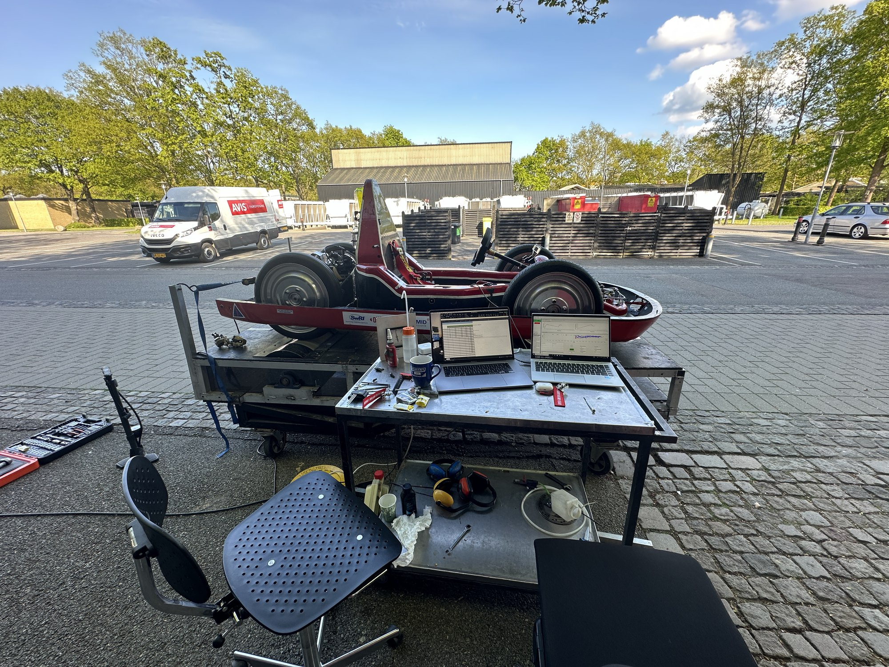
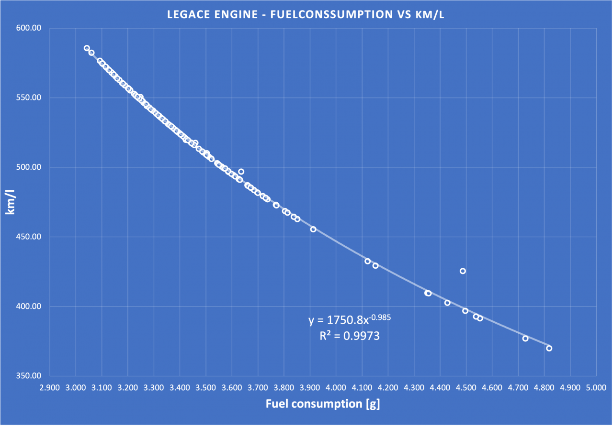
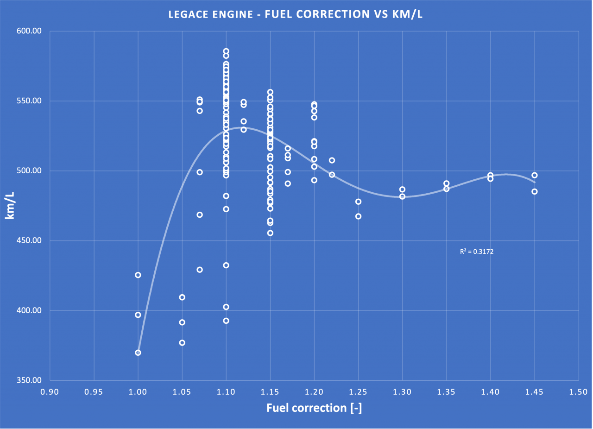
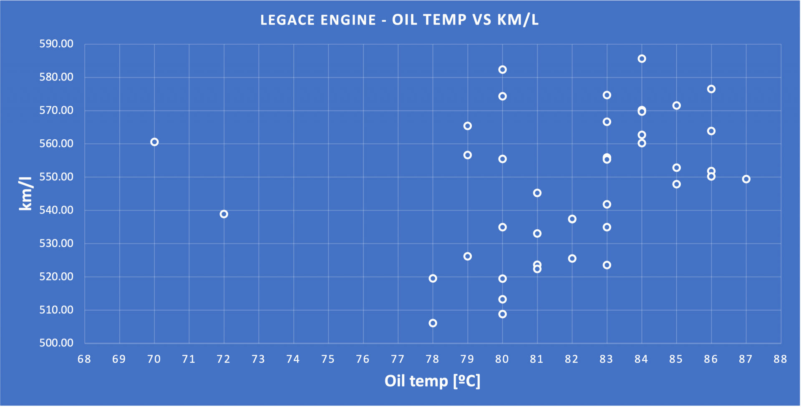
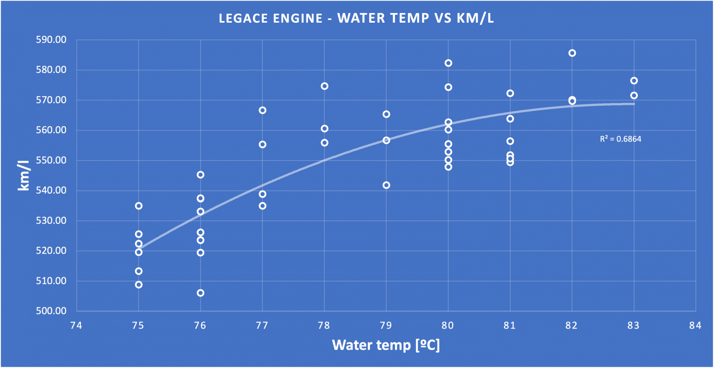
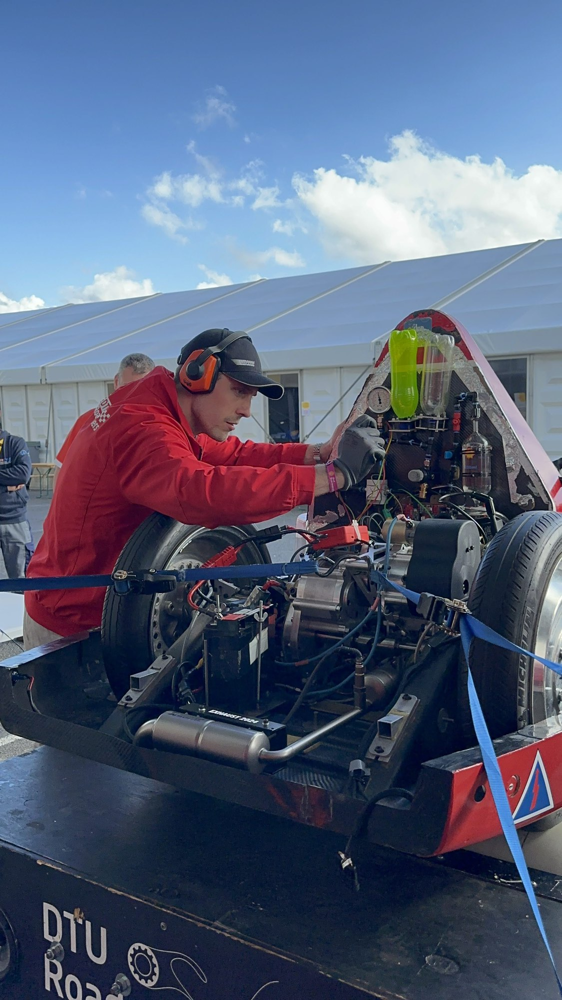
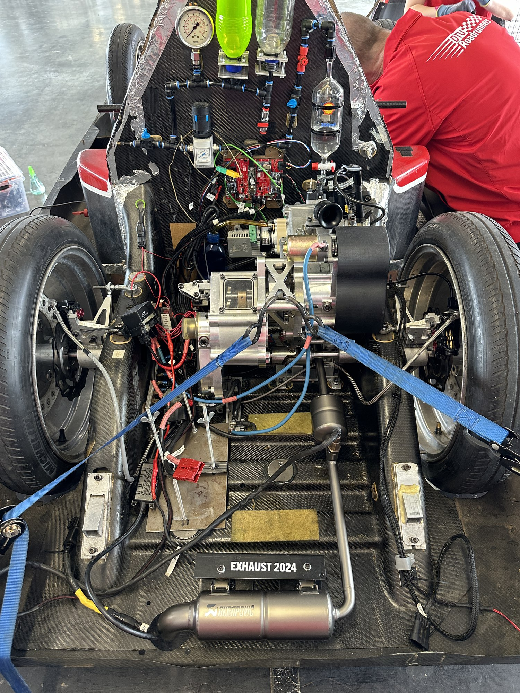

## The goal

At the Shell Eco-marathon, student teams compete to drive the furthest on the least energy. The DTU RoadRunners EcoCar competes in the Urban Concept ICE category, powered by the Legacy engine, a single-cylinder engine developed at DTU. The engine was already built, so the goal of this work was to get the highest possible mileage out of it through testing, calibration and tuning.

## My involvement

Team lead for engine and combustion efficiency: responsible for engine assembly and servicing, engine and chassis dynamometer testing, ECU calibration of injection and ignition, analysis of the test data, and preparing the engine for competition.

## The Legacy engine

The Legacy engine was designed at DTU specifically for the EcoCar. Its condition, combustion, cooling and control all affect the mileage, so the engine was kept as a measured and maintained system: assembled, serviced and checked before each test campaign.

Section view of the Legacy engine in CAD.

The complete Legacy engine in CAD.

## Testing on the dynamometers

The engine was tested on a dynamic engine test stand, where a servomotor simulates the car's air and rolling resistance, so each run reproduces a drive at the engine shaft. A PID controller holds the cooling water temperature, and the ECU and data-logging software record each run. Alongside the stand, the complete car was tested on a chassis dynamometer.

The EcoCar on its stand during test work outdoors.

In the autumn 2023 test programme, the mileage was measured against the ECU fuel correction, the fuel consumption, and the oil and water temperatures. The results spread widely, from about 370 km/l to about 585 km/l, which showed how much mileage depends on calibration and operating conditions:

Mileage against fuel used per run, from about 3.05 g (≈ 585 km/l) to about 4.8 g (≈ 370 km/l).

Mileage against ECU fuel correction. The best runs reached about 585 km/l at a correction of 1.10, against 370–425 km/l at 1.00.

Mileage against oil temperature, with no clear trend.

Mileage against cooling water temperature. The trend rises from about 520 km/l at 75 °C to about 570 km/l at 82–83 °C.

The fuel correction had the largest effect: too little fuel cut the mileage sharply, while the trend flattened out at higher corrections. A warmer engine also ran more efficiently, while the oil temperature showed no clear trend. These results set the targets for the ECU calibration of injection and ignition.

## Competition

At the Shell Eco-marathon, the tuned engine had to run reliably in the car through scrutineering and every attempt, with checks and adjustments in the paddock between runs.

Work on the engine in the paddock at the 2024 competition.

The EcoCar's engine bay at the 2024 competition.

## Result

DTU RoadRunners won **1st place in the EU Urban Concept ICE category at the Shell Eco-marathon in both 2024 and 2025**, with **413.83 km/l** and **517.5 km/l**. The 2024 event was attended in person. In 2025, during the MSc at TU Delft, the work on the car continued before and after the event, and the engine and calibration work from 2024 carried over into the 2025 car.
