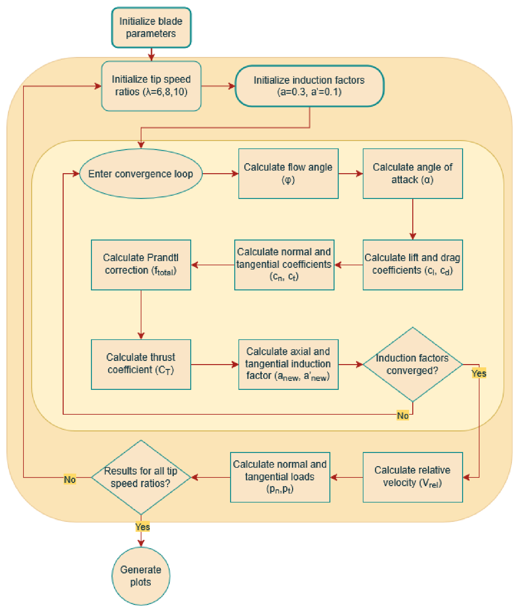
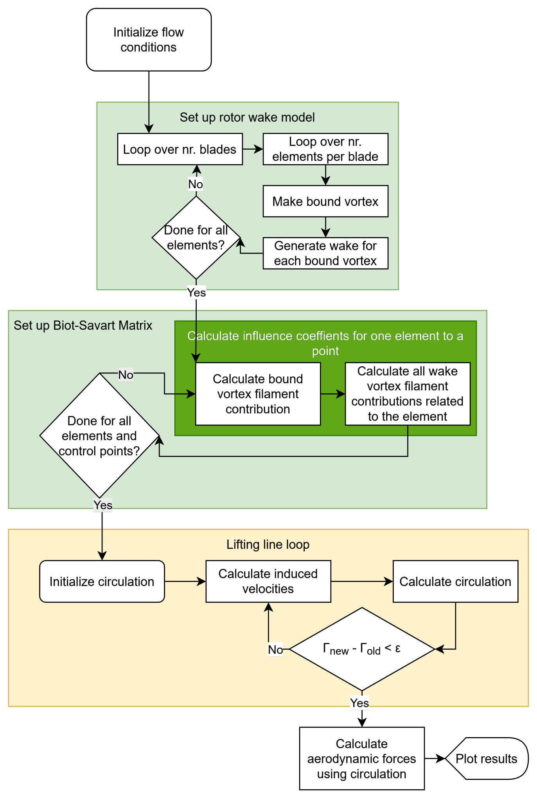

## The goal

Blade Element Momentum (BEM) theory is the industry workhorse for rotor design, and lifting-line methods add a physical model of the wake that BEM only approximates. This project built both from the ground up in Python: a BEM code in the DTU course Wind Turbine Technology and Aerodynamics (46300), then a further BEM code and a lifting-line code in the TU Delft course Rotor & Wake Aerodynamics (AE4135). The TU Delft codes were applied to the same wind turbine rotor at tip-speed ratios of 6, 8 and 10, so the two methods could be compared directly.

## My involvement

Developed the BEM codes, including the Prandtl tip and root corrections and the yawed-rotor model, and the lifting-line code with its frozen vortex wake and Biot–Savart induction, and carried out the discretisation and convergence studies and the comparison between the two methods.

## Part 1: Blade Element Momentum

### Code structure

Structure of the BEM code (report, Figure 1). Click to enlarge.

The BEM code splits the rotor into annuli. For each blade element, it starts from initial induction factors (a = 0.3, a′ = 0.1) and iterates: flow angle, angle of attack, lift and drag from the airfoil polar, normal and tangential force coefficients, the Prandtl correction, and new induction factors, until they converge. The converged element gives the relative velocity and the normal and tangential loads, and the whole sweep is repeated for tip-speed ratios of 6, 8 and 10. As the tip-speed ratio rises, thrust increases and torque falls, while power still increases with the higher rotational speed.

### Tip and root corrections

A finite number of blades sheds tip and root vortices that momentum theory does not capture, so Prandtl tip and root loss factors were added:

| Tip-speed ratio | Change in thrust | Change in torque |
|---|---|---|
| 6 | −1.7% | −4.2% |
| 8 | −2.7% | −6.8% |
| 10 | −3.0% | −7.3% |

Effect of the Prandtl tip and root corrections on total thrust and torque.

Without the corrections, the loads are overestimated, most strongly the torque, because the tip region has the longest lever arm.

### Yawed inflow

The code was extended to **yawed inflow** with a skewed-wake correction. The averaged induction is solved first, then distributed around the rotor disk with the skew correction, giving angle of attack, induction and loading at every radial and azimuthal position. Yaw makes the induction and loading increasingly asymmetric and lowers the loading, especially on the inner part of the blade. The 30° case did not converge, so results are shown up to 25°.

### Discretisation

With **cosine spacing**, the annuli get finer towards the tip, where the loading is highest. The total thrust was then within 1% of the 100-annulus result with only 10 annuli, while constant spacing needed at least 50. At 100 annuli, the converged thrust with constant spacing was about 1% higher, which makes it the more conservative choice for structural loads.

## Part 2: Lifting line

### Code structure

Structure of the lifting-line code (report, Figure 1). Click to enlarge.

The lifting-line code represents each blade element as a bound vortex at the quarter chord, with trailing vortices shed into a helical **frozen wake**. The code first builds the wake for every bound vortex on every blade. It then fills an influence matrix with the velocity that each bound and wake vortex filament induces at each control point, using the Biot–Savart law. Because this is done only once, the circulation loop itself is fast: induced velocities, new circulation and a convergence check, with relaxation for stability, before the loads are computed from the final circulation.

### Frozen wake

The wake convects at a constant speed based on the mean axial induction from the BEM results. Varying that induction by ±5% changed the thrust coefficient by less than 0.5%, so the results are not very sensitive to this assumption.

### Discretisation

The wake was discretised into segments per rotation and cut off after a number of rotations, and both were tested for convergence:

| Wake segments per rotation | TSR 6 | TSR 8 | TSR 10 |
|---|---|---|---|
| 1 | −3.0% | +22.5% | +34.5% |
| 2 | −17.8% | +1.5% | +12.2% |
| 4 | −2.1% | +0.4% | +2.8% |
| 10 | −0.6% | −0.4% | 0.0% |
| 20 | −0.2% | −0.2% | −0.1% |

Deviation of the lifting-line total thrust from the result with 50 wake segments per rotation.

The wake length also mattered: at tip-speed ratios 8 and 10, five to six wake rotations were needed to get within 1% of the result with ten rotations. Along the blade, cosine spacing again captured the steep loading at the root and tip with fewer elements. With 24 elements, it gave 2.3–2.9% more thrust than constant spacing, which needed about twice as many elements for the same accuracy.

## Comparing the two methods

| Tip-speed ratio | CT (LL / BEM) | ΔCT | CP (LL / BEM) | ΔCP |
|---|---|---|---|---|
| 6 | 0.463 / 0.482 | −3.9% | 0.349 / 0.358 | −2.5% |
| 8 | 0.632 / 0.645 | −2.0% | 0.447 / 0.439 | +1.8% |
| 10 | 0.757 / 0.753 | +0.5% | 0.478 / 0.449 | +6.5% |

Thrust and power coefficients from the lifting-line (LL) and BEM codes, read from the report's coefficient plot. Δ is the lifting-line value relative to BEM.

- **Angle of attack:** along the middle of the blade, the two methods agreed closely, for example 5.5–6.0° at a tip-speed ratio of 8. Near the root, the lifting-line code predicted angles several degrees higher, up to about 26° at a tip-speed ratio of 6.
- **Circulation:** at tip-speed ratio 6, the circulation has a single broad peak at mid-span. At 8 and 10, it develops a double peak, with the outer peak moving towards the tip as the rotor spins faster.
- **Operating point:** the power coefficient was highest at a tip-speed ratio of 10. Running at 8 instead reduces the thrust more than the power, which lowers fatigue loads and can increase the energy produced over the turbine's life.
- **Energy extraction:** the stagnation pressure upstream and downstream of the rotor confirms where the rotor takes energy from the flow, and how much remains in the wake.

## Result

The lifting-line and BEM codes agreed on the thrust coefficient to within 4% and on the power coefficient to within 7% across all three tip-speed ratios, and agreed closely on the loading along most of the blade. The largest differences were near the root, where the lifting-line wake used a single, uniform induction factor. The work showed where each method is reliable, and how much resolution each needs for converged results.
