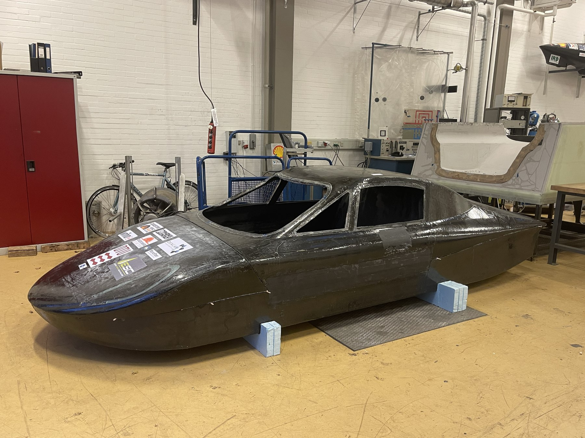
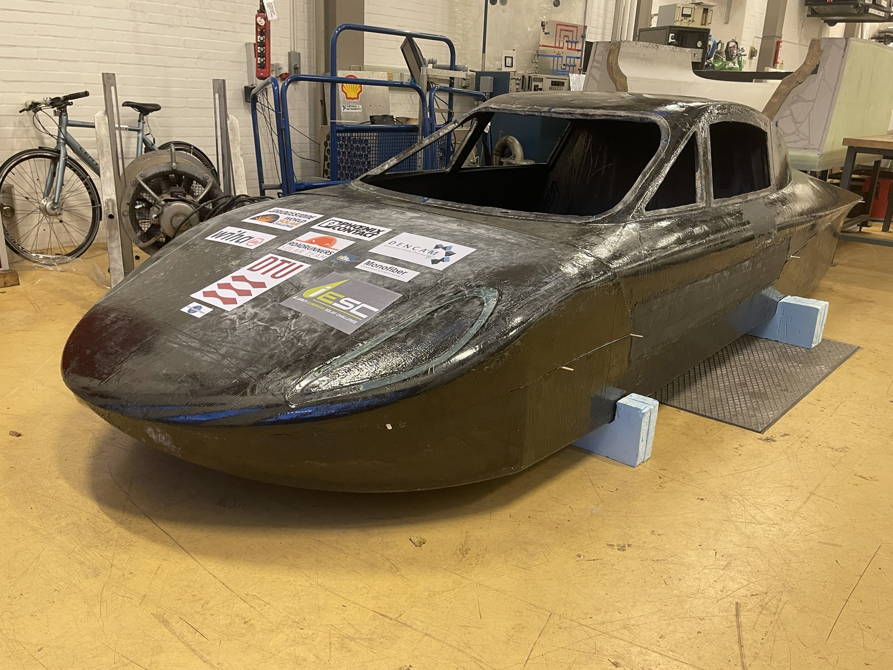
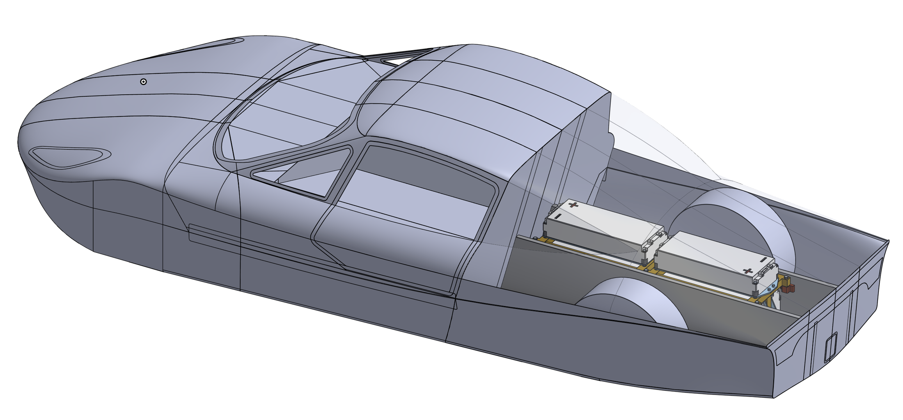
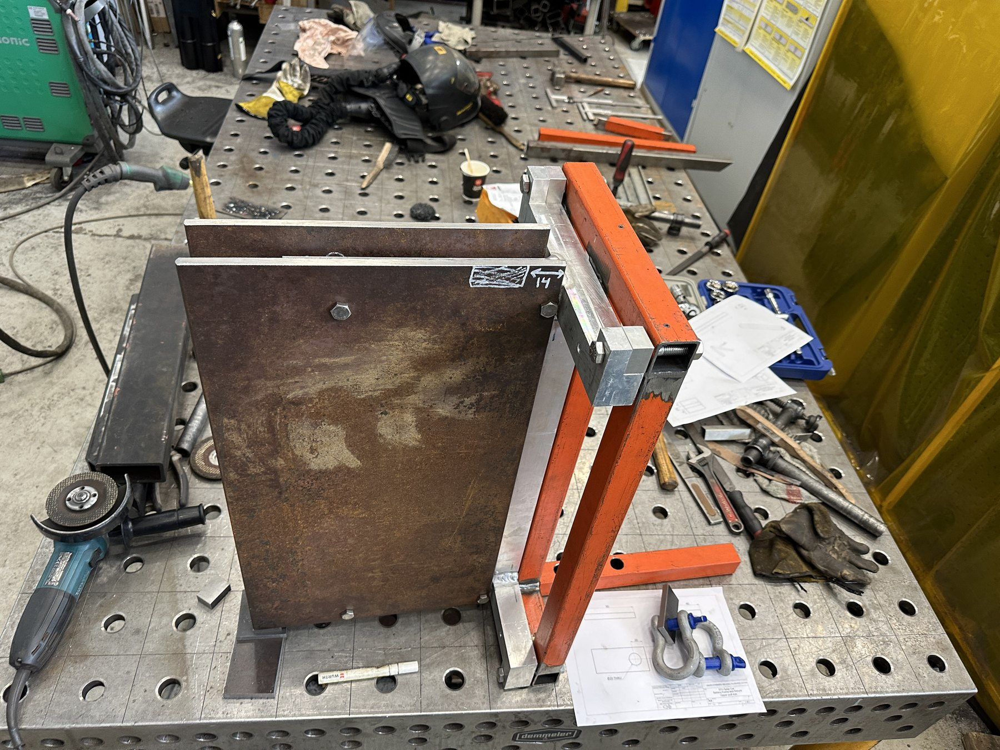
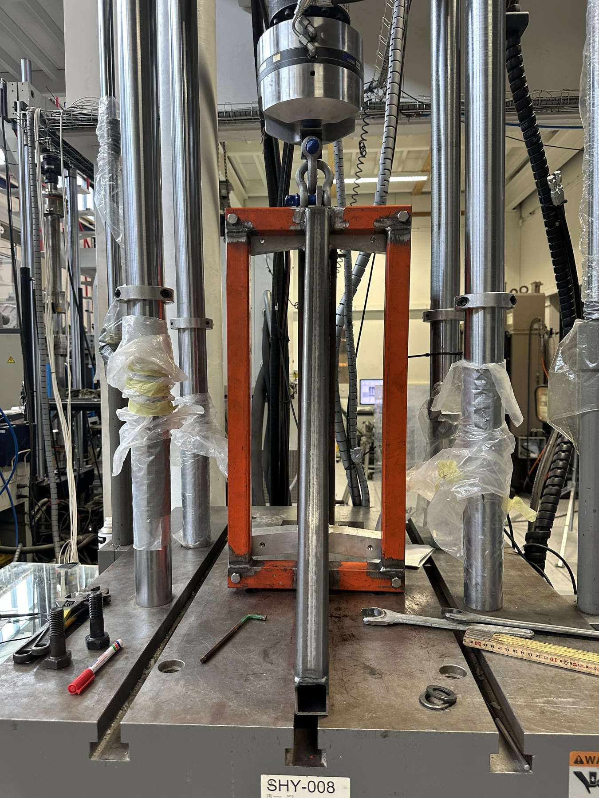

## The goal

The battery frame has to hold the solar car's battery modules securely, protect them in a collision and carry their cooling plates, while keeping the car light and stable. This project developed the frame for the DTU RoadRunners solar car, from requirements to a manufactured and strength-tested part.

The body of the DTU RoadRunners solar car in the workshop.

The same car from the front.

## My involvement

Responsible for the full development of the battery frame: the structural requirements and material selection, the CAD design and production drawings in Onshape, the integration of the cooling plates and testing of the cooling, and the strength testing of the manufactured frame.

## Requirements

The design was driven by the Bridgestone World Solar Challenge (BWSC) 2023 regulations:

| Requirement | Value |
|---|---|
| Crash load (BWSC 2023, §2.5.13) | 20 G in any direction |
| Mass per frame with modules and cooling plates | 100 kg |
| Required load per frame | 20 kN |
| Battery modules | 6 × VW ID.3 LGX E78 |
| Access | Batteries accessible for scrutineering |

Design requirements for the battery frame. The 20 kN follows from 100 kg at 20 G.

## Design

The main objective was to keep the **centre of gravity as low as possible**, which was given priority over weight distribution. The result is a long, low battery pack, with some modules sitting outside the wheelbase. The pack is split into **two identical frames of three modules**. This makes it modular: one frame can be removed for events such as the iLumen Solar Challenge, which need less battery capacity. Each frame measures 320 × 310 × 667 mm and holds its modules and cooling plates in one structure.

The battery bank integrated in the solar car. The long, low layout keeps the centre of gravity down.

## Cooling

Each module is cooled by a liquid cooling plate mounted in the frame, six plates in total. To verify the plates, a test loop with an off-the-shelf pump and hoses was assembled, which confirmed that the cooling system worked for the battery modules.

## Manufacturing and strength testing

The frame was made from **aluminium 6061**, chosen for its cost and its good heat treatment after welding, and was machined and welded in the DTU workshops from the production drawings. A full crash test was not practical, so the frame was instead bolted to a test bench and pulled along the car's driving direction in a displacement test, which simulates a head-on collision as a slow, steady load. The second test reached about **60 kN**, three times the 20 kN requirement, at 50 mm displacement, with visible bending in parts of the frame afterwards.

The test rig being built on the welding table.

The frame mounted in the rig in the hydraulic test machine.

## Outcome

In testing, the frame carried three times the load required by the BWSC 2023 regulations. In June 2024, however, the BWSC 2025 regulations changed the Cruiser class so that the chosen battery modules were no longer allowed. As the frame was sized for these modules, the work was paused until new modules were selected.
