## The goal

Every watt matters on a solar car, and side-view mirrors stick out from an otherwise smooth body into the airflow. For the DTU RoadRunners solar car, built for the Bridgestone World Solar Challenge and the iLumen European Solar Challenge, this project replaced the conventional mirror with a **camera in an aerodynamic housing**. The aim was the lowest possible drag while still meeting the rear-vision rules of the competitions and the UNECE regulations for road-legal vehicles.

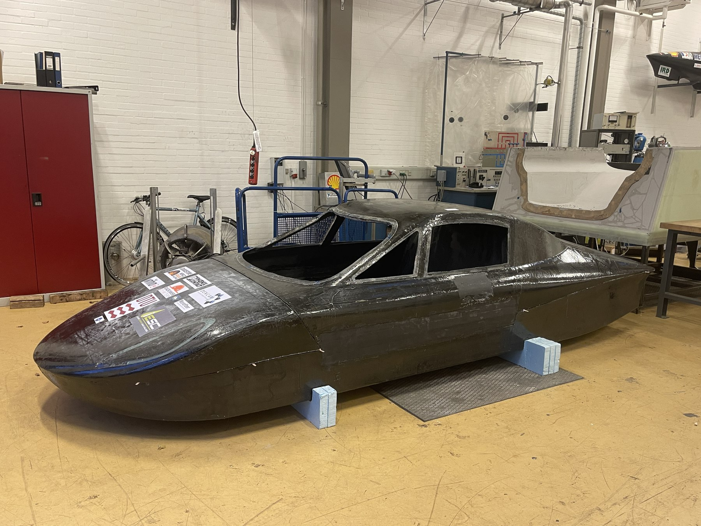

The body of the DTU RoadRunners solar car in the workshop.

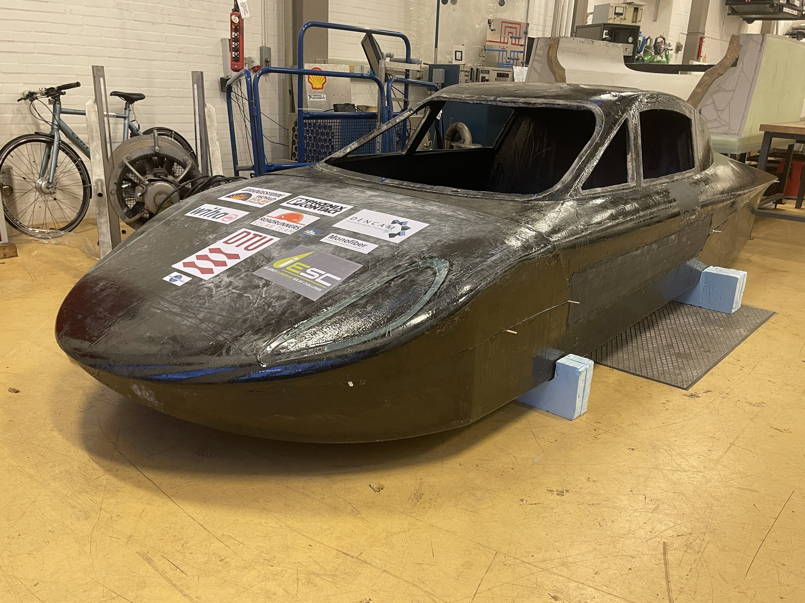

The same car from the front.

## My involvement

Carried out the project individually: the regulation study, the camera and housing design, Python tools for profile generation and CFD set-up, the CFD study, two wind tunnel campaigns with 3D-printed models, and the design, manufacturing and assembly of the working prototype.

## Requirements and constraints

The design space was set by regulations and hardware before any aerodynamics:

| Constraint | Source | Design consequence |
|---|---|---|
| Rear field of view | BWSC §2.18, UNECE R46 §15 | 20° camera field of view |
| Camera board 38 × 38 mm | Arducam IMX290 | 64 mm outer housing diameter |
| Replaceable lens guard, 34.5 mm | Insta360 lens | 42 mm opening at the rear |
| Rounded edges | UNECE R46 §6.2.2.1.1, R26 | 2.5 mm minimum edge radius |

Requirements and how they shaped the housing.

With the 64 mm diameter fixed, the shape was taken from the symmetric **NACA 4-digit** airfoils. A Python generator built ten profiles from NACA0020 to NACA0065, all 64 mm thick, so only the length changed, and checked that the camera and lens fit inside each one.

## CFD: finding the best profile length

All ten profiles were simulated in SimScale with the k–ω SST turbulence model, at the solar car's cruising speed of 80 km/h. The domain matched the test section of DTU's Red Wind Tunnel, halved with a symmetry plane. The first cell height was calculated in Python for y+ between 1 and 10, and a mesh study set the mesh at 2.5 million cells.

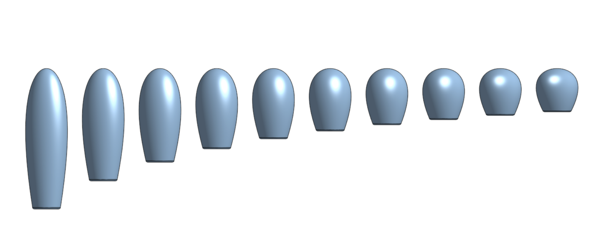

CAD models of the ten NACA profiles simulated in CFD, from NACA0020 (left) to NACA0065 (right).

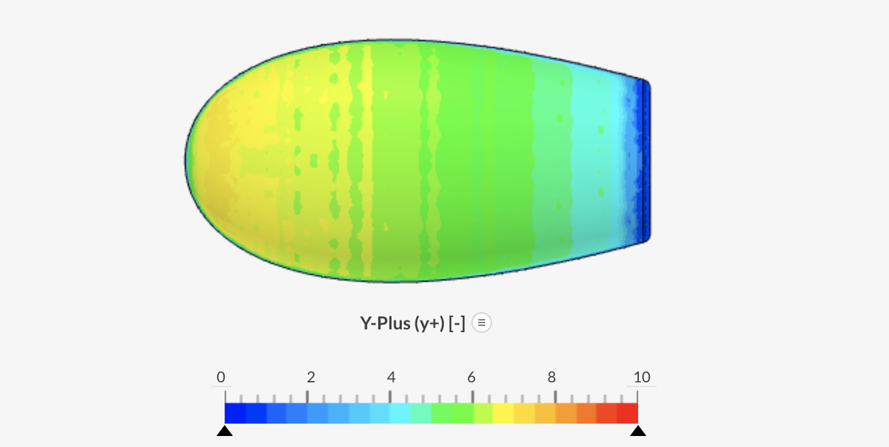

Surface y+ on the NACA0035 housing, within the target range for k–ω SST.

Combining the CFD pressure drag with theoretical skin friction showed a clear optimum in length, but six profiles from NACA0035 to NACA0060 were too close to separate reliably with CFD alone.

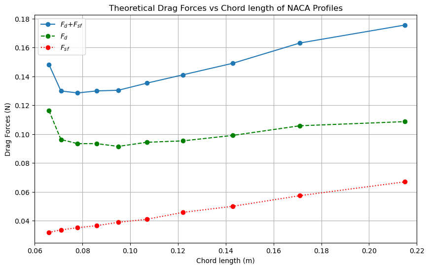

Skin friction drag (red), pressure drag (green) and total drag (blue) against profile length at 80 km/h.

## Wind tunnel test 1: profile length

Five profiles (NACA0025, 0035, 0045, 0055 and 0065) were 3D-printed and tested in the Red Wind Tunnel at five speeds, for Reynolds numbers from 60,000 to 120,000. Drag was measured in two independent ways: from the **momentum deficit** measured by a wake rake, and directly with a **force gauge**, with the drag of the mounting rod measured separately and subtracted.

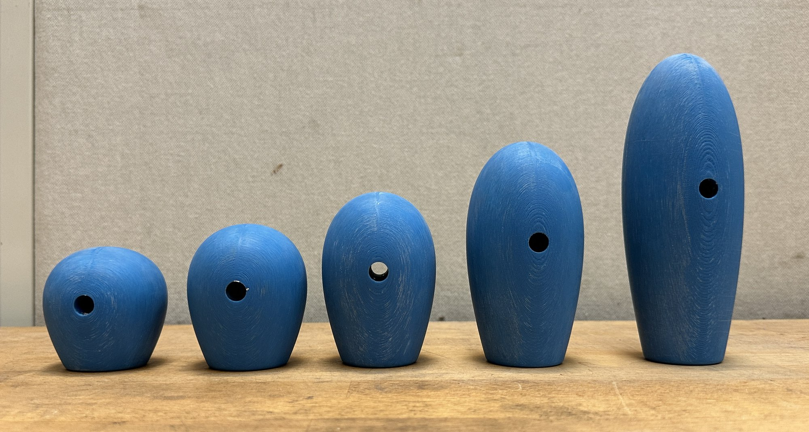

The five 3D-printed test models, from NACA0025 (left) to NACA0065 (right).

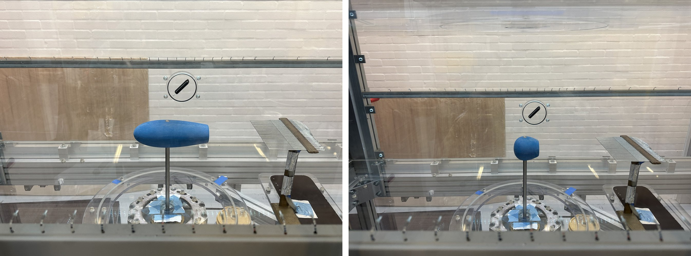

NACA0025 (left) and NACA0065 (right) mounted in the Red Wind Tunnel, with the wake rake downstream for the wake deficit measurement.

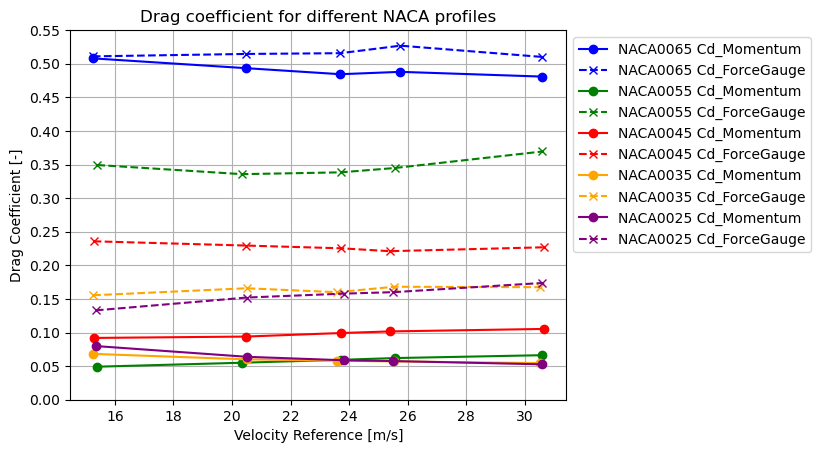

Drag coefficients from the wake rake (momentum) and force gauge for the five profiles.

NACA0025 and NACA0035 performed best with both methods. **NACA0035** was chosen, since it was also among the best in CFD.

## Wind tunnel test 2: mounting the mirror

The arm attaches the housing near the car's A-pillar, and its angle changes how air flows between the mirror and the body. To measure this, a NACA0035 model was printed with **32 pressure taps**, each a 1 mm micro-tube connected by silicone tubing to the pressure measurement system. A 90 × 20 cm section of the car's body around the A-pillar was 3D-printed, so the flow between mirror and body matched the real car.

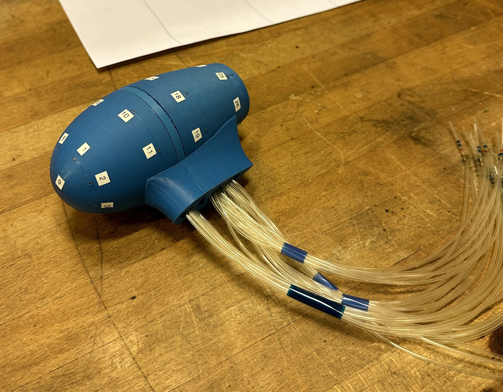

Pressure-tap model with 32 taps and their silicone tubing. The white numbered stickers were removed before any wind tunnel testing.

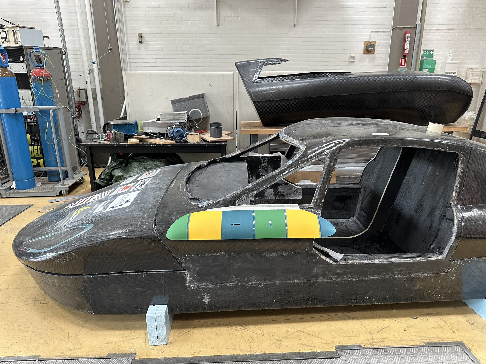

The 3D-printed body section placed on the A-pillar of the solar car.

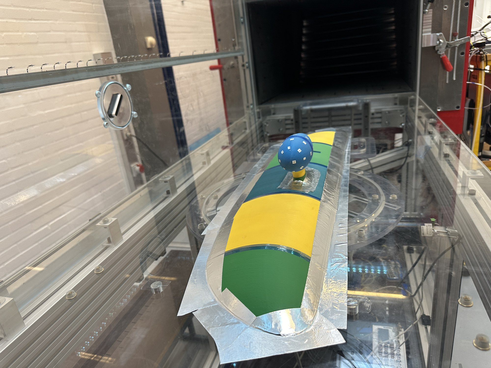

The model on the 0° arm and body panel in the Red Wind Tunnel. The white numbered stickers were removed before any wind tunnel testing.

Two arms were tested: a straight 0° arm, as short as possible, and an arm with a 45° bend that brings the housing closer to the body. The same configurations were simulated in CFD with virtual taps at the same positions:

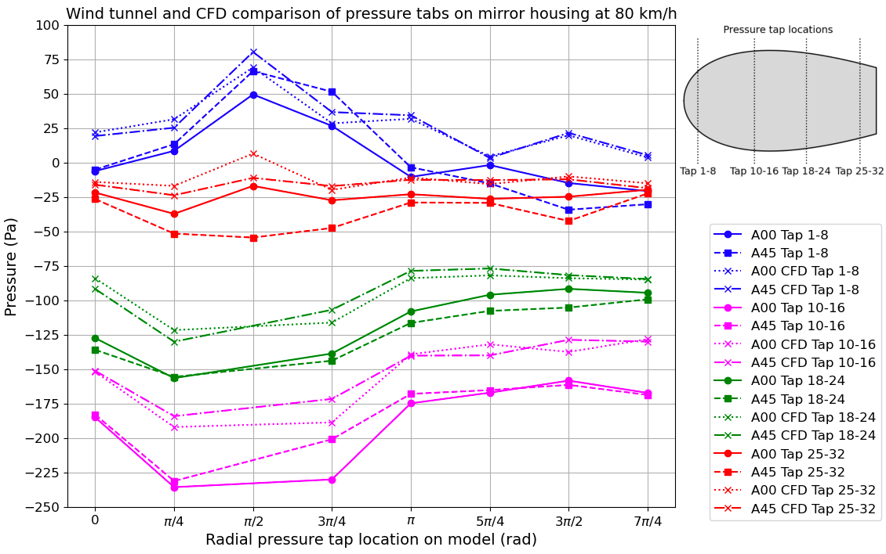

Measured and simulated surface pressure at every tap for both arms.

| Arm | Frontal area | Mean ΔCp, CFD against tunnel | Drag coefficient (CFD) |
|---|---|---|---|
| **0° arm** | **3,717 mm²** | **0.076** | **0.173** |
| 45° arm | 4,087 mm² | 0.096 | 0.192 |

Comparison of the two arm configurations.

The CFD followed the measured pressure distribution closely, with a mean difference in Cp of 0.076 for the 0° arm. The 45° arm built up more pressure between mirror and body and had a larger frontal area, so the **0° arm** was selected.

## Final design and prototype

The final housing holds the camera on four standoffs, with room for cable routing behind its board, and the lens at the rear inside the 20° field-of-view cone. The arm uses the same NACA0035 shape, with internal channels for the cables.

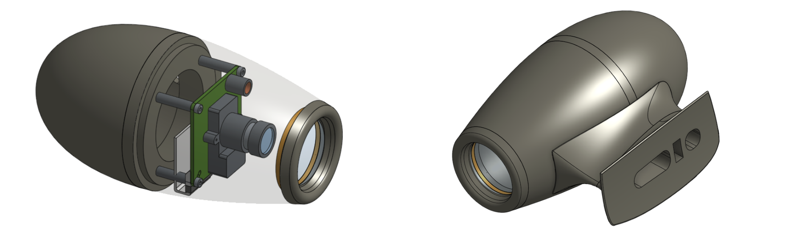

CAD model of the housing with the camera and lens integrated (left), and the full assembly on the 0° arm with cable-routing channels at the end of the arm (right).

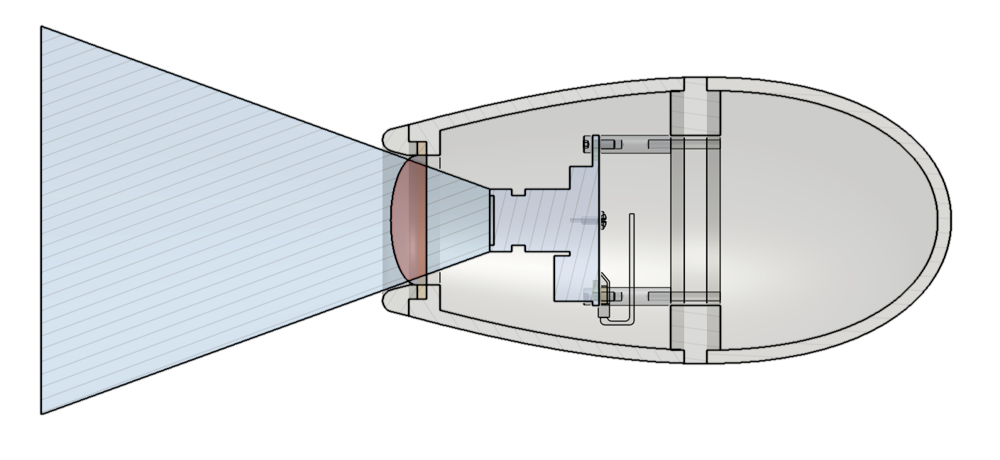

Cross-section of the final design. The blue cone shows the 20° field of view.

All parts were 3D-printed in PLA and assembled with the camera, which is controlled by a Raspberry Pi and shows its image on the same type of monitor used in the car.

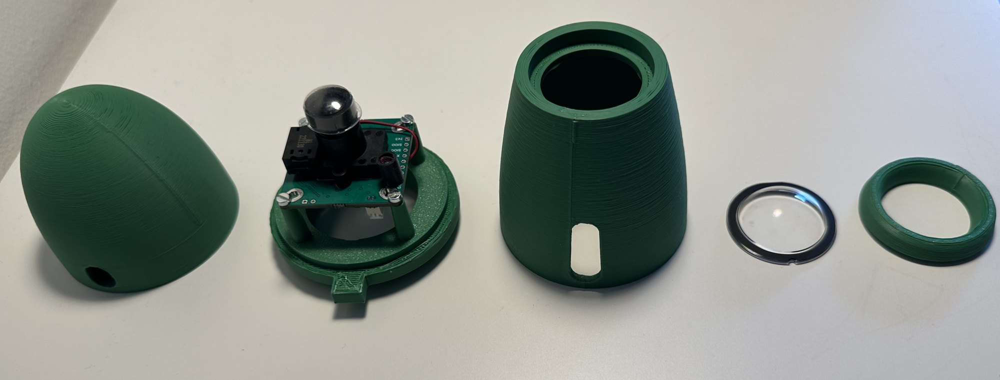

The manufactured parts, with the camera mounted on its four standoffs.

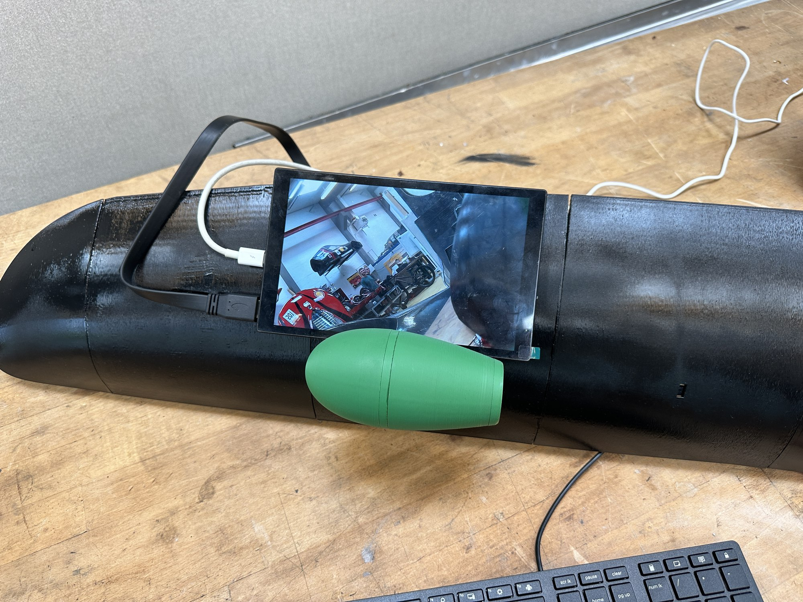

The complete prototype on the body panel, with the live camera image on the monitor.

## Result

The camera mirror reached a drag coefficient of **0.173**, less than half of the 0.48 estimated for the best conventional mirror developed for the car, while meeting the BWSC and UNECE visibility and safety rules. CFD and two independent wind tunnel methods agreed on the design, and the pressure measurements validated the CFD around the full mirror and arm. Integration on the car required changes to its carbon chassis, so the next steps were a carbon-fibre-reinforced version of the housing and road testing on the vehicle.

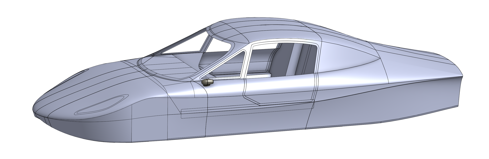

Side view of the full CAD model of the solar car, with the camera mirror on its 0° arm attached at the A-pillar.
