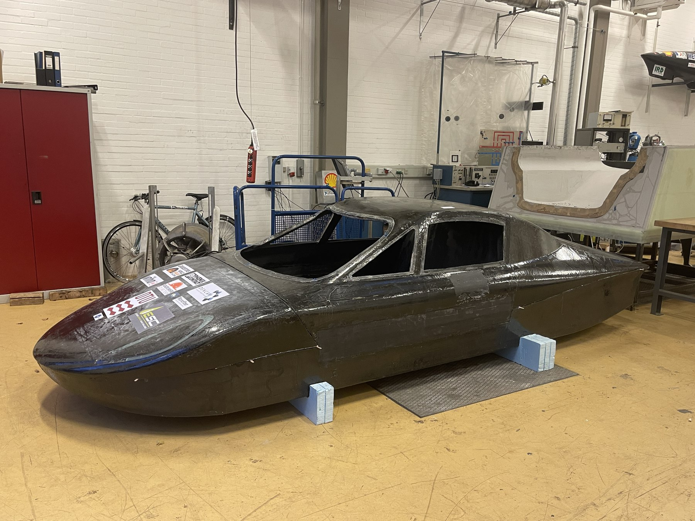
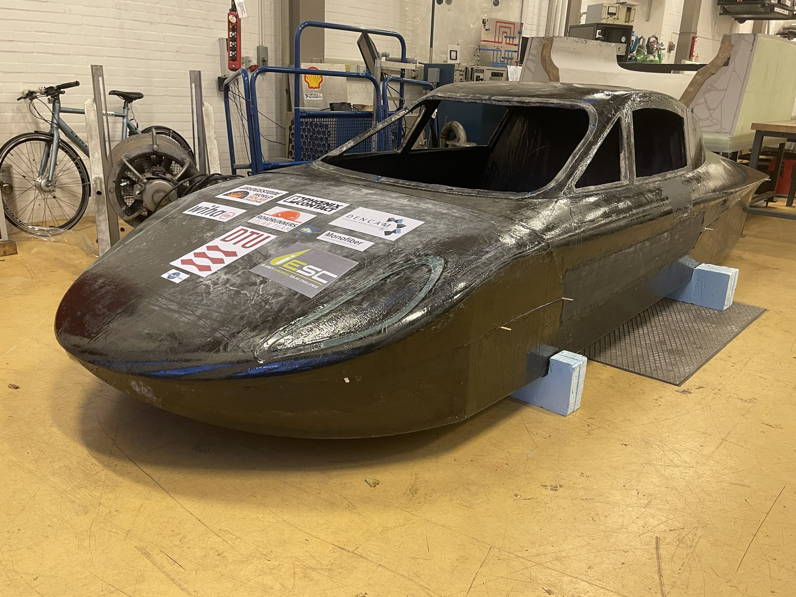
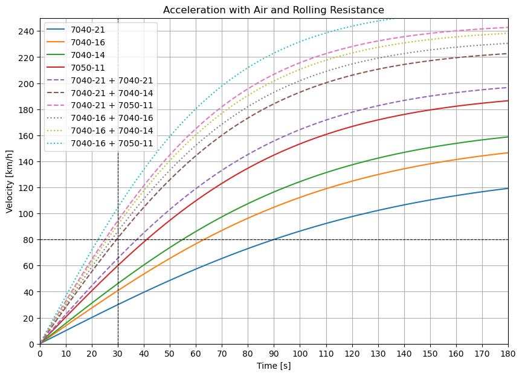
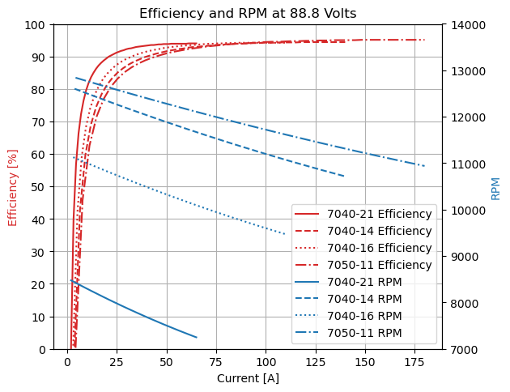
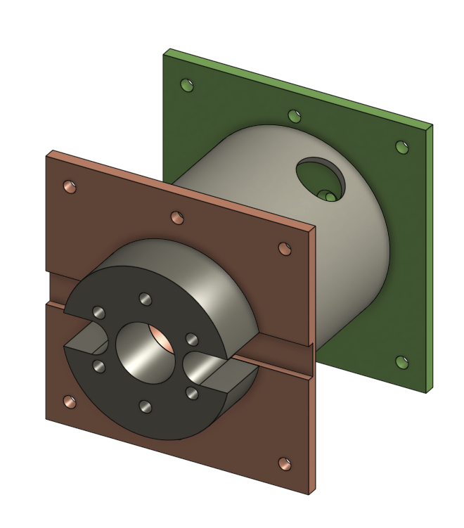
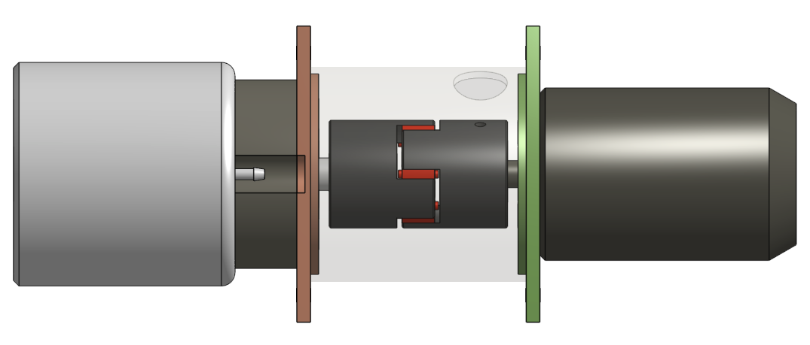
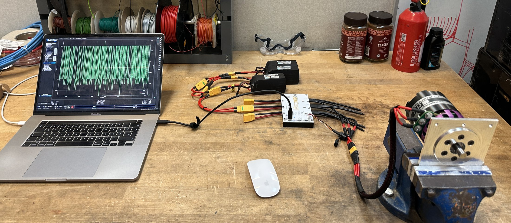
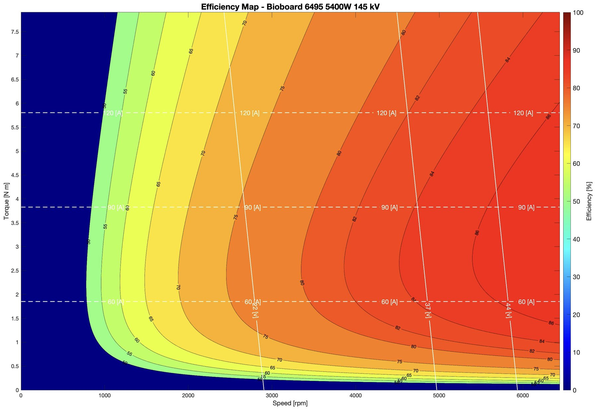
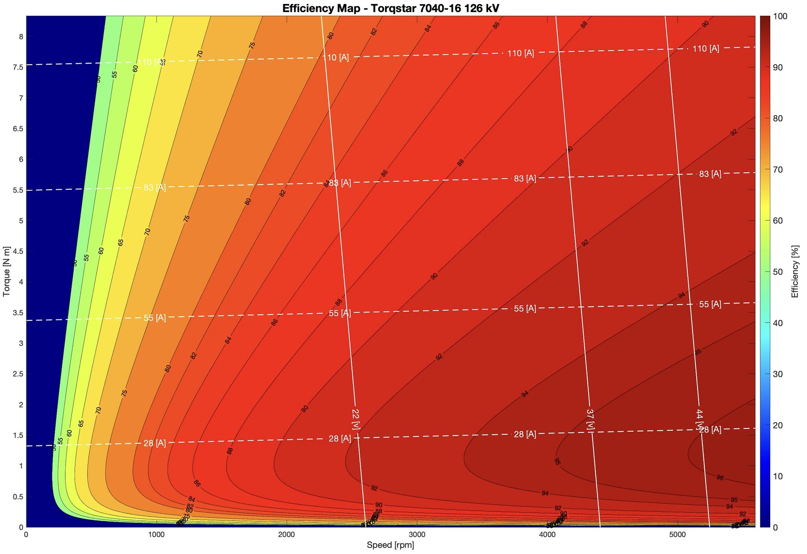

## The goal

The motor sets the efficiency, reliability and power-to-weight ratio of a solar car. This special course set out to select the drive motors for the DTU RoadRunners solar car, and to build a test stand to compare candidate motors under load before they go into the car.

The body of the DTU RoadRunners solar car in the workshop.

The same car from the front.

## My involvement

Carried out the project individually: the power and acceleration modelling in Python, the motor selection and procurement, the CAD design and CNC manufacturing of the test stand, the VESC controller setup, and the virtual dyno tests and analysis in MATLAB.

## Requirements

A vehicle model with the car's drag coefficient from CFD (0.117), frontal area from CAD (1.5 m²), a mass of 550 kg, rolling resistance and an 8:1 gear ratio gave the requirements: about **2000 W and 25 Nm to cruise at 80 km/h**, and acceleration from 0 to 80 km/h within **30 seconds**.

## Choosing the motors

To save the weight of a rear axle and differential, the design uses two motors, one on each rear wheel. One motor is optimised for cruising, and the other only engages when accelerating.

The motors are semi-custom Torqstar units from the German manufacturer Lehner Motortechnik, so the motor specification was driven by the calculations. Fewer windings per coil suit acceleration, more windings suit efficient cruising, and a larger chassis with bigger magnets adds torque. Four variants were specified from these trade-offs: the 7040 chassis with 14, 16 or 21 windings per coil, and the larger 7050 chassis with 11 windings. Each was modelled from Lehner's data, alone and in pairs, at the car's 88.8 V:

| Motor setup | 0–80 km/h | Distance |
|---|---|---|
| 7040-16 alone | 55.3 s | 615 m |
| 7050-11 alone | 41.2 s | 458 m |
| 7040-16 + 7040-16 | 28.2 s | 313 m |
| 7040-21 + 7050-11 | 25.1 s | 279 m |
| **7040-16 + 7050-11** | **23.1 s** | **257 m** |

Simulated acceleration with air and rolling resistance, at full throttle. Selected rows from ten configurations.

Simulated acceleration with air and rolling resistance for every single motor and motor pair at 88.8 V.

Efficiency (red) and speed (blue) against current at 88.8 V. The 7040-16 sustains close to 10,000 rpm, which the 7040-21 does not.

No single motor met the 30-second requirement. The **7040-16 for cruising and the 7050-11 for acceleration** gave the fastest pair, and the 7040-16 was also the only cruising motor to reach the roughly 10,000 rpm needed at highway speed. Both were ordered water-cooled, so they can share the battery cooling circuit. A low-cost Bioboard 5400 W motor was added as a wildcard cruising candidate, but it has little documentation and could only be judged by testing.

## The test stand

The stand couples two motors shaft to shaft: one drives, and the other acts as a generator whose load can be varied to map the driving motor's torque and efficiency. Each side is controlled by a 100 V / 250 A VESC controller. Interchangeable aluminium mounting plates fit both motor types, and they locate on a machined aluminium cylinder with an **H7/h7 fit** that keeps the shafts aligned and also contains any debris if a part fails at high speed. All parts were CNC-machined in the workshop.

CAD model of the test stand. The spacer for the Torqstar motors (black) leaves room for the water-cooling fittings.

Side view of the test stand. The Torqstar motor (left) and Bioboard motor (right) are joined by an axle coupling inside the cylinder.

## Virtual dyno

The shaft couplings for the stand were delayed, so the loaded tests could not be run within the course. Instead, each motor was characterised without load in VESC Tool's detection mode at about 50 V, from three LiPo packs. An open-source MATLAB virtual dyno then turned the measured parameters into efficiency and torque maps.

Virtual dyno test of a Torqstar motor. VESC Tool on the laptop reads the motor parameters through the VESC controller, supplied at about 50 V from three LiPo packs.

## Result

The Bioboard motor, at about a tenth of the price, delivered torque similar to the Torqstar 7040-16, but its efficiency was clearly lower. For long solar-powered runs, efficiency matters most, so the **Torqstar 7040-16 was confirmed as the cruising motor**. The virtual dyno maps are estimates from no-load measurements, not loaded dynamometer data. Loaded tests on the stand, once the couplings arrive, are the next step to validate them.

Efficiency map of the low-cost Bioboard motor from the virtual dyno.

Efficiency map of the Torqstar 7040-16, with a much larger high-efficiency region.

