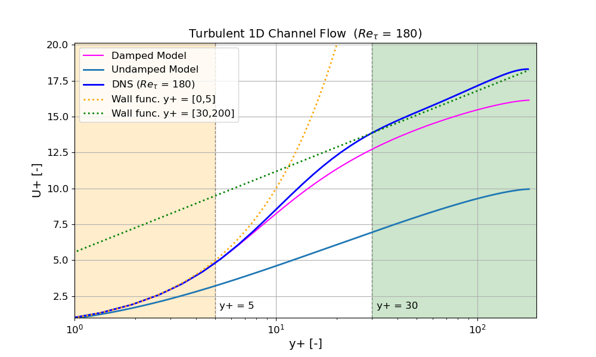
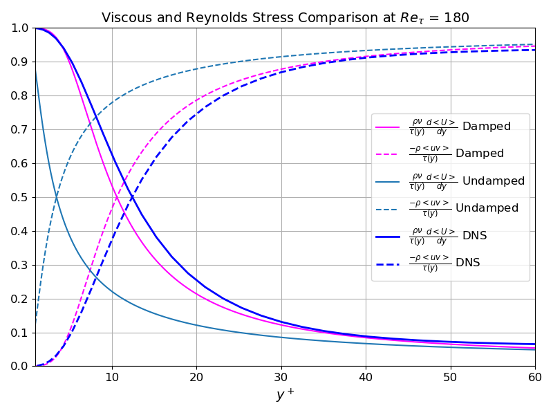
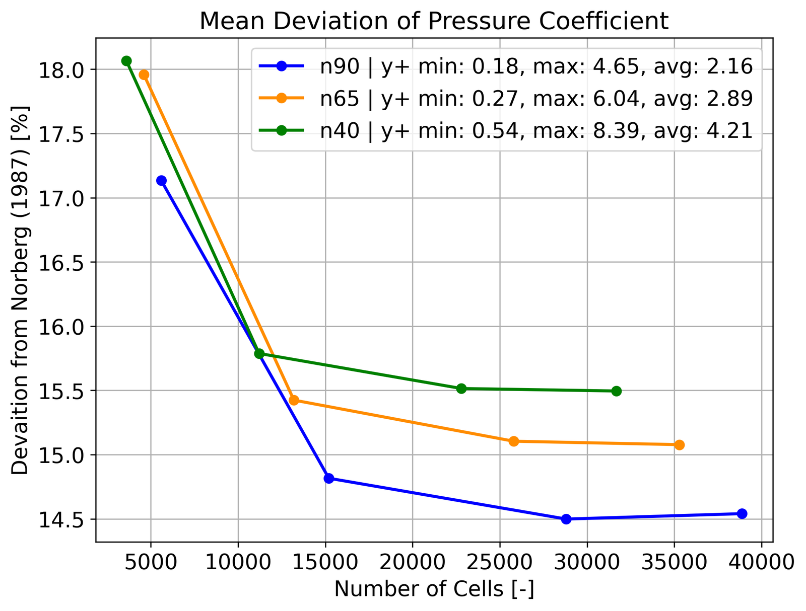
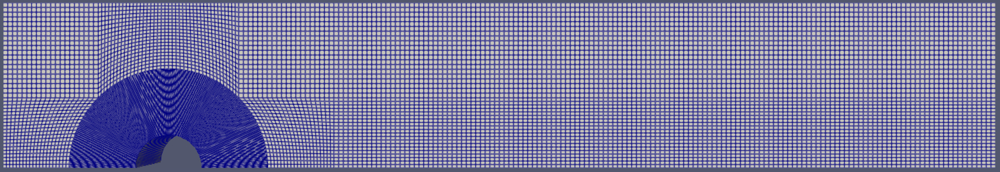
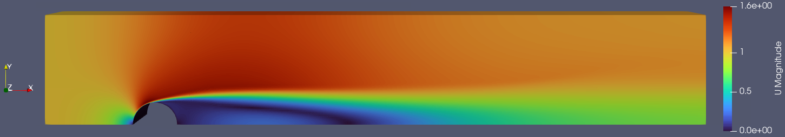
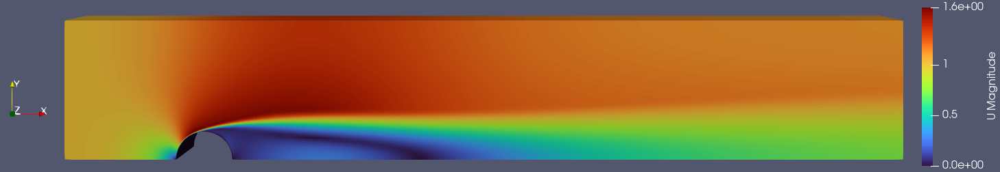
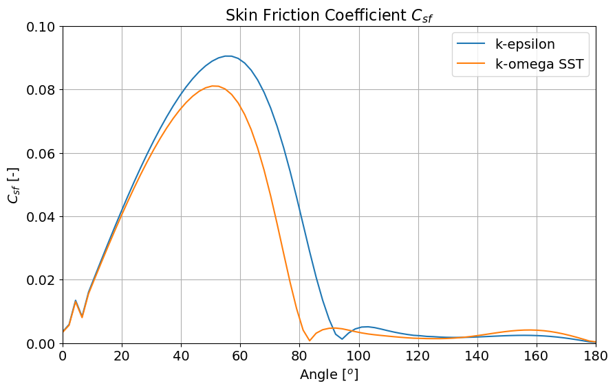
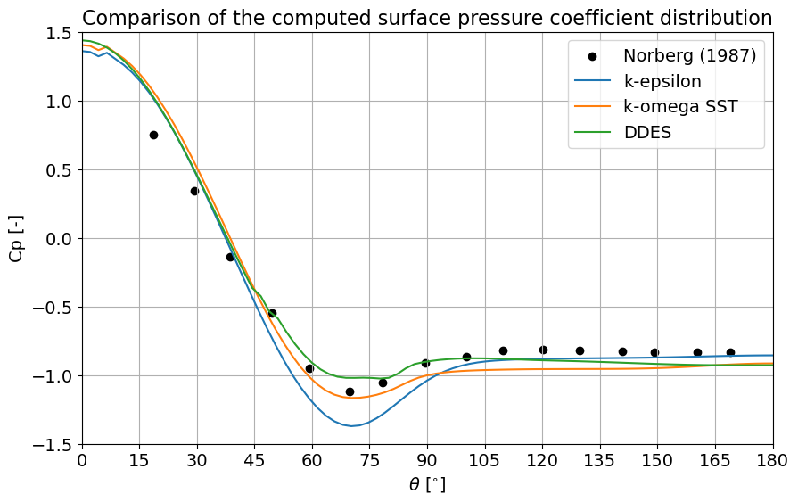

## The goal

Turbulence models decide how a simulation represents everything it cannot resolve. This course project worked through the hierarchy: from an algebraic model in a self-written solver for the simplest wall-bounded flow, to two-equation RANS models and a hybrid RANS/LES approach in OpenFOAM for unsteady flow past a cylinder. The results were validated against DNS and experimental data.

## My involvement

Derived and implemented the channel-flow solver in Python, built and refined the OpenFOAM meshes, set up and ran the RANS, LES and DDES simulations, and post-processed and validated the results against DNS and experimental data.

## Part 1: Turbulent channel flow

### A mixing-length solver

For fully developed channel flow, the Reynolds-averaged momentum equation reduces to a balance between the pressure gradient, viscous stress and Reynolds stress. Closing the Reynolds stress with the Boussinesq approximation and **Prandtl's mixing length**, with and without **van Driest damping** near the wall, gives an equation for the velocity gradient. This was discretised with finite differences and solved in Python from the wall (no slip) to the centreline (symmetry). It was run at friction Reynolds numbers of 180, 395 and 590 and compared with the DNS data of Moser, Kim and Moin.

Velocity profile at Reτ = 180. The damped model follows the DNS closely, while the undamped model underestimates the velocity across the channel.

### Why the damping matters

Without damping, the mixing length gives turbulent stress right down to the wall, so the viscous stress decays too early and the Reynolds stress takes over too soon. The van Driest function suppresses the eddy viscosity in the viscous sublayer and delays this transition, in close agreement with DNS:

Viscous and Reynolds stress as fractions of the total stress at Reτ = 180.

Higher Reynolds numbers needed finer grids to resolve the thinner near-wall region: 10,000 points at Reτ = 590, against 1,000 at Reτ = 180.

## Part 2: Flow past a cylinder in OpenFOAM

### Mesh study

The cylinder flow at Re = 3900 was simulated with pimpleFoam on a half domain with a symmetry plane. The blockMesh layout was modified with extra blocks to extend the domain to 15 diameters for the wake. Twelve meshes were tested with k–ε against measured surface pressure (Norberg, 1987):

| Near-wall mesh | Mesh 0 | Mesh 1 | Mesh 2 | Mesh 3 |
|---|---|---|---|---|
| n40 | 3,600 | 11,200 | 22,800 | 31,680 |
| n65 | 4,600 | 13,200 | 25,800 | 35,280 |
| n90 | 5,600 | **15,200** | 28,800 | 38,880 |

Number of cells for the three near-wall resolutions (rows) and four outer refinements (columns). The chosen mesh is in bold.

Deviation of the computed pressure coefficient from experiment for the three mesh families.

All mesh families converged above about 10,000 cells. The **n90 mesh with 15,200 cells** reached a mean deviation of 14.8%, while an n40 mesh with 31,680 cells, twice as many, gave 15.5%. Placing cells near the wall, for a y+ of about 2, mattered more than the total cell count.

The chosen n90 mesh with 15,200 cells.

### RANS: k–ε and k–ω SST

Both models captured the stagnation point, the acceleration around the sides, separation and the wake. k–ω SST predicted earlier separation and a shorter, wider wake:

Velocity magnitude with k–ε.

Velocity magnitude with k–ω SST.

The skin friction confirmed the difference: k–ω SST separates earlier, which gives a larger wake and a higher drag.

Skin friction coefficient around the cylinder. The earlier drop with k–ω SST marks its earlier separation.

### LES and DDES

For scale-resolving simulations, the mesh was extruded to 3D, with the spanwise cell count chosen for a z+ of about 40. LES with the Smagorinsky and kEqn subgrid models only showed the onset of vortex shedding and never developed full alternating shedding. A **delayed detached-eddy simulation (DDES)** was run instead, which resolved the unsteady wake shown in the cover image.

| Model | Drag coefficient | Deviation from Cd ≈ 1.0 |
|---|---|---|
| k–ε | 1.11 | +11.5% |
| k–ω SST | 1.25 | +25.5% |
| DDES | 1.48 | +48.5% |

Drag coefficient on the n90 mesh, against a reference value of about 1.0 at Re = 3900.

Surface pressure coefficient from all three models against the measurements of Norberg (1987).

## Result

The mixing-length solver showed how much a near-wall correction matters: with van Driest damping, a simple algebraic model reproduces the DNS profile of a turbulent channel. On the cylinder, the mesh study showed that near-wall resolution matters more than the total cell count. k–ε gave the closest drag, 11.5% above the reference, while k–ω SST and DDES matched the measured surface pressure more closely. The main limitations were also clear: the half-domain symmetry suppresses the asymmetric vortex shedding, and the mesh lacked radial grading, so a full domain with a graded mesh is the clear next step.
