## The goal

Two courses, two sides of wind turbine design. At TU Delft, a complete 3.5 MW onshore turbine was designed from the first sizing decision to certification loads. At DTU, the DTU 10 MW reference turbine was redesigned for lower loads in the aeroservoelastic code HAWC2, where the blade, structure and controller interact in time-domain simulations of turbulent wind.

## My involvement

Responsible for the 3.5 MW turbine's system sizing and rotor-diameter optimisation, rotor aerodynamic and structural design, drivetrain and electrical layout, tower and steady-state analysis, controller design and certification load analysis. Carried out the DTU 10 MW redesign individually: the load diagnosis, rotor and operating-strategy changes, aeroelastic stability analysis, controller tuning and design-load evaluation in HAWC2.

## Part 1: A 3.5 MW onshore wind turbine

The 3.5 MW, three-bladed upwind turbine for onshore coastal sites in Europe, IEC class II-B, was developed by scaling and redesigning the NREL 5 MW reference turbine. Every discipline fed into the next: the rotor size set the loads, the loads set the drivetrain and tower, and the tower dynamics set the controller.

### System design

The 3.5 MW rating and class II-B follow from a market analysis: onshore wind dominates new European installations, and turbines around 3.5 MW are typical in several countries. The wind climate was built from five coastal sites in Denmark, Germany, the Netherlands, Poland and Scotland, giving an average Weibull distribution with A = 8.97 m/s and k = 2.24.

The rotor was sized with a **levelised production cost** model. Energy yield grows with the square of the rotor diameter, while mass and cost grow faster, so the cost per MWh has a minimum:

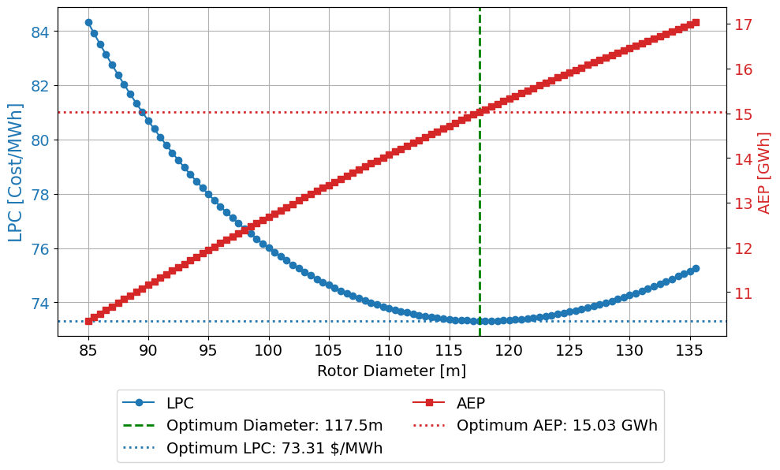

Levelised production cost (blue) and annual energy production (red) against rotor diameter. The minimum lies at 117.5 m.

| Parameter | Value |
|---|---|
| Rated power | 3.5 MW |
| Rotor diameter / hub height | 117.5 m / 84 m |
| Rated wind speed | 10.4 m/s |
| Rotor speed | 3.5–12.0 rpm |
| Tip speed | 74 m/s (noise limit 80 m/s) |
| Drivetrain | DFIG with a 3-stage, 98:1 gearbox |

Main design parameters of the turbine.

### Rotor aerodynamics and structure

The blade keeps the airfoil families of the reference blade, from cylindrical root sections through thick DU airfoils to the NACA 64-618 tip. The chord and twist were designed by blending the ideal blade-element distribution with the scaled reference. The ideal solution asks for chords over 10 m near the root, which cannot be built, so the reference shape was kept inboard.

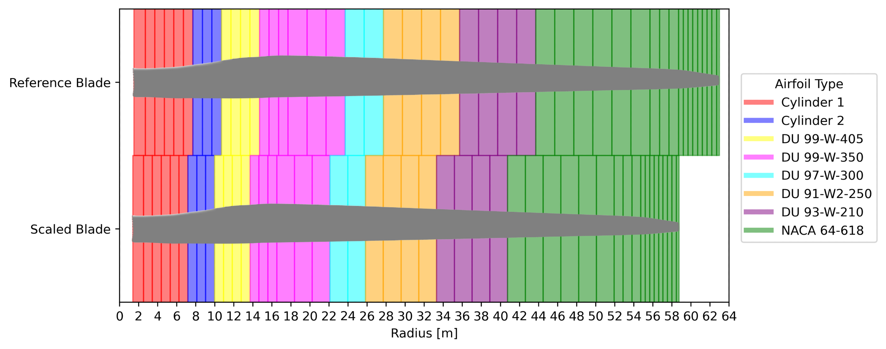

Airfoil layout of the NREL 5 MW reference blade (top) and the scaled 58.75 m blade (bottom).

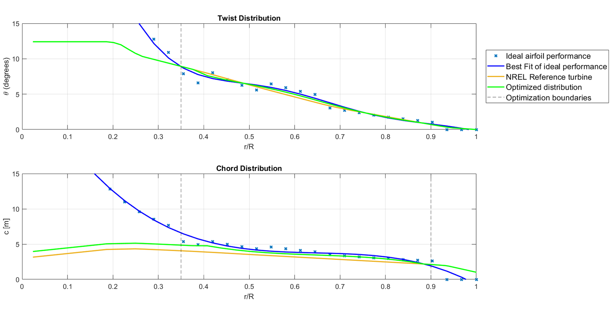

Twist (top) and chord (bottom) along the blade: ideal blade-element values, the scaled reference and the final design.

The chord was then fine-tuned for the optimal tip-speed ratio. In the BEM analysis, the rotor reached a power coefficient of **0.480 at a tip-speed ratio of 7.6** with zero pitch:

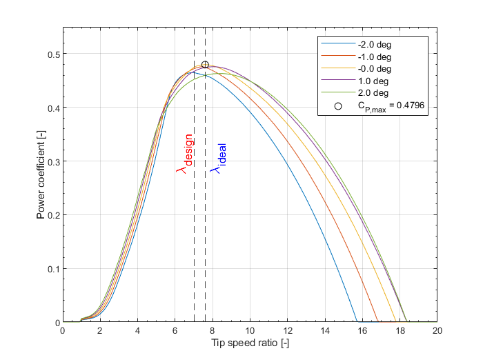

Power coefficient against tip-speed ratio for different pitch angles.

Blade mass and stiffness were scaled from the reference blade (mass with R³, stiffness with R⁴), giving a blade mass of 14.4 t. A main-shaft tilt of 3° and an upwind cone of 2.5° gave a tip clearance of more than 7.6 m.

### Drivetrain and electrical system

A weighted trade-off between direct drive, a doubly-fed induction generator (DFIG), a full-scale converter and constant speed selected the **DFIG**, for its lower cost and mass. The generator has 6 poles at 690 V. A three-stage gearbox (two planetary stages and one parallel stage) gives a ratio of 98:1. An off-the-shelf back-to-back converter sits at the tower base, to keep the nacelle light, and connects through 90 m of torsion-resistant cable.

### Tower and dynamics

The tower was first scaled from the reference, but its Campbell diagram showed a problem: the rotor's 3P excitation crossed the tower's natural frequencies inside the operating range, at about 8.45 rpm.

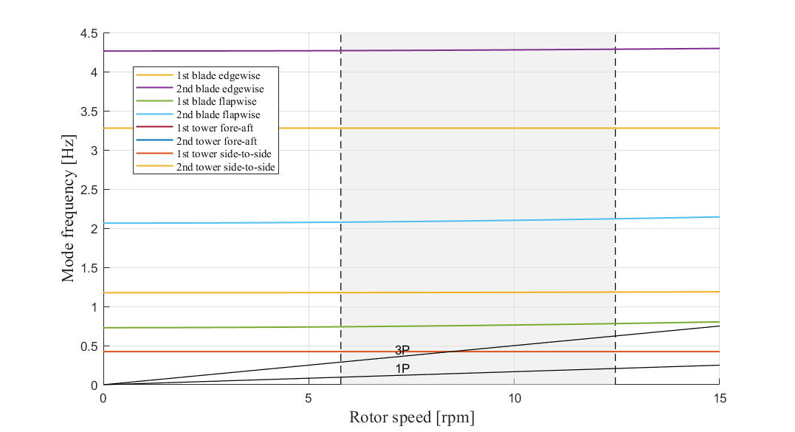

Campbell diagram of the first, scaled design. The 3P line crosses the tower modes within the operating range.

The soft-stiff window between 1P and 3P was too narrow, so the tower was redesigned as **stiff-stiff**. The base diameter was increased by 30%, which moved the first tower frequencies to 0.625 Hz, just above the 3P excitation. The torque control curve was updated to match the generator's speed range.

### Control

The controller uses a torque controller below rated wind speed and a **gain-scheduled PI pitch controller** above it, with low-pass and notch filters, and a tower fore-aft damping loop.

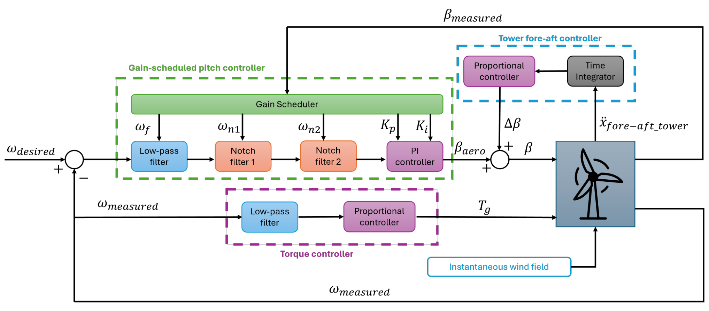

Control system: gain-scheduled pitch control, torque control and tower damping.

The pitch gains were tuned by loop-shaping at several pitch angles, for a gain margin above 6 dB, a phase margin above 40° and a crossover near 0.1 Hz. Step responses showed less overshoot and faster settling than a fixed-gain controller. The tower damping gain was set to 0.18, while higher gains amplified the tower motion.

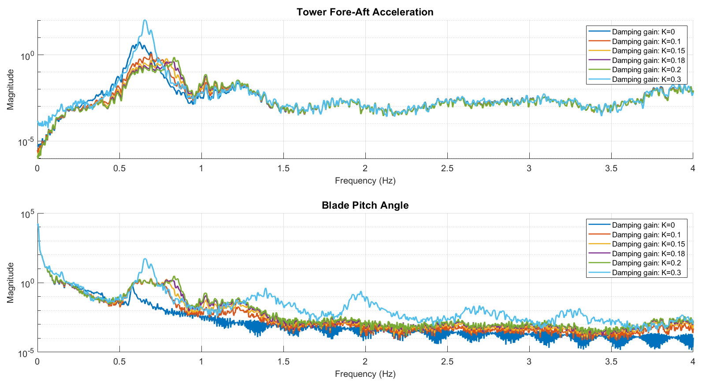

MATLAB simulation of the tower fore-aft damping: acceleration (top) and pitch angle (bottom) spectra for damping gains K = 0 to 0.3.

### Certification

The design was checked against IEC 61400-1 for normal and extreme turbulence, extreme wind shear and emergency shutdown. Blade-root moments from FASTTool were converted to stresses and checked in ultimate and fatigue limit states, with partial safety factors for composite blades. The stresses stayed well below the allowable limits.

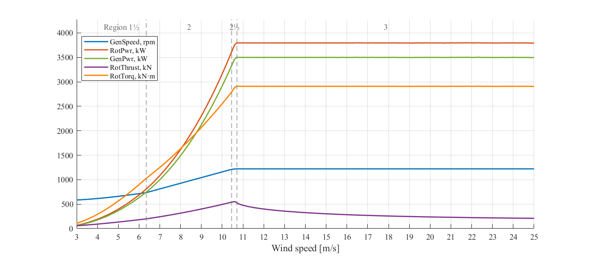

Steady-state response of the final design against wind speed.

## Part 2: Aeroservoelastic redesign of the DTU 10 MW

### The problem

An earlier redesign of the DTU 10 MW rotor for a low-wind class IIIB site had raised the annual energy production by 1.9%, but at a cost in loads: tower side–side fatigue was 84% above the reference turbine, and the tower fore–aft and in-plane blade-root loads had also increased. The individual task was to diagnose why, and to redesign the rotor, operating strategy and controller to bring the loads down without giving up too much energy.

### Design changes from the physics

| Load problem | Cause | Change |
|---|---|---|
| Tower side–side fatigue | At low rotor speed, the 3P excitation sat on the lightly damped 0.25 Hz tower side–side mode | Minimum rotor speed of 5.75 rpm, so 3P stays above 0.287 Hz |
| In-plane blade-root moments | Aerodynamic moment grows with R³, and torque with lower tip-speed ratio | Rotor radius kept at 89.16 m, design tip-speed ratio raised to 7.42 |
| Tower fore–aft loads | Thrust transients from pitch control | Pitch controller retuned for smoother action |

Diagnosis and design response for the three critical load channels.

The aeroelastic Campbell diagram confirmed the main fix: the tower side–side mode is now clear of the 3P line at all wind speeds.

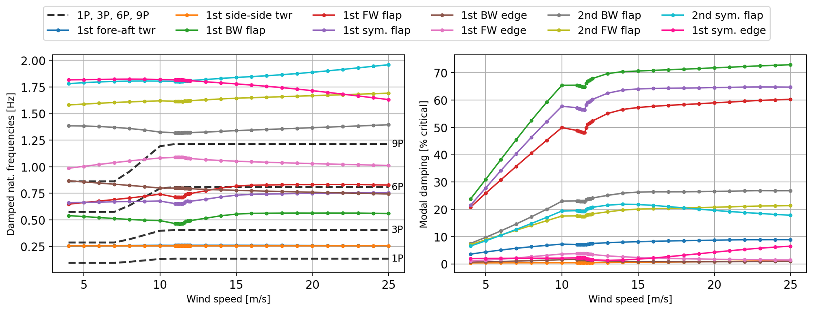

Aeroelastic Campbell diagram of the redesign: modal frequencies (left) and damping (right) against wind speed.

### Controller tuning

Constant-power control regulated the power more smoothly than constant torque into rated operation, so the tuning focused on its pitch controller. The damping ratio and natural frequency were swept in HAWC2 step-wind simulations. A damping ratio of 0.5 and a natural frequency of 0.05 Hz gave the best balance of overshoot, settling and smooth pitch action, which matters for fatigue.

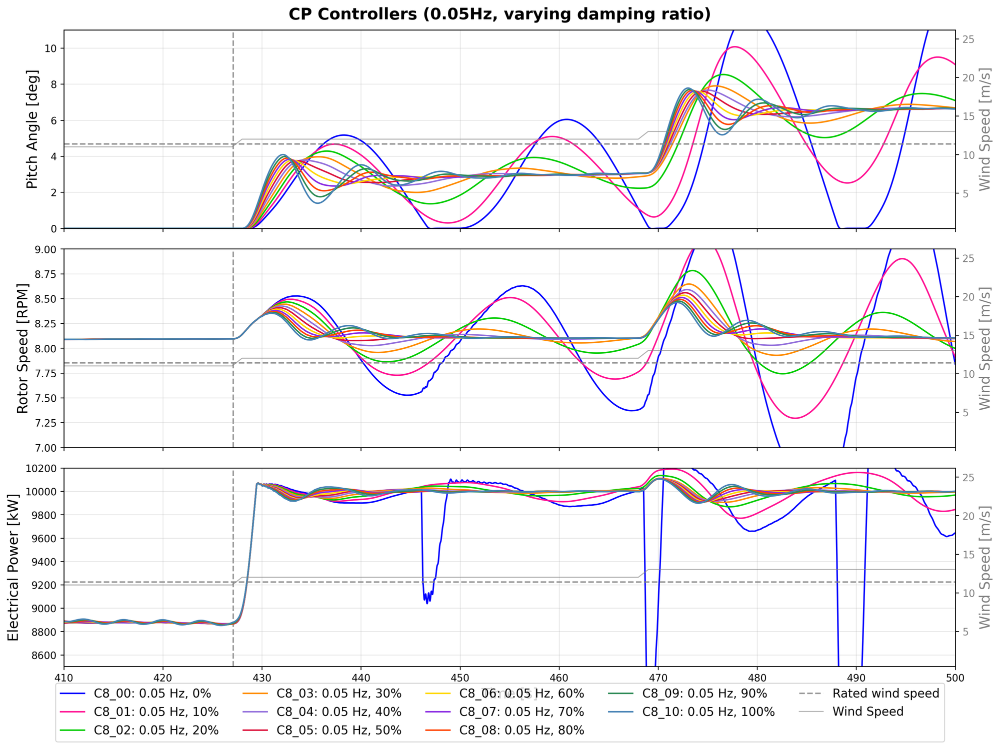

Step-wind responses for a sweep of pitch-controller damping ratios at a natural frequency of 0.05 Hz.

### Loads and energy

The design loads were evaluated with six 10-minute turbulent HAWC2 simulations per wind speed: ultimate loads from the extremes, and fatigue loads as damage-equivalent loads.

| Change against the DTU 10 MW | Earlier redesign | This redesign |
|---|---|---|
| Annual energy production | +1.9% | −1.9% |
| Tower fore–aft, ultimate / fatigue | +1.7% / +2.1% | −4.9% / −4.9% |
| Tower side–side, ultimate / fatigue | +4.2% / +84.1% | +2.4% / +5.7% |
| In-plane blade root, ultimate / fatigue | +3.8% / +4.7% | −6.1% / −8.8% |

Relative changes in energy production and design loads against the DTU 10 MW reference.

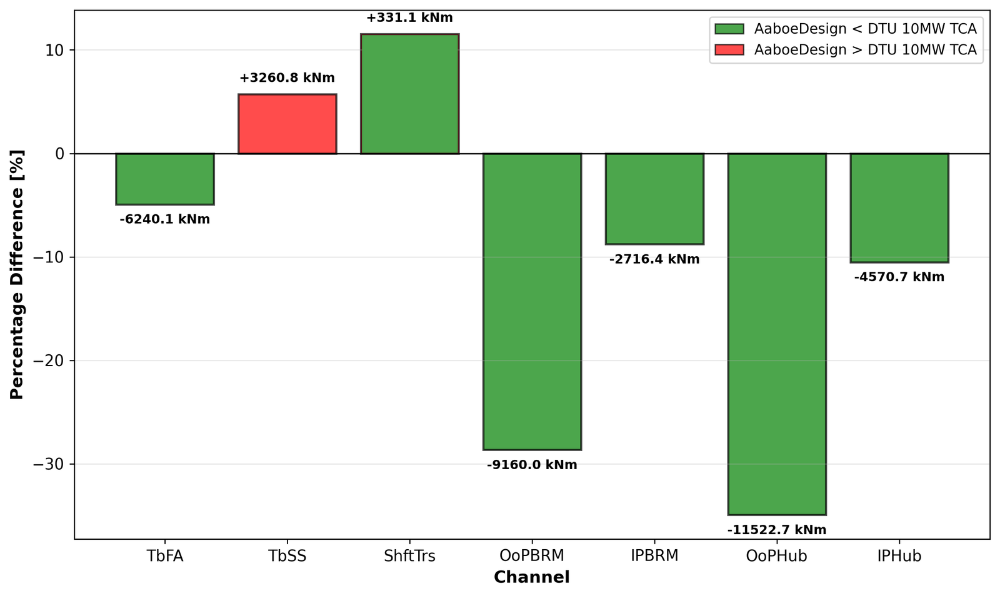

Fatigue (damage-equivalent) loads of the redesign against the DTU 10 MW reference, per load channel.

## Result

The 3.5 MW turbine met its power-production targets and behaved like the reference turbine across the operating range. Its estimated material cost fell by about 21% against the NREL 5 MW for 22% less annual energy, so it keeps a similar return on investment. Two findings point to the next design loop: the blade structure is conservative, and the simulated tip deflection of 6.53 m, against an expected 5.1 m, needs pre-bend, more cone or a stiffer blade.

The DTU 10 MW redesign solved two of the three load problems: in-plane and fore–aft loads fell below the reference turbine, and the critical tower side–side fatigue increase dropped from 84% to 5.7%. The price was 1.9% less energy than the reference, a clear and deliberate trade-off between loads and energy yield. Tower side–side loading remains the governing limit, which points to tower damping or further control near the 3P frequency as the next step.
